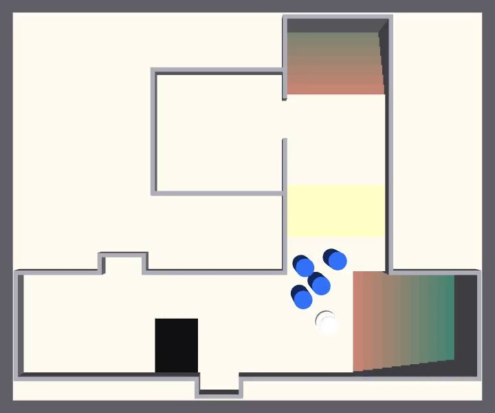

# 보이지 않는 계단 — 보고서 초안 (2026-11-10)

> **상태: 초안. 박준우 · 박정원 검토 전.** 0–6장은 2026-11-13에, 6-6 · 7장 · 부록은 2026-11-15에 이어 썼다. 파일명의 날짜는 작업 지시일(11-10)이다. 기존 문서 · 코드 · 결과는 고치지 않았고, 시뮬레이션을 돌리지 않았다.
>
> **보고서 양식 · 분량 · 발표 시간: 미확인, 임의 구성(발표 10분 기준).** 저장소와 강의 노트(`00_OT.md`)에서 찾지 못했다. OT에는 "14주차(11/30) 텀프로젝트 최종발표", "기말고사 → 텀프로젝트 보고서로 대체", 평가 비중 30 %만 있다. 다른 문서에는 최종 발표가 12/2 · 12/7로 적혀 있어 날짜도 미확인이다.
>
> **숫자마다 출처를 붙인다.** [v2] 판정 기준 v2 확인 실험 710회(시드 101–120, 10-30~31) · [v3] v3 400회(201–220, 10-31~11-01) · [v4] v4 500회(301–320, 11-01) · [사후] 결과를 본 뒤 로그를 다시 읽은 탐색(판정이 아니고 결론에 쓰지 않는다) · [사전] 기준 고정 전 사전 실험 1,086회(원래 노트북, 탐색, 결론 근거가 아니다) · [v5 예정] 11-05 고정, 미실행 · [부속 11-10] 판정 기준 v5 부속 기록(S8 원자료 재계산, 11-13, 미커밋) · [코드] 저장소 코드에서 읽은 것. **모두 시뮬레이션이다.**
>
> v5 결과가 들어갈 자리는 "[v5 결과]"로 비워 두었다 (6-4). 어떤 결과가 나와도 기준 v5 6장의 미리 정한 문장을 그대로 끼워 넣을 수 있게 결과별 문장을 옮겨 두었다.
>
> "이 시뮬레이션의 시험 조건에서"가 모든 결과 문장의 전제다.

---

## 0. 원 문서 대조 기록

지시받은 핵심 표의 값을 `최종 정리 v2 · v3 · v4`, `판정 기준 v5 부속 기록`, `타당성 점검`과 대조했고, `result.json`(v2 H1 · H2 · H4 · 시연, v3 H9a · H10 · H11 · H12, v4 A–D · F)을 11-13에 다시 세어 칸 합이 문서와 같은지 확인했다 (안전 실패 = 추락 또는 `min_edge < 0.15`). 다른 값은 없었다. 덧붙인 것은 다음과 같다.

| 지시받은 값 | 원 문서의 값 | 처리 |
|---|---|---|
| 후진 S8 앞뒤 IR 0/20, 실제 후진 0.24 m | [부속 11-10] P1irb 실제 후진 **중앙값 0.239 m, 최대 0.315 m** | 중앙값으로 적고 최대를 함께 적는다 |
| 후진 S8 P2i 18/20 | [v3] H11 18/20. [부속 11-10] 후진 거부 2/20(시드 201 · 204, 단일 프레임 마스크가 막음)이 따로 있다 | 18/20 판정과 무관하므로 각주로 둔다 |
| 0.8 m/s S3 · S4 IR 0.24 m 21/40 · 24/40 | [v4] B 21/40, [v3] H9a 24/40(다른 시드). 같은 설정 · 같은 시드의 [v4] C 참고 칸은 **14/40** | 세 값을 모두 적는다 (재현 차이의 근거) |
| 정면 0.8 m/s 칸당 5회 | [v4] F. 0.45 · 0.6 m/s 칸도 있다 | 0.8 m/s 외의 F 값도 6-2에 함께 적는다 |
| IR 처음부터 고장 0.45 m/s P1r 20/40 | [v3] H10. S3 14/20, S4 6/20 | 그대로 |

---

## 1. 초록

건물 안을 다니는 서빙 · 안내 로봇은 2D LiDAR로 만든 지도로 주행한다. 2D LiDAR는 한 높이의 수평면만 보므로(강의 노트 02 §6.3) 내려가는 계단은 지도에 빈 바닥으로 찍힌다. 이 프로젝트는 깊이카메라가 이미 쓰이는 현실을 전제로, **감지 결과를 Nav2 비용지도에 넣을 때 위치 오차와 후진에서 무엇이 깨지는지**를 Gazebo 시뮬레이션으로 비교했다. 제안 구성 P3i는 깊이카메라로 앞 바닥을 보고, 칸마다 로그오즈를 쌓아 판정하고, 판정한 칸을 map이 아니라 odom 좌표에 기억해 Nav2 keepout 마스크로 넣고, 하향 IR을 마지막 층으로 둔다.

판정 기준을 실험 전에 고정한 확인 실험을 세 번 돌렸다([v2] 710회, [v3] 400회, [v4] 500회, 모두 JW-laptop). 결과는 "제안이 이겼다"가 아니다. 평상 속도 0.45 m/s에서는 제안과 IR 구성의 안전 실패 차이를 검출하지 못했다([v2] H1 · H2b · H3, [v3] H9r). 차이가 난 곳은 네 군데다. ① 기억을 map 좌표에 두면 위치가 바로잡힐 때 도착이 깨졌다([v2] H2a, 도착 40/40 대 20/40, 안전 실패는 둘 다 0). ② 등 뒤 계단을 기억하지 않는 구성은 후진 요청을 그대로 수행해 구멍 위로 나갔고([v2] H4 P3n 20/20, [v3] H11 P2i 18/20), 기억하는 구성은 Nav2의 후진 충돌 검사에 걸려 후진을 시작하지 않았다([부속 11-10], 60회 모두 이동 0.001 m 이하). ③ 최고 속도 0.8 m/s에서 몸체 끝(0.24 m)의 앞 IR은 비스듬한 접근에서도 제동 여유가 모자랐지만([v3] H9a 24/40, [v4] B 21/40), 이 문제는 단일 프레임 카메라로도([v4] A P2i 0/40, 기준 완화 판정) IR을 0.30 m로 옮겨도([v4] B 1/40) 낮아져 카메라 고유의 이점이 아니었다. ④ 고속에서 카메라 처리가 죽거나 계단이 보이지 않으면 P3i는 IR 층으로 떨어져 IR 구성과 비슷하게 실패했다([v4] D 15/40, C 13/40).

가설은 모두 앞 결과를 본 뒤 세웠고, 세 번 모두 박정원 확인 없이 고정했으며, [v4] A는 사전 시험을 본 뒤 기준을 완화한 판정이다. 월드 2 재현과 0.45 m/s 정면 접근은 [v5 예정](400회, 11-05 고정)에서 시험한다. 모두 시뮬레이션이고 실제 로봇으로 옮길 수 없다.

---

## 2. 문제의식

### 2-1. 계단이 지도에서 사라지는 이유

- 서빙 · 안내 로봇은 2D LiDAR로 지도를 만들고(SLAM, 강의 노트 01 §3.1) 그 지도 위에서 AMCL로 위치를 추정하며 Nav2로 주행한다.
- 2D LiDAR는 레이저를 한 높이에서 수평으로 돌려 거리를 잰다. 강의 노트 02 §6.3의 표가 적은 단점이 "한 평면만 봄"이다.
- 내려가는 계단은 그 높이에 아무것도 없다. 레이저는 계단 위 허공을 지나 건너편 벽에 맞고, 계단 자리는 지도에 **빈 바닥, 곧 지나가도 되는 곳**으로 찍힌다.
- 이 프로젝트의 지도는 slam_toolbox로 직접 만들었고, 계단이 빈 바닥으로 찍힌 것을 확인했다 ([코드] `demo_cliff/ws/src/cliff_demo/maps/`).

### 2-2. 위험해지는 순간

| 순간 | 무슨 일이 생기나 | 시나리오 |
|---|---|---|
| 사람이 길을 막을 때 | 돌아갈 길을 찾다가 지도에서 '빈 바닥'인 계단 쪽을 고른다 | S2, S4, S5 |
| 밀리거나 미끄러질 때 | 바퀴는 밀린 것을 모른다. 위치를 착각해 계단까지 거리를 잘못 안다 | S3, S3j |
| 계단 표시를 빠뜨렸을 때 | 운영자가 금지구역을 칠하지 않은 계단이 있다 | S4, S6, S7, S8, S9 |
| 계단이 어두울 때 | 반사가 안 돌아와 깊이값이 없다 | 검은 계단(결측 100 %) |
| 뒤로 물러날 때 | 앞만 보는 센서는 등 뒤 계단을 모른다 | S8 |
| 빨리 달릴 때 | 몸체 끝에서 알아채면 제동 거리가 모자란다 | 0.8 m/s 설정, S9 정면 |

**시연 ([v2] 시연, 판정 대상 아님):** 지도만 쓰는 P0은 사람이 모퉁이를 막는 S2에서 10회 중 10회 안전 실패했다(추락 9, 걸침 1). 평상시 S1에서는 떨어지지 않는다([사전] 0/10).

### 2-3. 현장은 어떻게 막고 있나 (선행 사례 조사 10-31, 3장 요약)

| 분야 | 방식 | 근거 (공식 자료) |
|---|---|---|
| 산업용 AMR (MiR250) | 지도 금지구역 + 물리 방벽 | 사용자 가이드 v1.2(2020-07) 안전 장: 로봇이 내려가는 계단과 바닥 구멍을 제때 감지해 멈출 수 없으니 금지구역으로 표시하라(PDF 33쪽). 3D 카메라는 구멍과 내려가는 계단을 감지하지 못한다(75쪽). 모서리의 하향 IR은 낙하용이 아니라 5–20 cm 저장애물용이다 |
| 산업용 AMR (Omron LD) | 레이저가 보는 물리 방벽 + 금지구역 | OEM 가이드 Rev K · Safety Guide(2019-12) "Falling Hazards": 계단 입구를 내비게이션 레이저가 보고 멈출 수 있게 190–200 mm 이상(권장 250 mm)의 끊김 없는 방벽을 두라. 자체 낙하 감지를 내세우지 않는다 |
| 교육 · 연구용 (iRobot Create 3) | 하향 IR 정지 + 후진 제한 | 공식 문서: IR 4세트가 앞 범퍼 뒤에 있어 후진 중에는 낭떠러지를 못 본다. 기본 정책은 앞으로 탐색한 거리만큼만 후진을 허용한다 |
| 로봇청소기 | 하향 IR + 금지구역 | 기존 자료. 선행 사례 조사에서는 다시 확인하지 않았다 |
| 서빙 · 안내 로봇 (Bear, LG, Pudu, Keenon) | 깊이 · 스테레오 카메라 + LiDAR | 읽은 사양서 · 매뉴얼 어디에도 낙하 감지를 보장하는 문장이 없다. Keenon T8 매뉴얼(2022)은 계단 · 에스컬레이터 근처 사용을 금지하고, Pudu BellaBot 매뉴얼(2020)은 계단 가장자리에 펜스 등 차단을 요구한다. **카메라 데이터 처리 방식과 낙하 센서 유무는 공개 자료로 알 수 없다** |

### 2-4. 실제 사례 (동기로만 쓴다)

- 2024-06-20 오후 4시께, 구미시의 '로봇 주무관'이 구미시의회 건물 2층 계단 아래로 약 2 m 떨어져 파손됐다(베어로보틱스 기종, 모델명 비공개). **공식 원인은 공개되지 않았다** (2026-07-22 기사까지 확인).
- 2026-07-31(금) 또는 08-01(토)(보도마다 다르다), 홍콩국제공항 제1터미널 비공개 구역 계단에서 시험 중이던 순찰 로봇이 떨어졌다. 기종 · 원인 비공개, 공항관리국이 조사 중이라고 밝혔다.
- 두 사고의 원인을 단정하지 않는다. 핵심 근거는 MiR 매뉴얼이다.

### 2-5. 주제 문장과 그 이력

> **주제:** 깊이카메라가 이미 쓰이는 현실을 전제로, 감지 결과를 Nav2 비용지도에 넣을 때 위치 오차와 후진에서 무엇이 깨지는지 비교한다. 공개 자료에서 처리 방식을 확인할 수 없는 부분을 공개된 실험으로 드러낸다.

- Proposal(10/26)의 문장은 "현장 방식 사이의 빈 구간을 메우는 안전층"이었고, [v2] 결과를 본 뒤(10-31) 지금 문장으로 바꿨다. 결론을 담는 틀이 결과를 본 뒤 바뀌었다는 점을 밝힌다 (`최종 정리 v2` 5장).
- [v3] · [v4] 결과도 이 문장과 맞고, 그 뒤로는 바꾸지 않았다 (`최종 정리 v4` 4장).

---

## 3. 선행 사례

`보이지 않는 계단 — 선행 사례 조사 (2026-10-31).md`의 요약이다. 제조사 공식 자료, 공개 소스, 논문, 사고 보도를 봤고 소스는 읽기만 했다. **"못 찾음"은 "없음"이 아니다.**

### 3-1. 한 줄 결론

"현업이 이미 해결했다"는 근거를 못 찾았고, "아무도 안 했다"는 근거도 없다.

### 3-2. 항목별

| 선행 사례 | 확인한 것 | 이 프로젝트와의 관계 |
|---|---|---|
| depth_nav_tools (cliff_detector + nav_layer_from_points, Drwięga & Jakubiak, JAMRIS 2017) | 깊이 영상 **한 장씩** 지면 아래 점을 찾아 비용지도에 넣는다. 시간 필터가 없고, 깊이가 0 · NaN이면 낭떠러지로 세지 않는다. 저자들이 안전 임계 용도로 쓰지 말라고 적었다. master 마지막 커밋 2023-03-28 | P2(한 장씩 판정)와 같은 계열. 결측 처리가 다르다 |
| STVL (Nav2 시간 감쇠 복셀 레이어) | 복셀을 시간으로 만료시켜 기억한다. 확률 필터가 아니고 낭떠러지 기능이 없다(README · 소스 검색 0건). 기본 설정에서 지면 아래 점은 버려진다 | 시간 기억의 선행 |
| Nav2 공식 문서 (저장소 273개, 2026-10-27) | cliff · stairs · negative obstacle 검색 0건. keepout 필터는 있다 | P1의 기반 |
| iRobot Create 3 문서 | 하향 IR은 앞에만. 후진은 탐색한 거리만큼만 (Backup Limit) | 후진 문제를 공식 문서가 다루는 사례 (규칙 기반) |
| Hines 외 2021 (arXiv 2010.16018) | 관측 안 된 영역을 가상 표면으로. 라이다 오도메트리 국소 맵(약 10 m × 10 m)만 유지해 전역 정합 오차를 피한다. 실외 · 3D LiDAR | '모름' 상태, 국소 좌표 기억과 같은 계열 |
| Heckman 외 2007 (IROS) | 결측 데이터를 해석해 잠재적 낭떠러지로 라벨링 (실외, 3D 레이저, 초록만) | '값 없음' 처리와 같은 계열 |
| Singhani 2019, Ghani & Sahari 2017, Esuga-Mopah 외 2026 | 단안 RGB(깊이 아님) / Kinect → 레이저 스캔 / YOLOv8 + RealSense. 뒤 둘은 본문을 열지 못했다 | 직접 비교 대상 아님 · P2 계열 |

### 3-3. 이미 있는 것 (새롭다고 말하지 않는다)

지도 금지구역과 물리 방벽(MiR, Omron, Pudu 2020, Nav2 keepout) · 깊이카메라로 지면 아래 점을 찾아 비용지도에 넣기(depth_nav_tools) · 하향 IR 낙하 정지(Create 3) · 국소(odom 계열) 좌표 기억(Hines 2021, Nav2 로컬 코스트맵) · 관측 안 된 영역을 따로 다루기(Hines, Heckman) · 시간 기억(STVL) · 후진 중 낭떠러지를 못 본다는 문제 인식(Create 3) · 검은 테이프 · 창가 햇빛이 센서 오동작 조건이라는 점(Keenon 매뉴얼).

### 3-4. 공개 자료에서 못 찾은 것 (없다는 뜻이 아니다)

서빙 · 안내 로봇 4사의 낙하 처리 방식을 서술한 공식 문서 · 낭떠러지용 셀별 베이즈(로그오즈) 필터 + 비용지도 금지구역을 합친 공개 ROS 2 구현 · map 좌표 기억과 odom 좌표 기억을 낭떠러지 · 위치 오차 조건에서 비교한 연구 · 후진 중 낭떠러지를 지도 기억으로 막고 평가한 논문 · 구미 · 홍콩 사고의 공식 원인. 검색은 GitHub API와 일반 웹 검색 위주이고 학술 DB는 보지 않았다.

### 3-5. 발표 · 보고서에서 쓸 수 있는 문장 / 쓰면 안 되는 문장

| 써도 된다 | 쓰면 안 된다 |
|---|---|
| "MiR250 매뉴얼은 로봇이 내려가는 계단을 제때 감지하지 못한다고 적고, MiR와 Omron 모두 계단 앞 물리 방벽을 요구한다." | "현업은 이미 해결했다." / "Omron도 계단을 감지하지 못한다고 적었다." |
| "서빙로봇 제조사 공식 문서에는 낙하 감지를 보장하는 문장이 없고, Keenon 매뉴얼은 계단 근처 사용을 금지한다." | "서빙로봇은 낙하 센서를 단다." / "서빙로봇은 카메라로 계단을 감지한다." |
| "깊이카메라 낭떠러지 감지의 공개 구현은 한 프레임씩 판정하고, 저자들이 안전 용도로 쓰지 말라고 적었다." | "아무도 깊이카메라로 낭떠러지를 감지하려 하지 않았다." |
| "Nav2 공식 문서에는 낭떠러지 항목이 없다 (문서 저장소 검색 0건, 2026-10-27 기준)." | "Nav2는 낭떠러지를 못 다룬다." (금지구역은 있다) |
| "내가 찾은 범위에서는 …를 찾지 못했다." | "…는 존재하지 않는다." |

---
## 4. 제안 방법

### 4-1. 전체 구조

```
산업용 AMR:               [지도 금지구역] + [물리 방벽]                              (하향 IR은 낙하용이 아님)
로봇청소기 · Create 3:    [지도 금지구역] ────────────────────────────────────────────── [하향 IR 급정지, 앞에만]
서빙로봇 (공식 문서):     [깊이 · 스테레오 카메라 + LiDAR] ─ (처리 방식 · 낙하 센서 유무는 비공개)
이 프로젝트 (P3i):        [지도 금지구역] ─ [깊이카메라: 앞을 보고 · 쌓아서 판단 · odom 좌표에 기억] ─ [하향 IR 급정지]
                                            └ Nav2 비용지도에 넣을 때 무엇이 깨지는지 비교한다
```

현장 방식을 버리지 않고 그 위에 얹는다. 비교의 초점은 "카메라가 있느냐"가 아니라 "감지 결과를 어떤 좌표에, 어떤 필터로, 얼마나 기억해서 Nav2에 넣느냐"다.

| | 현장: keepout | 현장: 하향 IR | 제안의 카메라 층 |
|---|---|---|---|
| 무엇을 믿나 | 사람이 그린 지도 | 지금 바로 발밑 | 눈앞 0.3–3.0 m를 직접 관측 |
| 언제 아나 | 미리. 단, **자기 위치가 맞을 때만** | **몸체 끝이 가장자리에 닿을 때** | 약 2.5 m 앞에서 (판정까지 약 0.5초, [사전]) |
| 어떻게 피하나 | 경로 계획에서 제외 | 전진 급정지 | 경로를 다시 짠다 |
| 어떻게 판단하나 | 판단 안 함 | 순간값 (2회 연속) | 여러 장에 걸쳐 증거를 쌓는다 |
| 기억은 어디에 | 지도 좌표에 고정 | 없음 | 바퀴 기준 좌표(odom) |

### 4-2. 다섯 단계 ([코드] `cliff_detector.py`, `ir_guard.py`, `servi.urdf.xacro`, `params/nav2.yaml`; 수치는 `발표 자료용 정리 (10-23)` 3장)

1. **깊이카메라로 앞 바닥을 잰다.** 몸통 높이 0.6 m, 45° 아래, 해상도 160×120, 10 Hz, 수평 화각 86°. 픽셀마다 광선을 따라가 바닥보다 얼마나 낮은지 계산하고, 로봇 앞 0.3–3.0 m 바닥을 10 cm 칸으로 나눈다. 칸마다 이번 화면의 관측을 셋 중 하나로 정한다: **낮음**(바닥보다 8 cm 넘게 아래 픽셀 30 % 초과), **바닥**(바닥 높이 ±8 cm 픽셀 70 % 초과), **값 없음**(반사 없는 픽셀 50 % 초과).
2. **베이즈(로그오즈) 필터로 확신이 쌓일 때까지 기다린다.** 칸마다 점수를 매 화면 고친다: 낮음 +0.9, 바닥 −0.7, 값 없음 +0.35(1.2까지만). 점수는 −2.5~3.5로 묶고 **2.0을 넘으면 낭떠러지**다. 최소 3장 연속 낮음(0.2–0.3 s)이어야 판정된다. [사전]에서 가짜 낭떠러지가 한 장씩 판정보다 44배 줄었다(221,584 → 4,975 셀-프레임). 판정 지연 중앙값 0.55 s, 계산 0.13 ms/장 [사전].
3. **odom 좌표에 기억한다.** 카메라는 앞만 보므로 돌거나 물러날 때 기억이 필요하다. map 좌표에 두면 위치를 착각한 채 본 가장자리가 틀린 자리에 박제되고, 위치가 바로잡히면 멀쩡한 바닥에 **유령 낭떠러지**가 남아 로봇을 가둔다. odom 좌표에 두면 AMCL이 map→odom을 고칠 때 기억도 로봇과 같이 옮겨진다. Nav2 로컬 코스트맵이 odom 프레임인 것과 같은 이유다.
4. **Nav2 두 번째 keepout 필터로 넣는다.** 판정 칸을 `/cliff_filter_mask`(map 프레임, 5 Hz)로 발행한다. 가장자리 **0.3 m 안은 금지(254)**, **0.7 m까지는 비용 띠(90 → 15)**다. 로컬 · 전역 비용지도 모두에 들어가므로 Nav2의 회전 · 후진 복구 동작도 이 마스크로 충돌을 검사한다.
5. **하향 IR을 마지막 층으로 둔다 (P3 → P3i).** IR 4개를 몸체 앞(±20°, ±60°, 중심에서 0.24 m), 바닥 위 2.5 cm에 단다. 20 Hz, 7 cm보다 멀거나 반사가 없으면 낭떠러지, 2회 연속이면 `ir_guard`가 **전진 명령만** 0으로 막는다(회전 · 후진은 막지 않는다). 이 정지는 velocity_smoother를 지나지 않아 바퀴 플러그인의 가감속 한계 3.0 m/s²를 받는다 ([사후] `최종 정리 v3` 4-1, [코드] 확인).

### 4-3. 강화안 P3p (묶음)

팀원 피드백(10-19)을 반영한 P3+를 확인 실험에서는 P3p로 부른다. P3i에 다음을 **함께** 더한 구성이라, 어느 하나의 효과로 나눌 수 없다.

| 추가 기능 | 하는 일 | 설정값 |
|---|---|---|
| 3상태 판정 (결측 중립) | '값 없음'은 낭떠러지 증거도 바닥 증거도 아니다. 칸을 낭떠러지 / 바닥 / 모름으로 나눈다 | – |
| 정지거리 속도 상한 | 앞 통로(폭 ±0.25 m, 3 m)에서 처음 만나는 '모름' · '낭떠러지' 칸까지 거리로 속도를 제한 | v = a(−t + √(t² + 2d/a)), a = 2 m/s², IR 정지 가능 속도 0.37 m/s |
| IR 기억 + 후진 | IR이 본 칸을 기억에 영구 기록하고 0.4 m 물러난 뒤 다시 경로를 짠다 | 후진 0.4 m |
| 지면 평면 추정 | 0.3–1.2 m 앞 점들에 RANSAC으로 평면을 맞추고 높이를 그 기준으로 잰다 | 점 150개 이상, 기울기 5° 안, inlier 60 % 이상 |
| 거리별 임계값 | 먼 거리는 '낮음' 기준을 높인다 | τ(d) = max(8 cm, 3·d·σφ), σφ = 1° |
| 시점 변화 게이트 | 5 cm 또는 3° 움직였을 때만 증거를 센다 | – |

[v4]에서 P3p는 `v_nav`를 `max_vel`로 넘겨 0.8 m/s 설정이 가능했다. [v4 사후]에서 S3에서는 속도 상한이 듣지 않았다(6-5).

### 4-4. 비교한 방식 (요약. 전체 표는 부록 B)

P1ir(keepout + 비용 띠 + 앞 IR 0.24 m) · P1ir(0.30)(앞 IR만 0.30 m, 몸체 밖 5 cm의 가상 배치) · P1irb(앞 + 뒤 IR) · P1r(keepout + 비용 띠만) · P2i(단일 프레임 카메라 + 앞 IR, 서빙로봇 처리의 대용, **가정**) · P3n(필터, 기억 없음) · P3m(필터 + map 좌표 기억) · P3(필터 + odom 기억) · **P3i(P3 + 앞 IR, 최종 제안)** · P3p(강화안). 판정 기준 v2부터 모든 방식의 keepout 마스크 모양을 같게 했다(금지 0.3 m + 비용 띠 0.3–0.7 m). 그래서 P1ir은 현장 구성 그대로가 아니다.

### 4-5. 강의와의 연결 (강의 노트에서 확인한 것만)

`~/JW_WIKI/wiki/4-2/concepts/kw/로봇네비게이션/` 노트 01 · 02 · 04 · 05 · 06 · 07 · 08에서 확인했다 (04는 11-15에 더했다). 노트 번호 NN = Lecture #(NN+1)이다. **확인하지 못한 것은 그렇게 적었다.**

| 프로젝트 요소 | 노트에서 확인한 것 | 위치 | 확인하지 못한 것 |
|---|---|---|---|
| 2D LiDAR 지도에 계단이 없다 | 2D LiDAR의 단점 "한 평면만 봄". SLAM = 위치추정과 지도작성을 동시에, LiDAR SLAM(Cartographer) | 02 §6.3 표, 01 §3.1 | – |
| 센서 잡음과 센서 모델 실패 | 예1 벽까지 5 m가 4.98, 5.03으로 흔들리는 **랜덤 노이즈**(가우시안으로 흡수), 예2 유리를 못 본 LiDAR = **평균을 내도 사라지지 않는 체계적 오류**. "측정이 틀릴 수 있다는 가능성을 센서 모델에 넣어야 한다" | 02 §2 | 깊이카메라의 결측 · 이상치 모델은 노트에 없다. 우리가 주입한 결측 75 % · 이상치 15 %는 가정이다 |
| 내부 센서의 drift | 엔코더 · IMU는 변화량을 적분하므로 슬립 · 잡음 · bias가 누적된다 → 외부 기준과 맞추는 localization이 필요 | 02 §1 Q, §3 | odom 기억의 유효기간은 노트에 없다 (8장 한계) |
| 스테레오 깊이 오차 | 깊이 오차가 거리 제곱으로 커진다 (노트의 보충 설명) | 02 §6.2 | 우리 시뮬레이션의 깊이 잡음은 거리와 무관한 6 mm다 (8장) |
| map / odom / base_link | 세 좌표계(map · base_link · sensor)와 역할, static(몸체 고정) vs dynamic(map→base_link) transform. §8 ROS2 대응 표: "TF 트리 map→odom→base_link→laser (REP-105). odom은 연속적이지만 drift, map은 불연속 보정" | 05 §1–2, §8 | §8 표는 노트 작성자의 보충이다(슬라이드에 ROS 코드 없음). REP-105 원문의 'odom Frame Consistency' 보존 정책은 노트에 없고 `제안 발전 방안 (11-03)`이 원문을 읽은 것이다 |
| 좌표 변환의 연쇄 | 동차변환행렬 T(회전 + 병진을 한 4×4 행렬로), 연쇄 법칙 ⁰ₙT = ⁰₁T ¹₂T …. "내비게이션의 TF 트리(map → odom → base_link → laser)도 같은 곱이다" | 04 §3.3, §4 | 04는 매니퓰레이터 복습 강의다. TF 트리 문장은 노트 작성자의 연결이다. AMCL이 map→odom을 고치는 방식은 노트에 없다 |
| 차동구동 로봇 | v = (v_R + v_L)/2, ω = (v_R − v_L)/2a (🎯). Case 1 직진 · 후진, Case 2 제자리 회전, Case 3 곡선. 비홀로노믹 제약. 3×2 Jacobian은 역행렬이 없어 RTR 또는 polar control이 필요 | 06 §3.1–3.3, §5 | 캐스터 위치, 실제 몸체 치수는 노트 범위 밖 |
| 폐루프와 센서 잡음 | 폐루프 오차식에 센서 잡음 V 항이 들어가고, 루프 이득을 키우면 잡음이 그대로 통과한다 (표준 유도로 복원한 식, ⚠️ 판서 대조 필요) | 07 §3 | 우리 IR 정지는 피드백 제어가 아니라 명령 차단이다. 연결은 개념 수준이다 |
| AEB와 이진 판정 | AEB = 이진 분류, confusion matrix, **"accuracy가 높다고 좋은 시스템이 아니다"** → recall(놓치지 않기) 중심, FN = 위험한데 안 밟음. TTC = r/[−ṙ]₊, min TTC 임계값. 거리 임계값만 쓰면 FP가 는다 (🎯) | 08 §3.2–3.6 | **정지 거리 · 제동 거리 식(v·t_r + v²/2a, v_max(d))은 08 노트에 없다.** 팀원 피드백1 §2-1 · §2-5와 기각된 2안 노트에서 온 식이다. 이 보고서에서 그 식을 쓸 때는 강의에서 확인한 것이 아니라고 적는다 |
| 이진 베이즈 필터 · 로그오즈 · 점유 격자 | 노트 01 §3.1: SLAM의 상호 의존을 확률로 푸는 도구가 "Bayes filter / Kalman filter". 02 §8: Probabilistic Robotics Ch.2 Bayes filter → Ch.3 Kalman → Ch.4 Particle 예고. 교재 인덱스: PR Ch.9 Occupancy Grid Mapping ↔ 10주 SLAM 도입 | 01 §3.1, 02 §8, `00_Textbook_ProbabilisticRobotics.md` | **이진 베이즈 필터와 로그오즈 갱신식은 노트 01–09에 없다.** 10주(Intro to SLAM) · 11주(Kalman Filter) 노트는 wiki에 없어 확인하지 못했다. 교재 포인터(Thrun Ch.4, Ch.9)로만 적고 "노트에 없는 내용"으로 표시한다 |
| 칼만 필터 (odom 공분산으로 기억 반경 넓히기) | 노트 없음 | – | 피드백1의 연결 후보일 뿐이다 |

---

## 5. 실험 설계

### 5-1. 환경



| 요소 | 사양 |
|---|---|
| 도구 | ROS 2 Humble + Gazebo Classic 11.10.2 + Nav2 1.1.20. Nav2는 Humble 기본 파라미터(AMCL 2,000 입자, NavFn, DWB, 복구 동작 회전 → 대기 → 0.3 m 후진). 지역 비용지도 5 Hz, 전역 1 Hz. 0.8 m/s 설정에서도 최고 속도 값 외에는 그대로다 |
| 지도 | slam_toolbox로 직접 만든 지도. 계단이 빈 바닥으로 찍힌다 |
| 로봇 | 서빙로봇형 차동구동. 반지름 0.25 m, 약 14 kg, 적재물 없음. 270° LiDAR(8 m), 하향 깊이카메라, 앞 IR 4개(뒤 IR은 P1irb만). 최고 속도 기본 0.45 m/s, Nav2 가속 1.0 · 감속 2.0 m/s², 바퀴 플러그인 가감속 한계 3.0 m/s². 앞 캐스터는 중심 앞 0.17 m |
| 월드 1 | 시청 2층을 단순화. 복도 → 모퉁이 → 가지 복도 → 사무실. 계단 A(모퉁이, 난간 없이 열린 2.8 × 2.4 m 구멍), 계단 B(사무실 문 옆), 깊이 2 m. 검은 매트(복도), 창가 햇빛(가지 복도). 모든 상수를 이 월드의 [사전] 1,086회로 정했다 |
| 월드 2 | 다른 배치의 한 층. [v2] H8에서는 검은 매트가 복도를 덮어 시험이 안 됐고, 매트를 결과를 보고 옮긴 자리를 [v3] H12와 [v5 예정]이 쓴다. **처음 보는 월드가 아니다** |
| 센서 결함 주입 | Gazebo는 적외선 흡수 · 햇빛을 그리지 못해 참값 위치의 픽셀만 골라 넣었다. 검은 매트 깊이 결측 75 %(IR도 같은 확률로 헛감지), 햇빛 구역 깊이 이상치 15 %, '검은 계단'은 계단 구멍 안 광선 결측 50–100 %. 깊이 잡음은 거리와 무관한 표준편차 0.006 m이고 픽셀 · 프레임마다 독립이다. 카메라 처리 · 전송 지연은 0이다. 판정 알고리즘은 주입 위치를 모른다 |
| 추락 판정 | 시뮬레이터의 참값 기준. 높이 −10 cm 미만 또는 34° 넘게 기울어짐 |

### 5-2. 시나리오 (요약. 전체 표는 부록 A)

S1 평상시 · S2 모퉁이를 4명이 막음(45 s 뒤 흩어짐; H1 · H12는 마찰 μ 0.02) · S3 복도 중간에서 0.81–1.00 m 밀림(참값 순간이동, 바퀴는 모름, **항상 계단 A 쪽인 +x 방향**, [코드] `scenario.py` `push()`) · S3j 초기 위치를 같은 크기로 틀리게 입력 · S4 문 앞을 4명이 막아 계단 B 쪽으로 우회, 계단 B keepout 없음 · S5 6명이 걸어 다님(로봇 0.75 m 안으로는 먼저 다가가지 않음) · S6 S5 + 계단 B keepout 없음 · S8 계단 옆 목적지(가장자리 0.55 m)에 도착하면 앞에 사람 3명이 나타나고 Nav2 BackUp으로 0.6–0.9 m 물러나라는 요청을 받음, 계단 A keepout 없음, **사람은 6 s 타이머가 끝나면 로봇이 물러났든 아니든 사라진다**([코드] `YIELD_REST`) · S9 복도에서 계단 A 서쪽 가장자리로 곧게 접근, 목표는 구멍 안, keepout 없음, 제한 30 s.

### 5-3. 지표와 판정 규칙

| 항목 | 정의 |
|---|---|
| **주 지표: 안전 실패** | 추락 **또는** 걸침(로봇 중심이 가장자리 0.15 m 안, `min_edge < 0.15`). 반지름 0.25 m라 몸체 일부가 허공에 있는 상태다 |
| **부 지표: 도착** | 마지막 목적지에 `arrived`. 목표에서 1.5 m 넘게 떨어진 가짜 도착은 미도착 (v3부터) |
| 참고 지표 | 가장자리 최소 거리, 도착 시간, 복구 횟수, 가짜 낭떠러지, 사람 최소 거리 · 접촉(v4), 실제 후진 거리 · 후진 거부(v5 부속) |
| 검정 | 같은 시나리오 · 시드끼리 짝지은 McNemar 정확 검정(양측). 주 가설에 Holm 보정. 차이의 95 % 신뢰구간은 짝을 반영한 Newcombe 방법 10 |
| **이점** | 지표가 좋은 쪽이고, 보정 p < 0.05이고, 도착 차이 신뢰구간 하한이 −20 %p보다 위 (Proposal의 10 %p에서 바뀌었다) |
| **불리** | 안전 실패가 유의하게 높거나, 도착 차이 신뢰구간 상한이 0 아래 (v4에서 "불리 (도착 구간만)" 줄을 실험 전에 더했다) |
| **차이 검출 못 함** | 위 어디에도 해당하지 않음. "동등"이라고 쓰지 않고 신뢰구간을 함께 적는다 |
| **시험 안 됨** | 성립 조건(5-6) 미달. 판정을 내지 않는다 |
| 부 가설 | 보정 없이 p와 신뢰구간만 적고 결론의 근거로 쓰지 않는다 |

### 5-4. 판정 기준 고정 절차 (버전별)

**가설은 모두 앞 결과를 본 뒤 세웠다.** 새 시드는 우연을 줄일 뿐 이 순서를 지우지 못한다. 세 번 모두 박정원 확인 없이 고정했다.

| 버전 | 가설을 세울 때 본 것 | 고정 시각 (해시) | 외부 증명 | 박정원 확인 | 회차 · 시드 | 바뀐 것 |
|---|---|---|---|---|---|---|
| v1 (10-20) | [사전] 1–5번 | 문서 날짜만 | 없음 | – | 6–8번 실험 판정 | v2부터 1,086회 전부를 탐색으로 둠 |
| v2 | 1,086회 전부 | 10-30 01:52 (해시 3개) | **없음.** 해시 파일이 실험 뒤 커밋 `91eaf964`(11-01 01:14)에 처음 들어감 | 없음 | 710회, 101–120 | 모든 방식의 마스크 모양 통일, 합계 검정 폐기, 결과 무관 결함 규칙, S3j 추가, 월드 2 추가 |
| v3 | v2 결과 | 10-31 17:37 (해시 4개) | **없음.** 같은 이유 | 없음 (박준우 지시로 고정) | 400회, 201–220 | 사전 시험에서 1.0 m/s 탈락 → H9b 제외, H11c도 파생 제외 (520 → 400) |
| v4 | v2 · v3 결과 | 11-01 10:29 (해시 12개). 커밋 `f94d100b` 푸시 **10:37:09**, 첫 회차 10:38:05 | **있음** (GitHub 활동 기록) | 없음 ("고정 전 공유"를 "확인 없이 고정"으로 바꿈) | 500회, 301–320 (F는 301–305) | **A의 속도 조건을 사전 시험 뒤 완화**(B의 P1ir로 대신 봄). "마지막 확인 실험"이라고 약속 |
| v5 | v2–v4 결과, v4 F, 11-02 점검 | 11-05 23:30 커밋 `5e8d0b93` (해시 25개) | **있음.** 커밋이 `origin/main`에 있다(11-13 확인). 푸시 시각은 이 초안에서 확인하지 않았다 | **빈칸** (기준 v5 13장 첫 항목. "이번에는 확인을 받은 뒤 고정한다"고 적혀 있으나 문서 상태 줄은 "확인 전") | 400회 계획, 401–425 | **v4 "마지막" 약속을 바꿨다.** 부속 기록(11-10)은 미커밋 |

### 5-5. 장치 결함 규칙 (결과와 무관)

- **결함:** `launch.log`의 'Transform data too old' 40줄 초과, 또는 outcome `infra_fault` · `sim_stalled`, 또는 `result.json` 없음. v4부터 D의 주입 실패(카메라 종료 기록 없음), v5부터 카메라 방식인데 처리한 깊이 영상 0프레임을 더했다. 결과(도착 · 추락)는 보지 않는다.
- 결함 회차는 같은 시드로 최대 2번 다시 돌리고 원본은 `v*_faults/`에 보관한다. 결함으로 뺀 회차 중 안전 실패였던 것은 모두 공개하고 보수적 수치도 적는다. 가짜 도착은 결함이 아니라 미도착이다.
- 결과: [v2] 0회(단, 실행이 7번 끊겨 결과 없이 끝난 시도 5회를 다시 돌렸고 그 폴더는 덮어써 남아 있지 않다), [v3] 0회(가짜 도착 2회, 둘 다 안전 실패로 셈), [v4] 1회(E의 0.8 m/s S5 P3i 시드 315, TF 시작 실패, 주 가설 칸 아님), [v5 예정] 사전 시험 · 스모크 0회.

### 5-6. 시험 성립 조건 (비교 지표는 보지 않는다)

- [v2]–[v4]: 칸마다 가장자리 1 m 안에 든 회차 80 % 이상(모두 20/20). 속도를 올린 칸은 접근 속도 중앙값이 설정값의 70 % 이상. [v4] A의 P2i · P3i 칸은 이 조건을 같은 시드의 B P1ir(0.24)로 대신 봤다(완화). 전 규칙이면 S4 P2i 0.40 m/s(50 %)로 **A는 시험 안 됨**이다.
- [v5 예정]: S3 밀림 기록 19/20 이상, AMCL 추정–참값 거리가 0.5 m 넘게 벌어졌다 0.2 m 아래로 돌아온 회차 16/20 이상, S8 P1r 안전 실패 10/20 이상(막지 않으면 위험한 배치인지), 물러나기 기록 19/20 이상, S9 접근 속도 중앙값 0.40 m/s 이상 · 각도 5° 안, 제동 시험 감속 ±15 % 안. 11-02 점검이 "가장자리 1 m 안 80 %"로는 위험한 배치인지 가릴 수 없다고 지적해 바꿨다.

### 5-7. 실행 정보

| 실험 | 회차 | 시간 | 결함 | 비고 |
|---|---:|---|---:|---|
| [사전] 1–8번 | 1,086 | 10/14–22 | 129회 재실행 | 원래 노트북(i7-1165G7, Iris Xe). 상수를 맞추며 쌓은 탐색 |
| 재현 확인 | 18 | 10/30 이전 | – | JW-laptop에서 같은 시드 18회 → "같은 경향"(안전 판정 17/18, 도착 15/18 일치) |
| [v2] | 710 | 10-30 01:52 – 10-31 04:55 (27시간 3분, 순 16시간 26분) | 0 | 실행이 7번 끊겼다 재개 (재부팅 1, 사용자 중단 3, 기록 없음 3) |
| [v3] | 400 | 10-31 17:37 – 11-01 01:05 (7시간 27분) | 0 | 끊김 없음 |
| [v4] | 500 | 11-01 10:38 – 19:11 (8시간 33분) | 1 | 끊김 없음 |
| [v5 예정] | 400 | 약 7시간(어림) | – | 사전 시험 · 스모크 11-05 통과 |

JW-laptop: Ryzen 7 8845HS, 30 GB, RTX 4060, Ubuntu 22.04, 전원 연결, 성능 모드. 확인 실험은 모두 이 한 대에서 돌렸다.

---
## 6. 결과

### 6-1. Proposal 약속 대비

Proposal(10/26) 대본 6 · 8장과 예상 질문 Q11에서 약속한 것과 지금 상태다.

| Proposal 약속 | 무엇으로 시험했나 | 결과 | 상태 |
|---|---|---|---|
| **H1** 악조건에서 제안(P3i)의 안전 실패율이 현장 표준(keepout + IR)보다 유의하게 낮고, 도착률은 10 %p 넘게 떨어지지 않는다 | 0.45 m/s: [v2] H1(미끄러운 바닥 μ 0.02) · H2b(위치 오차) · H3(keepout 누락). 0.8 m/s: [v3] H9a, [v4] A · B | 0.45 m/s: 1/20 대 6/20(보정 p 0.375), 0/40 대 0/40, 0/40 대 0/40 → 모두 차이 검출 못 함. 0.8 m/s: [v3] H9a P3i 0/40 대 P1ir 24/40 이점. 그러나 [v4] A에서 단일 프레임 P2i도 0/40(기준 완화 판정)이고, [v4] B에서 IR을 0.30 m로 옮기면 1/40이다 | **지지되지 않음 (0.45 m/s).** 0.8 m/s의 이점은 재현됐지만 [v4] A · B로 **카메라 고유의 것이 아님**이 드러났다 |
| **H2** 평상시에는 두 방식에 차이가 없다 | [v2] H7 (부 가설) S1 · S5 도착 | P3i 36/40 대 P1ir 38/40 (−19 ~ +8 %p, p 0.69). 도착 시간 중앙값 S1 27.3 s 대 27.45 s | **모순 없음.** 동등을 입증한 것은 아니다 (차이 검출 못 함) |
| **H3** 낭떠러지를 odom 좌표에 기억해야 위치를 착각해도 어긋나지 않는다 | [v2] H2a S3 · S3j, P3 대 P3m, 도착 | 40/40 대 20/40 (+33 ~ +65 %p, 보정 p < 0.0001). S3 20/20 대 4/20, S3j 20/20 대 16/20. 안전 실패는 둘 다 0/40 | **지지 (도착만, 주로 S3).** S3j만 떼면 차이 검출 못 함 (p 0.125, 참고) |
| **H4** 필터와 기억이 각각 따로 필요하다 (2×2) | 기억: [v2] H4 S8 P3 대 P3n, [v3] H11 S8 P3i 대 P2i (주 가설). 필터: [v2] H5 S1 · S2 P3 대 P2on 도착 (부 가설), [사전] fb1. 고속: [v4] A | 기억: 0/20 대 20/20, 0/20 대 18/20 → 이점(후진 S8 한정). 필터: 도착 20/20 대 8/20 (p 0.0005, 보정 없음), [사전] P2o 도착 20 %. [v4] A: P3i(필터 + 기억)와 P2i(단일 프레임)의 안전 실패 차이 검출 못 함 (0/40 · 0/40) | **기억은 주 가설, 필터는 부 가설.** 필터가 안전에 더한 것은 확인 실험에서 보이지 않았다 (도착과 가짜 낭떠러지에서만 보였다) |
| 검은 계단 · 유리는 하향 IR로 보완한다 | [v2] H6a · H6b 결측 100 % (부 가설, 0.45 m/s, 칸당 10회). [v4] C (0.8 m/s) | 0.45 m/s: P3i 0/20 대 P3 9/20, P3i 0/20 대 P1ir 0/20. 0.8 m/s: P3i 13/40, P3p 10/40, P1ir 14/40 | 0.45 m/s에서는 IR 층이 막았다. **0.8 m/s에서는 IR 층으로 떨어져 IR 구성과 비슷하게 실패** |
| 가속 때 차체 기울기 오차를 주입해 영향을 확인한다 | [사전] fb1 (10/21–22) | P3 가짜 낭떠러지 88 → 883 (10배), 안전 실패 0, 도착 영향 없음 | **사전 실험에서만 확인.** 확인 실험(v2–v4)에는 넣지 않았다 (8장 한계 3) |
| 설정을 고정한 채 두 번째 월드에서 재확인한다 | [v2] H8, [v3] H12 (부 가설), [v5 예정] W1–W3 | H8 시험 안 됨(매트가 복도를 덮어 77/80 시간 초과). H12 성립, 차이 검출 못 함(S2 μ 0.02 1/20 대 1/20, S4 0/20 대 0/20). 매트는 H8 결과를 보고 옮겼다. **주 결론(H2a · H4 · H11)은 월드 2에서 돌린 적이 없다** | **[v5 결과]** (6-4에 자리) |
| 최종 발표에서 현장 표준 대비 · 악조건별 · 구성 요소 분석을 보인다 | 이 보고서 6-2 · 6-3 | – | 보인다. 단 "제안이 이겼다"가 아니라 "무엇이 어디서 깨지나"다 (7장) |
| (Q11) 장비를 구하면 실제 깊이카메라 영상으로 오프라인 검증한다 | – | – | **미이행.** 장비를 구하지 못했다 |

### 6-2. 핵심 표: 구성 × 조건의 안전 실패

주 지표 안전 실패(추락 또는 걸침)다. 칸 안의 괄호는 추락 수, "–"는 시험하지 않음이다. 같은 칸에 여러 실험이 있으면 나란히 적고 합치지 않는다. 주 가설 판정에 쓰인 칸은 **굵게**, 나머지는 부 가설 · 참고다.

| 조건 | keepout만 P1r | 앞 IR 0.24 m P1ir | 앞 IR 0.30 m P1ir(0.30) | 앞 + 뒤 IR P1irb | 단일 프레임 + IR P2i | 필터, 기억 없음 P3n | 필터 + map 기억 P3m | 필터 + odom 기억 P3 | **P3i (제안)** | P3p (강화안, 묶음) |
|---|---|---|---|---|---|---|---|---|---|---|
| **0.45 m/s, S3 · S4 (비스듬한 접근)** | **20/40 (16)** [v3 H10] | 1/40 [v3 H9r]. **0/40** (S3 · S3j) [v2 H2b], **0/40** (S4 · S6) [v2 H3] | – | – | 0/40 [v3 H11b] | – | 0/40 (S3 · S3j) [v2 H2a] | **0/40** [v3 H10]. 0/40 [v2 H2a] | 0/40 [v3 H9r · H11b]. **0/40 · 0/40** [v2 H2b · H3] | – |
| **0.8 m/s 설정, S3 · S4 (비스듬)** | – | **24/40 (10)** [v3 H9a]. **21/40 (11)** [v4 B]. 14/40 (10) [v4 C 참고, B와 같은 설정 · 같은 시드] | **1/40 (0)** [v4 B] | – | **0/40** [v4 A. S4 접근 속도 0.40 m/s = 설정값의 50 %, 기준 완화] | – | – | – | **0/40** [v3 H9a]. **0/40** [v4 A] | – |
| 정면 0.8 m/s, S9 (칸당 5회, 부 가설) | – | 5/5 (5) [v4 F] | 5/5 (5) [v4 F] | – | – | – | – | – | 0/5, 가장자리 0.50–0.65 m 앞에서 멈춤 [v4 F] | – |
| 정면 0.6 m/s, S9 (5회) | – | 5/5 (5) | 2/5 (0) | – | – | – | – | – | 0/5 | – |
| 정면 0.45 m/s, S9 (5회) | – | 5/5 (0), 첫 정지 중앙값 0.157 m, 복구 뒤 0.13–0.14 m | 0/5, 첫 정지 0.201 m | – | – | – | – | – | 0/5, 0.578 m | – |
| 정면 0.3 m/s, S9 (5회) | – | 0/5 | 0/5 | – | – | – | – | – | 0/5 | – |
| **후진 S8** (목적지 가장자리 0.55 m, 뒤로 0.10 m/s로 0.6–0.9 m 요청) | – | 20/20 (10) [v2 참고]. 실제 후진 0.462 m [부속 11-10] | – | 0/20 [v2 H4-ref]. 실제 후진 **0.239 m**(최대 0.315) 뒤 뒤 IR이 멈춤 | **18/20 (10)** [v3 H11]. 실제 후진 0.592 m, 거부 2/20 | **20/20 (6)** [v2 H4]. 실제 후진 0.656 m | – | **0/20** [v2 H4]. 실제 후진 **0.000 m, 후진 거부 20/20** (Nav2 BackUp이 `Collision Ahead`로 거절) | 0/20 [v2 H4-ref]. **0/20** [v3 H11]. 실제 후진 **0.000 m, 거부 20/20 · 20/20** | – |
| 못 보는 계단(결측 100 %), 0.45 m/s, S3 · S4 (칸당 10회, 부) | – | 0/20 [v2 H6b] | – | – | – | – | – | 9/20 (6) [v2 H6a] | 0/20 [v2 H6a · b] | – |
| **못 보는 계단(결측 100 %), 0.8 m/s, S3 · S4** | – | 14/40 (10) [v4 C 참고] | – | – | – | – | – | – | **13/40 (6)** [v4 C] | **10/40 (0)** [v4 C] |
| **카메라 처리 종료(`cliff_detector` SIGKILL), 0.8 m/s, S3 · S4** | – | – | – | – | – | – | – | – | **15/40 (4)** [v4 D] | **0/40** [v4 D] |
| **IR 처음부터 고장, 0.45 m/s, S3 · S4** | (IR 없음 = P1r) **20/40 (16)** [v3 H10] | – | – | – | – | – | – | **0/40** [v3 H10] | – | – |
| 미끄러운 바닥 μ 0.02, S2, 0.45 m/s | – | **6/20 (6)** [v2 H1]. 월드 2: 1/20 (1) [v3 H12] | – | – | – | – | – | 1/20 (1) [v2 참고] | **1/20 (1)** [v2 H1]. 월드 2: 1/20 (1) [v3 H12] | – |
| 월드 2, S4, 0.45 m/s (부) | – | 0/20 [v3 H12] | – | – | – | – | – | – | 0/20 [v3 H12] | – |
| **월드 2, 위치 오차 S3 · S3j (도착으로 판정)** | [v5 결과] (참고) | – | – | – | – | – | [v5 결과] | [v5 결과] | – | – |
| **월드 2, 후진 S8** | [v5 결과] (성립 확인) | – | – | – | [v5 결과] | [v5 결과] | – | [v5 결과] | [v5 결과] | – |
| **월드 2, 정면 0.45 m/s S9w2, 기본 제동** | – | [v5 결과] | – | – | – | – | – | – | [v5 결과] | – |
| **월드 2, 정면 0.45 m/s S9w2, 감속 0.8 m/s² (적재 가정)** | – | – | [v5 결과] | – | – | – | – | – | [v5 결과] | – |

**읽는 법**

- 0.45 m/s의 비스듬한 접근에서는 IR이 있는 구성끼리 차이가 없다. 차이는 keepout만 쓰거나(P1r) IR이 없을 때(P3 대 P1r) 난다. H10은 P3와 P1r의 비교여서 카메라 층의 효과이고, 제안 고유의 근거가 아니다.
- 0.8 m/s에서 몸체 끝 IR(0.24 m)의 실패는 세 번 재현됐다(24 · 21 · 14/40). 같은 설정 · 같은 시드가 21/40과 14/40으로 갈린 것은 시드가 결과를 고정하지 않는다는 뜻이다(안전 판정 일치 31/40). 20 %p 안쪽 차이는 이 흔들림 안에 있다.
- 정면 접근에서는 IR 0.30 m도 0.6 m/s부터 실패했고 0.8 m/s에서 5/5 추락했다. P3i는 모두 0/5다. 칸당 5회라 0/5의 95 % 상한은 약 43 %다.
- S8의 "기억 0/20"은 **후진을 거부해 0 m 움직인 결과**다. "안전한 범위만큼 물러났다"가 아니다 (7-2).
- 0.8 m/s에서 카메라가 못 보거나 죽으면 P3i는 IR 층으로 떨어져 13–15/40이 실패한다. IR 0.24 m 구성과 비슷한 수준이다.
- 모든 칸이 20회(F는 5회)다. 0/40의 95 % 상한은 양측 Wilson 8.8 %(단측 정확 7.2 %), 0/20은 16.1 %다.

**도착 (부 지표, 판정에 쓰인 칸만)**

| 조건 | 비교 | 도착 | 출처 |
|---|---|---|---|
| 위치 오차 S3 · S3j | P3(odom 기억) 대 P3m(map 기억) | **40/40 대 20/40** (S3 20/20 대 4/20, S3j 20/20 대 16/20). P3m의 미도착 20회는 복구 22회 끝에 `failed`, 132–139 s | [v2] H2a |
| 0.8 m/s S3 · S4 | P3i 대 P2i | **34/40 대 40/40** (−29 ~ −3 %p) → "불리 (도착 구간만)". 미도착 6회는 복구 22회 끝에 `failed`, 끝 위치가 금지 띠 경계(가장자리 0.28–0.36 m) | [v4] A |
| 0.8 m/s S3 · S4 | P3i 대 P1ir | 34/40 대 23/40 | [v3] H9a |
| 후진 S8 | 기억 있음 대 없음 | P3 20/20 대 P3n 8/20, P3i 20/20 대 P2i 7/20, P1ir 4/20, P1irb 20/20. **기억 있는 구성의 20/20은 사람이 6 s 타이머로 사라진 뒤 출발한 것이다** | [v2] H4, [v3] H11, [코드] |
| 카메라 처리 종료 0.8 m/s | P3p 대 P3i | 39/40 대 27/40. P3p의 도착 시간 중앙값은 S3 40.7 s(P3i 16.5 s) | [v4] D |

### 6-3. 버전별 요약 (판정표. 회차를 합치지 않는다)

**[v2] 판정 기준 v2 (시드 101–120, 710회, Holm 보정 5개)**

| # | 시나리오 | 비교 | 지표 | 결과 | 차이 (95 % CI) | 보정 p | 판정 |
|---|---|---|---|---|---|---:|---|
| H1 | S2, μ 0.02 | P3i 대 P1ir | 안전 실패 | 1/20 · 6/20 | −25 %p (−47 ~ −1; 짝 반영 −48 ~ +1) | 0.375 | 차이 검출 못 함 |
| H2a | S3 · S3j | P3 대 P3m | 도착 | 40/40 · 20/40 | +50 %p (+33 ~ +65) | < 0.0001 | 이점 |
| H2b | S3 · S3j | P3i 대 P1ir | 안전 실패 | 0/40 · 0/40 | 0 %p (−9 ~ +9) | 1 | 차이 검출 못 함 |
| H3 | S4 · S6 | P3i 대 P1ir | 안전 실패 | 0/40 · 0/40 | 0 %p (−9 ~ +9) | 1 | 차이 검출 못 함 |
| H4 | S8 | P3 대 P3n | 안전 실패 | 0/20 · 20/20 | −100 %p (−100 ~ −77) | < 0.0001 | 이점 |

부 가설 · 참고: H4-ref P3i 0/20 대 P1irb 0/20 · H5 도착 P3 20/20 대 P2on 8/20 (p 0.0005) · H6a 결측 100 % P3i 0/20 대 P3 9/20 (p 0.0039) · H6b P3i 0/20 대 P1ir 0/20 · H7 S1 · S5 도착 36/40 대 38/40 · H8 월드 2 시험 안 됨. **v2 결론:** map 좌표 기억은 도착을 깨뜨렸고(H2a), 기억이 없으면 후진에서 안전이 깨졌고(H4), 제안과 IR 구성의 차이는 검출하지 못했다(H1 · H2b · H3). 모두 월드 1이다.

**[v3] 판정 기준 v3 (시드 201–220, 400회, Holm 보정 3개)**

| # | 시나리오 | 최고 속도 | 비교 | 안전 실패 | 차이 (95 % CI) | 보정 p | 도착 | 판정 |
|---|---|---:|---|---|---|---:|---|---|
| H9a | S3 · S4 | 0.8 m/s | P3i 대 P1ir | 0/40 · 24/40 | −60 %p (−74 ~ −42) | 3.6 × 10⁻⁷ | 34/40 · 23/40 | 이점 |
| H10 | S3 · S4 | 0.45 m/s, IR 고장 | P3 대 P1r | 0/40 · 20/40 | −50 %p (−65 ~ −33) | 3.8 × 10⁻⁶ | 40/40 · 22/40 | 이점 |
| H11 | S8 | 0.45 m/s | P3i 대 P2i | 0/20 · 18/20 | −90 %p (−97 ~ −64) | 7.6 × 10⁻⁶ | 20/20 · 7/20 | 이점 |

부 가설: H9r 0.45 m/s P3i 0/40 대 P1ir 1/40 · H11b 0.45 m/s P3i 0/40 대 P2i 0/40 · H12 월드 2 S2 1/20 대 1/20, S4 0/20 대 0/20. 0.8 m/s 칸의 접근 속도 중앙값은 0.59–0.72 m/s(설정값의 74–90 %)다. **v3 결론:** 세 주 가설이 이점이지만, H9a의 판정은 그대로 두되 [v4] 뒤에는 속도를 제안 고유의 근거로 쓰지 않고 "앞을 보는 층이 필요하다"고 쓰지 않는다. H10은 카메라 층의 효과다. 1.0 m/s 묶음은 사전 시험에서 탈락해 시험하지 않았다.

**[v4] 판정 기준 v4 (시드 301–320, 500회, Holm 보정 4개, 모두 S3 · S4 최고 속도 0.8 m/s)**

| # | 조건 | 비교 | 안전 실패 | 차이 (95 % CI) | 보정 p | 도착 (차이 CI) | 판정 |
|---|---|---|---|---|---:|---|---|
| A | 없음 | P3i 대 P2i | 0/40 · 0/40 | 0 %p (−9 ~ +9) | 1 | 34/40 · 40/40 (−29 ~ −3) | 불리 (도착 구간만). **기준 완화 판정** |
| B | IR 위치 | P1ir(0.30) 대 P1ir(0.24) | 1/40 · 21/40 | −50 %p (−64 ~ −33) | 7.6 × 10⁻⁶ | 37/40 · 25/40 (+13 ~ +45) | 이점 |
| C | 계단 결측 100 % | P3p 대 P3i | 10/40 · 13/40 | −8 %p (−20 ~ +5) | 0.91 | 33/40 · 29/40 (−5 ~ +25) | 차이 검출 못 함 |
| D | `cliff_detector` 종료 | P3p 대 P3i | 0/40 · 15/40 | −38 %p (−53 ~ −22) | 1.8 × 10⁻⁴ | 39/40 · 27/40 (+13 ~ +46) | 이점 |

실험 전에 고정한 v4 결론 문장(기준 v4 9장): ① 고속 문제는 앞을 보거나 IR을 옮기면 풀리고, 제안 고유의 이점은 위치 오차와 후진이다 (S3 · S4의 비스듬한 접근에 관한 문장). ② 못 보는 계단에서는 속도 제한을 더해도 안전 실패가 남았다. 0.8 m/s 운영을 권하지 않는다. ③ 고속 운영에는 속도 제한이 필요하다 (P3p는 묶음이라 속도 제한 하나의 효과라고 쓰지 않는다). 예측과 결과: A 빗나감(P3i가 낮을 것으로 예측), B 맞음(어림 8–9/40보다 결과가 좋았다), C 앞부분만 맞음, D 맞음. 부 가설 E(S5 사람, 칸당 20회): 접촉 0.45 m/s P3i 1/20 · P1ir 0/20, 0.8 m/s 2/20 · 1/20(시험 안 됨). 0.8 m/s 칸에 접촉이 있어 "0.8 m/s 운영을 권한다"고 쓰지 않는다. F는 6-2에 있다.

### 6-4. [v5 결과] 자리 (판정 기준 v5, 11-05 고정, 미실행)

v5는 두 가지를 묻는다. **W (월드 2 재현):** 위치 오차(H2a)와 후진(H4 · H11)의 이점이 상수를 하나도 고치지 않은 월드 2에서도 나오는가. **B (0.45 m/s 정면 접근):** 평상 속도에서도 정면으로 접근하면 IR 구성이 실패하고 P3i는 버티는가, IR을 0.30 m로 옮겨도 제동이 약하면(적재 가정, 감속 0.8 m/s²) 실패하는가. 가설은 v2–v4 결과와 v4 F를 본 뒤 세웠다. 시드 401–425, 400회, 약 7시간.

| # | 월드 · 시나리오 | 앞 대 뒤 | 지표 | 실험 전 예측 | **결과** | 차이 (95 % CI) | 보정 p | 도착 | **판정** |
|---|---|---|---|---|---|---|---|---|---|
| W1 | 월드 2, S3 · S3j | P3 대 P3m | 도착 | P3이 더 많이 도착 | [v5 결과] | [v5 결과] | [v5 결과] | – | [v5 결과] |
| W2 | 월드 2, S8 | P3 대 P3n | 안전 실패 | P3이 낮다 | [v5 결과] | [v5 결과] | [v5 결과] | [v5 결과] | [v5 결과] |
| W3 | 월드 2, S8 | P3i 대 P2i | 안전 실패 | P3i가 낮다 | [v5 결과] | [v5 결과] | [v5 결과] | [v5 결과] | [v5 결과] |
| B1 | 월드 2, S9w2, 기본 제동 | P3i 대 P1ir(0.24) | 안전 실패 | P1ir 15/20 이상, P3i 0/20 | [v5 결과] | [v5 결과] | [v5 결과] | (도착 조건 없음) | [v5 결과] |
| B2 | 월드 2, S9w2, 감속 0.8 m/s² | P3i 대 P1ir(0.30) | 안전 실패 | P1ir 15/20 이상, P3i 0/20 | [v5 결과] | [v5 결과] | [v5 결과] | (도착 조건 없음) | [v5 결과] |

성립 조건 통과 여부(5-6): [v5 결과]. 장치 결함: [v5 결과]. 실행 시간: [v5 결과]. 격자 G(감속 4단계 × 지연 2단계 × 방식 3개, 칸당 5회, 판정 없음): 칸별 안전 실패 · 첫 정지 여유 · 실제 감속을 기준 v5 5장의 예측표(예: 기본 감속 IR 0.24 m 첫 정지 0.157 m, 감속 0.8 IR 0.30 m 0.108 m, P3i는 모든 칸 0)와 나란히 적는다: [v5 결과]. 참고 지표(부속 11-10, 판정 아님): WS8의 실제 후진 거리 · 후진 거부 여부 · 시작 가장자리 거리 — 예측은 P3 · P3i 0.00 m · 거부 20/20, P3n · P1r 거부 0/20, P2i 0–2/20: [v5 결과].

**미리 정한 결론 문장 (기준 v5 6장 그대로. 결과에 맞는 줄을 골라 쓴다. 어느 결과든 "평균적으로 더 안전하다"와 "실제 로봇에서도 같다"는 쓰지 않는다)**

| 결과 | 쓸 문장 |
|---|---|
| W1–W3 모두 이점 | "위치 오차 · 후진에서의 이점은 상수를 바꾸지 않은 월드 2에서도 재현됐다." |
| W 중 하나라도 이점 아님 | 그 결론은 "월드 1에서만 확인됐다"로 쓴다. 설계를 고치거나 회차를 늘리지 않는다 |
| B1 · B2 모두 이점 | "평상 속도(0.45 m/s)에서도 정면으로 접근하면, 지금 배치의 IR(0.24 m)은 걸침 기준을 넘었다. IR을 0.30 m로 옮겨도 제동이 약하면(적재 가정) 넘었다. P3i는 두 조건에서 모두 버텼다. 비스듬한 접근에서는 v2에서 차이를 검출하지 못했다." |
| B1만 이점 | "정면 접근에서 지금 배치의 IR은 걸침 기준을 넘었다. IR 0.30 m 배치와는 약한 제동에서도 차이를 검출하지 못했다." |
| B1 · B2 모두 이점 아님 | "평상 속도에서 IR 구성보다 안전하다"를 쓰지 않는다 |
| 격자에서 P3i가 한 칸이라도 실패 | 그대로 보고하고, "시험 범위에서 버텼다"를 쓰지 않는다 |

**W2 · W3을 글로 옮길 때의 단서 (부속 11-10 3장, 실험 전에 등록):** 이점이면 그 뜻은 "기억이 있으면 위험한 후진을 거부한다(0 m 이동)"이다. "안전한 범위만큼 물러나 비켜 준다"는 시험하지 않았고 이 배치(가장자리 0.55 m, 후진 시작 문턱 약 0.75 m)에서는 시험할 수 없다. 도착은 비켜 준 증거가 아니다. "서빙로봇의 비켜 주기 기능이 동작한다"로 쓰지 않는다. 기억 없는 구성의 실패는 "후진을 요구한 만큼 했다"는 뜻이다.

### 6-5. 사후 분석 (판정이 아니다)

결과를 본 뒤 로그를 다시 읽어 계산한 탐색이다. 보정이 없고, 판정표와 결론 문장을 바꾸지 않는다. 원인을 시험으로 확인한 것은 없다. 출처는 `최종 정리 v3 · v4` 4-1과 5장 재검토, [부속 11-10]이다.

| 무엇 | 값 | 뜻 |
|---|---|---|
| 안전 실패 문턱을 바꿔 보면 (B) | 0.15 m 기준 1 · 21/40 → 몸체 반지름 0.25 m 기준 **33 · 35/40** (p 0.50). 추락만 0 · 11 | **B의 효과는 문턱에 기댄다.** IR 0.30 m는 걸침 기준을 넘겼을 뿐 40회 중 33회는 몸체가 가장자리 위로 나갔다. 구동 바퀴 중심이 구멍 위로 나간 회차 13/40(0.24 m는 28/40, A의 P3i는 0/40) |
| 문턱을 바꿔 보면 (C, H9a) | C: 추락만 0 · 6 (p 0.031), 0.10 m 3 · 10, 0.15 m 10 · 13, 0.25 m 32 · 30. H9a: 0.25 m 기준 P3i도 5/40 | C의 "차이 검출 못 함"도 문턱에 민감하다. 같다는 뜻이 아니다 |
| C에서 속도 상한 | S4 P3p의 IR 정지 시작 속도 0.41 m/s(9회 모두), S3 P3p 0.79 m/s(14회 중 12회) | **S4에서는 상한이 들었고 S3에서는 듣지 않았다.** 가능한 설명(시험 안 함): `speed_cap`의 '본 바닥' 기억이 odom에 있어 밀림만큼 어긋나 계단 앞 칸이 '바닥'으로 남았다 |
| D에서 P3p가 버틴 모습 | 종료 뒤 접근 속도 0.19 m/s(P3i 0.69). 근처 IR 정지 P3p 1/40, P3i 31/40 | P3p는 IR로 막았다기보다 **IR까지 가지 않았다.** 느린 동안 AMCL이 위치를 바로잡거나 사람이 떠나 노출이 줄었을 수 있다(확인 안 함) |
| IR 위치 (B) | 첫 IR 정지 때 접근 각도 55–69°(S9는 3° 안). 정지 시작 위치 0.208 → 0.264 m. 실험 전 어림은 8–9/40이 남는다였고 실제 1/40 | 차이는 설명하지 못했다. 비스듬한 접근에 관한 값이다 |
| 제동 | F로 맞춘 감속 2.4–2.7 m/s², 지연 0.063–0.067 s(바퀴 한계 3.0, Nav2 설정 2.0). 0.8 m/s S3 IR 정지는 가장자리 0.207 m에서 시작해 0.111 m까지(중앙값, 13회) | 정면 추락은 가장자리 0.04–0.11 m에서 일어났고 앞 캐스터(중심 앞 0.17 m)가 허공에 뜬다. **정지 거리 식은 강의 노트에서 확인하지 못했다** (4-5) |
| 추락의 모습 | S3 · S4에서 IR만 남는 칸의 추락 31회([v4])가 모두 복구 동작 1회 이상 뒤에 일어났다. [v3] H9a 추락 10회 중 7회는 복구 3–16회 뒤 약 0.02 m/s에서, 끝 자세 9/10이 옆 · 뒤 가장자리 | "빠르면 못 멈춰 그대로 떨어진다"는 그림은 일부에만 맞는다. 추락 수는 제동 거리보다 복구 로직을 보여 주는 값일 수 있다. `ir_guard`는 전진만 막는다 |
| P3i의 여유 (0.8 m/s) | 금지 띠 0.30 m 침범 [v3] 4/40 → 25/40, [v4] A 23/40(P2i 8/40). 미도착 6/40은 복구 22회 끝에 금지 띠 경계(가장자리 0.28–0.36 m)에 갇힘 | 앞을 보는 층은 0/40으로 막았지만 금지 띠 안까지 밀려 들어간 회차와 경계에 멈춰 선 회차가 늘었다. 위험성 평가표 R12 · R13 |
| 재현 차이 | 같은 설정 · 같은 시드 P1ir(0.24): B 21/40, C 14/40. 판정 일치 31/40 (보정 전 p 0.039) | 시드는 결과를 고정하지 않는다. 작은 차이를 읽지 않는 근거 |
| S8 후진 거부 기전 ([부속 11-10], 11-02 발견 · 11-13 재계산 · v5 전에 등록) | Nav2 BackUp은 2 s 앞을 내다보며 로컬 비용지도로 충돌을 검사한다. 금지 0.30 + 반지름 0.25 + 2 s × 0.10 m/s ≈ **0.75 m** 밖에서만 후진이 시작된다. S8 시작 거리 중앙값 0.59–0.61 m(최대 0.67) | 기억이 있으면 **S8에서는 후진이 한 번도 시작될 수 없는 배치**다. 안전 쪽에서는 이점, 임무 쪽에서는 요청 거절이다 |
| 필터의 몫 ([v3] H11 0.45 m/s) | 가짜 낭떠러지 P2i 5,027 · P3i 14 (S3), 놓침 563 · 3,335. 안전 실패 둘 다 0 | 필터는 가짜를 크게 줄이는 대신 놓침을 늘렸다. 이 조건에서 안전에 더한 것은 보이지 않는다 |

### 6-6. 판정만 모아 보면

주 가설 판정만 옮긴다. 부 가설 · 사후 분석은 넣지 않았다.

| 판정 | 가설 | 한 줄 |
|---|---|---|
| **이점** | [v2] H2a, H4 · [v3] H9a, H10, H11 · [v4] B, D | 위치 오차의 도착(카메라끼리), 후진의 안전(카메라끼리), 0.8 m/s 비스듬한 접근(P3i 대 IR 0.24 m), IR 고장(카메라 층 대 keepout만), IR 위치(0.30 대 0.24 m), 카메라 처리 종료(P3p 대 P3i) |
| **불리 (도착 구간만)** | [v4] A | 안전 실패 0/40 대 0/40, 도착 34/40 대 40/40. **기준 완화 판정** |
| **차이 검출 못 함** | [v2] H1, H2b, H3 · [v4] C | 0.45 m/s의 P3i 대 IR 구성 세 가지, 계단 결측 100 % 0.8 m/s의 P3p 대 P3i |
| 시험 안 됨 | [v2] H8 (부 가설) | 월드 2에서 매트가 복도를 덮어 계단에 가지 못했다 |
| **[v5 결과]** | W1–W3, B1, B2 | [v5 결과] |

주 가설 12개(v2 5 · v3 3 · v4 4) 가운데 P3i가 동작하는 IR 구성을 이긴 것은 [v3] H9a 하나다. 그 H9a도 [v4] A · B 뒤로는 카메라 고유의 근거로 쓰지 않는다 ([v4 사후] `최종 정리 v4` 5장 재검토 2번).

---

## 7. 논의

### 7-1. 무엇이 어디서 깨지는가

이 보고서의 메시지는 "제안이 이겼다"가 아니다. **감지 결과를 Nav2에 넣을 때 무엇이 어디서 깨지는가**다. 상황마다 깨진 것, 막은 층, 막지 못한 층을 나란히 둔다.

| 상황 | 깨진 것 | 막은 층 | 막지 못한 층 | 근거 |
|---|---|---|---|---|
| 위치 오차 (S3 밀림 · S3j 초기 위치) | map 좌표 기억. 위치가 바로잡힌 뒤 멀쩡한 바닥에 금지 칸이 남아 **도착**이 깨졌다. 안전 실패는 둘 다 0/40 | odom 좌표 기억 (P3 40/40 도착) | map 좌표 기억 (P3m 20/40, S3만 보면 4/20) | [v2] H2a |
| 등 뒤 계단 (S8 후진) | 앞만 보는 층. Nav2 BackUp이 요구한 만큼 물러나 구멍 위로 나갔다 | 기억(후진 **거부**, 0 m 이동), 뒤 IR(0.239 m 물러난 뒤 정지) | 기억 없는 카메라 P3n 20/20 · P2i 18/20, 앞 IR만 P1ir 20/20 | [v2] H4 · H4-ref, [v3] H11, [부속 11-10] |
| 0.8 m/s 설정, 비스듬한 접근 (S3 · S4) | 몸체 끝(0.24 m) IR의 제동 여유 | 앞을 보는 카메라(필터든 단일 프레임이든), IR을 0.30 m로 | IR 0.24 m (24 · 21 · 14/40) | [v3] H9a, [v4] A · B · C 참고 |
| 0.8 m/s 정면 접근 (S9, 칸당 5회) | IR 두 배치 모두 | P3i (0/5, 가장자리 0.50–0.65 m 앞 정지) | IR 0.24 · 0.30 m (5/5 추락) | [v4] F (부 가설) |
| 0.8 m/s + 카메라가 계단을 못 보거나 처리가 죽음 | P3i의 카메라 층. IR 층으로 떨어진다 | 처리 종료에서는 P3p (0/40, 묶음) | P3i 13 · 15/40. 결측 100 %에서는 P3p도 10/40 | [v4] C · D |
| IR이 처음부터 고장 (0.45 m/s) | keepout만 남은 구성 | 카메라 층 (P3 0/40) | keepout만 (P1r 20/40) | [v3] H10 |
| 계단이 깊이에 안 잡힘 (0.45 m/s) | 카메라만 쓰는 구성 | 앞 IR (P3i 0/20, P1ir 0/20) | 카메라만 (P3 9/20) | [v2] H6a · H6b (부 가설) |
| 미끄러운 바닥 μ 0.02 (S2) | 둘 다 남았다 | – | P3i 1/20, P1ir 6/20 (차이 검출 못 함). 월드 2 1/20 · 1/20 | [v2] H1, [v3] H12 |
| 0.45 m/s 비스듬한 접근 (S3 · S3j · S4 · S6) | 깨지지 않았다 | IR이 있는 구성 모두 | – | [v2] H2b · H3, [v3] H9r |
| 안전 층이 만든 새 문제 | 금지 띠 경계에 갇혀 계단 옆을 막음, 검은 매트에서 IR이 전진을 막음 | – | P3i 0.8 m/s 미도착 6/40 [v4] A, 0.45 m/s 180회 중 7회 [사후], 월드 2 매트 P3i 38/40 시간 초과 [v2] H8 | 위험성 평가표 R10 · R13 |

**읽는 법.** 한 상황에는 대개 그 상황에 맞춘 다른 해법이 있었다(후진엔 뒤 IR, 비스듬한 고속엔 IR 0.30 m). 그래서 이 결과가 지지하는 문장은 "카메라를 쓴다면 **기억을 어느 좌표에 두는지와 기억이 있는지**가 결정적이다"이다 (`제안 발전 방안` 3장 0안). "P3i가 IR 구성보다 안전하다"는 지지하지 않는다.

### 7-2. 후진 S8 결과의 뜻

- **기억 있는 구성의 0/20은 후진을 거부한 결과다.** P3 · P3i 60회 모두 실제 이동이 0.001 m 이하였고, `launch.log`에 `Collision Ahead - Exiting DriveOnHeading`이 회차마다 한 번 있다 [부속 11-10].
- **기전.** Nav2 BackUp은 2 s 앞을 내다보며 로컬 비용지도로 충돌을 검사한다. 금지 0.30 m + 반지름 0.25 m + 2 s × 0.10 m/s ≈ 0.75 m 밖이어야 후진이 시작된다. S8의 시작 위치는 가장자리 0.59–0.61 m(중앙값)라 **이 배치에서는 기억 있는 구성이 한 번도 후진할 수 없다** [부속 11-10, 계산].
- **"안전한 범위만큼 물러난다"는 시험하지 않았다.** 이 배치에서는 시험할 수도 없다. 시험하려면 문턱 밖에서 출발하는 변형이 필요하다 (9-2).
- **도착 20/20은 비켜 준 증거가 아니다.** S8의 사람은 6 s 타이머(`YIELD_REST`)가 끝나면 로봇이 물러났든 아니든 사라진다 [코드]. 기억 있는 구성은 제자리에 있다가 사람이 사라진 뒤 출발했다.
- **안전 쪽에서는 이점이고, 임무 쪽에서는 요청 거절이다.** "서빙로봇의 비켜 주기 기능이 동작한다"고 쓰지 않는다.
- **후진 문제의 해법은 기억만이 아니다.** 뒤 IR을 단 P1irb도 0/20이었다 ([v2] H4-ref, P3i 0/20 대 P1irb 0/20). 기억이 뒤 IR보다 낫다고 말할 수 없다.
- **"후진 안 하면 당연히 안 떨어지지 않나"에 대한 답.** 맞다. 이 결과가 보인 것은 두 가지다. 등 뒤 계단을 아는 층이 없으면 BackUp의 충돌 검사가 그대로 통과한다. 카메라 기억을 비용지도에 넣으면 그 검사가 후진을 막는다. 얼마나 물러나도 되는지는 이 기전이 판단하지 않는다. 문턱은 금지 폭 · 반지름 · 내다보는 시간으로 정해진다.
- 이 사실은 11-02 점검 때 로그로 확인됐지만 11-10 부속 기록 전에는 어느 문서에도 없었다. 부속 기록은 **미커밋**이라, v5 실행 전에 커밋 · 푸시해야 사전 등록으로 밖에서 확인된다.

### 7-3. "제안 고유의 이점"의 범위

- [v4] 고정 문장은 "고속 문제는 앞을 보거나 IR을 옮기면 풀리고, **제안 고유의 이점은 위치 오차와 후진이다**"다.
- 이 이점은 **카메라 구성 안의 이점**이다. H2a(P3 대 P3m), H4(P3 대 P3n), H11(P3i 대 P2i)은 모두 카메라 구성끼리의 비교다.
- 위치 오차의 차이는 **도착**에서 났고, 안전 실패는 양쪽 다 0/40이다 [v2] H2a.
- 후진의 차이는 **거부**(0 m 이동)에서 났다 (7-2).
- IR 구성보다 낫다는 뜻으로 읽지 않는다. 주제 문장의 전제("깊이카메라가 이미 쓰이는 현실을 전제로")가 이 증거에 맞는 범위다 ([v4 사후] 재검토 2번).

### 7-4. 타당성 위협

**내부 타당성 (원인을 맞게 짚었나)**

| 위협 | 내용 | 영향 |
|---|---|---|
| 가설을 결과를 본 뒤 세웠다 | v2는 사전 1,086회를, v3는 v2를, v4는 v2 · v3를, v5는 v2–v4와 v4 F를 본 뒤 세웠다 | 새 시드는 우연을 줄일 뿐 이 순서를 지우지 못한다. "처음부터 예측했다"고 말할 수 없다 |
| 고정의 외부 증명 | v2 · v3 고정 해시는 실험 뒤 커밋(`91eaf964`, 11-01 01:14)에 처음 들어갔다. v4는 푸시 10:37:09 → 첫 회차 10:38:05로 밖에서 확인된다. v5는 커밋 `5e8d0b93`이 원격에 있고 아직 실행 전이다 | v2 · v3가 실험 전에 고정됐다는 것은 내부 기록뿐이다 |
| 박정원 확인 없이 고정 | v2 · v3 · v4 세 번 모두 확인 없이 고정했다. v4는 "고정 전 공유"를 "확인 없이 고정"으로 바꿨다. v5는 기준 13장 첫 항목이 빈칸이다 | 독립 검토를 거쳤다고 말할 수 없다 |
| **[v4] A의 기준 완화** | 사전 시험을 본 뒤 P2i · P3i 칸의 속도 조건을 같은 시드의 B P1ir(0.24)로 대신 봤다. 전 규칙이면 S4 P2i 0.40 m/s(50 %)로 **시험 안 됨**이다 | A의 판정은 실제 접근 속도가 아니라 최고 속도 설정에 관한 것이다. P2i는 느려서 실패가 낮았을 수 있다 |
| v4의 "불리 (도착 구간만)" 줄 | 결과 전에 넣었고 A가 실제로 이 줄로 판정됐다 | 순서는 맞지만, 넣은 직후의 판정이라 함께 밝힌다 |
| **S3 밀림은 항상 계단 쪽** | 밀림은 언제나 계단 A 쪽인 +x 방향이다 [코드 `scenario.py` `push()`] | 위치 오차 결과는 "계단 쪽으로 밀린 경우"에 관한 것이다. 다른 방향 밀림의 결과는 모른다 |
| 시나리오 선택 | IR이 마지막 층이 되도록, keepout을 일부러 빼서 골랐다 (S4 · S6 · S8 · S9) | 실패율을 실제 발생 빈도로 읽을 수 없다 |
| S8의 사람 타이머 | 사람은 6 s 뒤 무조건 사라진다 | 도착은 비켜 준 증거가 아니다 (7-2) |
| P2i는 가정 | 서빙로봇의 처리 방식은 공개 자료로 알 수 없다 | 실제 서빙로봇과 비교했다고 말할 수 없다 |
| 상수를 한 월드에서 정했다 | 필터 상수 · 금지 폭 · IR 위치를 월드 1의 [사전] 1,086회로 정했다 | 월드 1 결과가 상수에 맞춰졌을 수 있다. v5 W가 이것을 시험한다 |
| 기록의 빈틈 | [v2] 결과 없이 끊긴 5회의 폴더를 덮어써 원본이 없다. 10-31 17:22에 문서만 바뀐 force push가 한 번 있었다 | 판정에는 영향이 없지만 밝혀 둔다 |
| 대조의 범위 | 재계산(`result.json` 1,610개)은 통계만 다시 센다 [타당성 점검] | 시뮬레이션 코드의 오류는 잡지 못한다 |

**통계적 결론 타당성 (숫자가 버티나)**

| 위협 | 값 | 영향 |
|---|---|---|
| 칸당 회차가 적다 | 0/40의 95 % 상한 8.8 %(양측 Wilson), 0/20 16.1 %, 0/5 약 43 % | 낮은 실패율의 크기와 작은 차이를 말할 수 없다 |
| 검출력 | [v2] H1 1/20 대 6/20, 차이 −25 %p(짝 반영 −48 ~ +1) | "차이 없음"이 아니라 "검출하지 못함"이다 |
| 같은 설정 · 같은 시드의 재현 차이 | P1ir(0.24) [v4] B 21/40 · C 14/40, 판정 일치 31/40 | 20 %p 안쪽 차이는 흔들림 안에 있다 |
| 같은 장면의 반복 | S3 P1ir 20회가 가장자리 0.5 m 안에 드는 곳 x 7.70–7.76, 진행 방향 표준편차 4° [v4 사후] | 신뢰구간은 이 장면 안의 잡음만 말한다 |
| 버전을 넘은 다중 비교 | 주 가설 12개로 Bonferroni 보정해도 이점 판정은 모두 p < 0.001 [v4 사후] | 숫자는 버틴다. 순서 문제는 보정으로 지워지지 않는다 |
| 보정 없는 값 | 부 가설과 사후 분석은 보정이 없다 | 결론에 쓰지 않는다 |

**지표 타당성 (재는 것이 재려는 것인가)**

| 위협 | 값 | 영향 |
|---|---|---|
| 걸침 문턱 0.15 m | [v4] B를 몸체 반지름 0.25 m 기준으로 다시 세면 33 · 35/40 (p 0.50) [사후] | B의 효과는 문턱에 기댄다. C도 문턱에 민감하다 |
| 중심만 본다 | 구동 바퀴 중심이 구멍 위로 나간 회차: IR 0.30 m 13/40, 0.24 m 28/40 [사후] | 안전 실패 1/40이 "몸체가 모두 바닥 위"라는 뜻은 아니다 |
| 도착 | 1.5 m 밖 가짜 도착은 미도착. S8의 도착은 타이머 뒤의 출발이다 | 도착을 임무 성공의 증거로 쓸 때 시나리오를 함께 본다 |
| 추락 수의 뜻 | S3 · S4의 IR만 남는 칸에서 추락 31회가 모두 복구 동작 뒤였다 [v4 사후] | 추락 수가 제동 거리보다 복구 로직을 보여 줄 수 있다 |
| 접촉 | 거리 0.45 m 이하로 판정, 사람이 먼저 피하는 모델 [v4] E | 충돌 안전의 근거가 아니다 |
| 속도 | "0.8 m/s"는 설정값이다. 접근 속도 중앙값 [v3] 0.59–0.72, [v4] 0.68–0.74 m/s | "0.8 m/s로 달렸다"고 쓰지 않는다 |

**외부 타당성 (다른 곳으로 옮길 수 있나)**

| 위협 | 값 | 영향 |
|---|---|---|
| 시뮬레이션뿐 | Gazebo의 센서 · 마찰 · 제동 모델 | 실제 로봇의 실패율을 말할 수 없다 |
| 월드 | 주 결론(H2a · H4 · H11)은 월드 1에서만 나왔다. 월드 2는 처음 보는 월드가 아니다(매트를 H8 결과를 보고 옮겼다) | [v5 결과] |
| 깊이 센서 | 잡음은 거리와 무관한 0.006 m, 픽셀 · 프레임마다 독립이다. 카메라 지연 0 | 필터 이득과 먼 거리 판정이 실제보다 좋게 나왔을 수 있다 |
| 제동 · 적재 | 바퀴 감속 한계 3.0 m/s², 14 kg, 적재물 없음. 실제 서빙로봇 적재 30–40 kg(판매처 자료) | 제동이 약하면 결과가 바뀐다. v5 B2와 격자가 일부를 본다 |
| Nav2 설정 | 0.8 m/s에서도 최고 속도 값 외에는 기본값, 컨트롤러 한 가지 | 고속에 맞춘 시스템의 결과가 아니다 |
| 환경 | 넓게 열린 계단 구멍 하나, 판정 문턱 8 cm · 7 cm | 낮은 단차, 유리, 경사로, 에스컬레이터는 모른다 |
| odom | 밀림 없는 회차의 끝 위치 오차가 주행 거리의 0.4–0.9 %, 회차 150 s 이하 | 긴 운영에서 odom 기억이 얼마나 버티는지 모른다 |
| 기계 | 확인 실험 전부 JW-laptop 한 대 | 다른 기계에서의 재현 |

### 7-5. 진행하며 바뀐 것

| 시점 | 바뀐 것 | 왜 | 밝히는 이유 |
|---|---|---|---|
| Proposal (10/26) → v2 기준 | 도착 조건 "10 %p 넘게 떨어지지 않음" → "도착 차이 신뢰구간 하한 −20 %p 위" | 칸당 20회로는 10 %p를 가릴 수 없다 | 판정 규칙이 Proposal과 다르다 |
| Proposal 대본의 예상 답변 | "미끄러운 바닥에서 keepout + IR 30 % 추락, 제안 0 %"는 [사전] 값이었다 | [v2] H1에서 1/20 대 6/20, 차이 검출 못 함 | 발표에서 이 문장을 쓰지 않는다 |
| 10-31 (v2 뒤) | 주제 문장을 "빈 구간을 메우는 안전층" → "무엇이 깨지는지 비교"로 바꿨다 | v2에서 0.45 m/s 차이를 검출하지 못했다 | 결론의 틀이 결과를 본 뒤 바뀌었다 |
| v3 | 1.0 m/s 묶음(H9b) · H11c 제외 | 사전 시험 탈락 | 사양상 더 빠른 속도는 모른다 |
| v4 | A의 속도 조건 완화, "불리 (도착 구간만)" 줄 추가, "마지막 확인 실험" 약속 | 사전 시험 8번 미달 | 7-4 |
| v4 뒤 | "IR은 미끄러우면 못 멈춘다", "IR보다 먼저 알아야 한다"를 쓰지 않기로 했다 | [v4] A · B | Proposal 대본 3 · 4장과 다르다 |
| v5 (11-05) | **v4 "마지막" 약속을 바꿨다.** 월드 2 재현과 0.45 m/s 정면 접근 | 11-02 타당성 점검의 과적합 지적, [v4] F | 약속을 바꾼 실험이라는 점을 밝힌다 |
| 11-10 | S8 후진 거부 기전을 부속 기록에 적었다 (미커밋) | 11-02에 보고도 적지 않았다 | 7-2 |

### 7-6. 강의 내용으로 다시 읽기

강의 노트에서 확인한 것만 연결한다. 4-5 표의 "확인하지 못한 것"은 여기서도 그대로다.

- **AEB = 이진 분류, recall 중심 (08 §3.2–3.3).** 낭떠러지 판정도 "있다 / 없다"의 이진 분류다. 안전 실패는 FN(위험한데 막지 못함) 쪽이고, 가짜 낭떠러지는 FP 쪽이다. 필터는 FP를 크게 줄이고 놓침을 늘렸다 (가짜 P2i 5,027 → P3i 14, 놓침 563 → 3,335, [사후]). 노트의 "accuracy가 높다고 좋은 시스템이 아니다"처럼, 가짜를 줄였다고 안전이 늘지는 않았다. 확인 실험에서 필터가 안전에 더한 것은 보이지 않았다 (6-1 H4 줄).
- **거리 임계값의 한계 (08 §3.4).** 노트는 거리만 쓰는 판정이 상대 속도를 고려하지 않는다고 적는다. 하향 IR은 "발밑 7 cm보다 멀면 낭떠러지"라는 거리 판정이고 속도를 보지 않는다. 0.8 m/s에서 IR 0.24 m가 실패한 것과 같은 구조로 읽을 수 있다. **정지 거리 식은 노트에 없다** (4-5).
- **좌표 변환의 연쇄 (04 §4, 05 §8).** map 좌표 기억은 map에 고정된다. AMCL이 map→odom을 고치면 로봇의 map 위치는 옮겨지지만 기억은 그대로라 어긋난다. odom 기억은 map→odom 보정과 함께 옮겨진다. 노트의 "odom은 연속적이지만 drift, map은 불연속 보정"(05 §8, 노트 작성자 보충)이 H2a의 결과와 맞는다.
- **체계적 오류 (02 §2).** 노트는 평균으로 사라지지 않는 오류를 예로 든다. [사전]에서 기울기 오차(상관 오차)를 넣자 가짜 낭떠러지의 P2 · P3 비가 65배에서 9배로 줄었다. 독립 잡음에 강한 필터가 체계적 오류에는 덜 듣는다는 같은 구조다.
- **차동구동의 비홀로노믹 제약 (06 §3).** 차동구동 로봇은 옆으로 비킬 수 없어 비켜 주기가 후진 · 회전으로만 된다. 그래서 S8의 "등 뒤"가 생긴다.

---

## 8. 한계

번호는 앞 장에서 "8장 한계 N"으로 가리킨다.

1. **시뮬레이션뿐이다.** 실제 로봇 · 실제 계단에서 돌린 적이 없다. 어느 결과도 실제 로봇으로 옮길 수 없다.
2. **한 장면, 한 월드의 상수다.** 상수를 월드 1 [사전] 1,086회로 정했고 주 결론(H2a · H4 · H11)과 0.8 m/s 결과는 모두 월드 1이다. 월드 2 재현은 [v5 결과]다.
3. **가속 때 차체 기울기(상관 오차)를 확인 실험에 넣지 않았다.** Proposal은 이 오차를 넣어 보겠다고 약속했고 [사전] fb1에서만 했다(가짜 낭떠러지 88 → 883, 안전 실패 0). 깊이 잡음은 거리와 무관한 0.006 m이고 독립이며, 카메라 처리 · 전송 지연은 0이다.
4. **제동 · 지연 · 적재 상수에 결과가 달렸다.** 감속 2.4–2.7 m/s²(맞춘 값), 지연 약 0.065 s, 14 kg, 적재물 없음. 민감도는 [v5 결과] 격자에서 일부만 본다.
5. **odom 기억에 유효기간이 없다.** 회차가 150 s 이하라 긴 운영에서 odom 오차가 쌓일 때의 결과를 모른다 (위험성 평가표 R9).
6. **안전한 범위만큼의 후진은 시험하지 않았다.** S8 배치에서는 기억 있는 구성이 후진을 시작할 수 없다 (7-2).
7. **고장 범위가 좁다.** `cliff_detector` 프로세스 종료 한 가지를 0.8 m/s에서만 시험했다. 0.45 m/s 카메라 고장, 주행 중 IR 고장, 일시 끊김, 잘못된 깊이값, `ir_guard` · Nav2 · AMCL 고장은 시험하지 않았다.
8. **사람과의 충돌은 범위 밖이다.** 사람이 먼저 피하는 모델이고, 접촉은 거리로 판정했다.
9. **Nav2를 고속에 맞추지 않았다.** 최고 속도 값만 바꿨고 컨트롤러 · 계획기는 한 가지다.
10. **환경 범위가 좁다.** 넓게 열린 계단 구멍, 8 cm · 7 cm 판정 문턱. 낮은 단차 · 유리 · 반사 바닥 · 경사로 · 에스컬레이터는 없다.
11. **실제 깊이카메라 영상으로 오프라인 검증하지 못했다.** Proposal 예상 질문 Q11의 약속이고 장비를 구하지 못했다.
12. **P2i는 서빙로봇 처리의 대용이다.** 실제 처리 방식은 공개 자료로 알 수 없다.
13. **1.0 m/s 이상은 시험하지 않았다.** v3 사전 시험에서 탈락한 뒤 다시 시도하지 않았다.
14. **기계 한 대에서 돌렸다.** 확인 실험은 모두 JW-laptop이다.
15. **연구 과정의 한계.** 가설을 결과를 본 뒤 세웠고, 세 번 모두 박정원 확인 없이 고정했고, 독립 검토가 없다 (7-4).
16. **위험성 평가와 규격은 원문을 보지 않았다.** 위험성 평가표는 검토 전 초안이고 척도와 P 값이 작성자 판단이다. ISO는 목차만 확인했다 (부록 D).

---

## 9. 다음 설계 (제안. 시험하지 않았다)

**이 장의 설계는 모두 시험하지 않았다.** 박준우 · 박정원이 합의한 계획도 아니다. 결과가 아니라 제안으로만 읽는다.

### 9-1. 지금 남은 확인: v5

판정 기준 v5는 11-05에 고정했고(커밋 `5e8d0b93`, 해시 25개) 아직 돌리지 않았다. 결과는 6-4의 [v5 결과] 자리에 미리 정한 문장으로 넣는다. 결과를 보고 설계를 고치거나 회차를 늘리지 않는다 (기준 v5 6장).

### 9-2. 안전한 범위만큼 물러나는가 (S8 변형, [부속 11-10] 5장)

- **묻는 것:** 기억이 있으면 안전한 만큼은 물러나는가. 지금 S8은 이것을 시험할 수 없다 (7-2).
- **설계 안:** 목적지를 가장자리 1.2 m(문턱 0.75 m 밖)에 두고, 안전한 요청 0.3 m와 위험한 요청 0.9 m를 준다. 방식 P3i · P1irb · P2i, 시드 10개, 60회, 월드 2, 상수 변경 없음. 참고 실험이고 보정에 넣지 않는다.
- **미리 적은 예측:** P3i는 0.3 m 요청을 끝까지 하고, 0.9 m 요청은 약 0.45 m 물러난 뒤 멈춘다. P1irb · P2i는 둘 다 끝까지 한다.
- **접는 기준:** P3i가 안전한 요청을 10회 중 3회 이상 거부하면 "안전한 만큼은 물러난다"를 쓰지 않는다.
- 고정 파일(`geometry.py` · `scenario.py`)을 고쳐야 하므로 v5 뒤에 별도 기준 문서로 한다.

### 9-3. 2단 기억 + 금지구역 제안 (`제안 발전 방안` 3-C)

**왜:** 지금 시험은 한 장면 · 한 번 주행이라, 필터와 기억이 하는 일인 "관측을 쌓는 일"을 재지 못했다 (`제안 발전 방안` 1장). 한편 현장의 금지구역은 사람이 그리고 고치며, 배치를 바꿀 때마다 계단을 빠뜨릴 수 있다 (MiR · Omron 자료, 3장).

**설계 (네 단계):**

1. 기록은 odom에 한다. 지금 방식 그대로이고 [v2] H2a가 근거다.
2. odom 기억에 주행 거리 기준 유효기간을 둔다. REP-105의 odom 보존 정책 요구에 따른 것이다 (`제안 발전 방안`이 원문을 읽었다).
3. map→odom이 일정 시간 튀지 않으면 odom 기억을 map으로 옮겨 보관한다. 옮기는 순간의 map→odom을 쓴다.
4. 여러 세션에서 반복 확인된 칸을 keepout으로 **제안**하고, 운영자가 승인한다. 안전 등급은 주장하지 않는다.

원리는 "참은 반복되고 오류는 반복되지 않는다"다. 프레임 수준에서는 필터가, 세션 수준에서는 제안이 이 원리를 쓴다.

**지금 결과와의 연결:** H2a(기록 좌표)와 H4 · H11(기억 유무)이 부품이 된다. 필터 없이 기억하면 도착이 떨어졌다 ([v2] H5 부 가설, P2on 8/20 대 P3 20/20). 그래서 관측을 쌓기 시작하면 필터가 필요해진다는 가설이 나온다. **이 가설도 결과를 본 뒤 세운 것이다.**

**기존 로그로 본 타당성 (`2단 기억 타당성 분석 (2026-11-15)`, 사후 · 판정 아님):** 같은 시나리오의 시드 20회를 같은 건물의 세션 20번으로 보고 다시 셌다. 같은 장면 · 이상적 센서이고, 세션끼리 기억을 넘겨받지 않았다.

- **세션 반복 제안:** odom에 기록한 필터 기억에서 참 칸의 80 %는 20회 중 10회 이상 반복됐고, 거짓 칸의 94 %는 1–2회에 그쳤다. 5회 이상 반복된 칸만 금지구역으로 제안하는 규칙은 거짓 제안 0–1칸으로 운영자 금지구역 띠의 91–100 %를 덮었다 ([v2] · [v3] · [v4] 사후).
- **map 보관 (설계 3단계):** 위치 오차가 같은 자리에서 되풀이되면 map에 쌓인 유령 칸도 20회 중 최대 20회 반복됐다. "map→odom이 몇 초 안 튀면 안정"이라는 옮기기 조건은 대부분 위치가 틀린 상태에서 성립했다. 그래서 map 보관 조건은 새로 정해야 할 미해결 부품이다 ([v2] · [v3] · [v4] 사후).
- **유효기간과 필터 (설계 2단계, C2):** 유효기간은 끝 위치 오차율(0.56 %)이 아니라 방향 오차까지 담은 기억 칸 어긋남으로 정해야 한다. 이 시뮬에서는 3–5 m 주행이면 기억 칸이 10 cm 어긋났다. 필터 없이 쌓은 기억의 도착 실패(8/20)는 거짓 칸의 수가 아니라, 로봇 옆에 남은 거짓 칸 1–2개에 갇힌 것과 함께 일어났다 ([v2] H5 사후).

**시험 초안 (합의 전):**

| # | 질문 | 비교 |
|---|---|---|
| C1 | N세션 뒤 제안이 실제 가장자리를 얼마나 덮는가, 거짓 제안은 얼마나 되는가 | 새 월드, 현실 잡음 |
| C2 | 필터 없이 쌓으면 한 세션 안에서 기억된 거짓 칸에 갇혀 도착이 떨어지는가 (11-15 수정) | 2단 기억 대 P2on식 |
| C3 | map에 바로 쌓으면 위치 오차 세션에서 유령 제안이 생기는가 | 2단 기억 대 P3m식 |
| C4 | odom 기억은 몇 m 주행까지 유효한가 | 계통 오차 범위 × 유효기간 |
| C5 | 제안을 승인한 뒤, 금지구역을 빠뜨린 상황(S4형)의 안전 실패가 올바른 keepout 수준으로 내려가는가 | 승인 대 누락 |

- **탈락 기준 (예, 합의 전):** C1에서 미리 정한 덮음 비율에 못 미치거나, C2에서 2단 기억의 세션 안 도착 · 갇힘이 P2on식보다 낫지 않으면 자동 제안을 접는다.
- **11-15 수정의 근거 (`2단 기억 타당성 분석 (2026-11-15)`, 사후 · 판정 아님):** 기존 로그를 세션 반복으로 다시 세면 P2on식 거짓 칸도 세션을 넘어 반복되지 않았다. 그래서 원래 C2 기준("거짓 제안이 늘어나는가")으로는 필터가 필요 없다는 결론이 나온다. 필터가 실제로 막은 것은 한 세션 안의 갇힘이었다. 이 분석과 `제안 발전 방안`의 수정은 11-15 현재 미커밋이다.
- **구현 어림:** 격자 하나, 옮기기 규칙, 제안 마스크 내보내기, 세션 이어 돌리기. 3–4일 (`제안 발전 방안` 어림).
- **비교군 (선택, 3-D):** IR이 본 낭떠러지도 같은 odom 기억에 넣는다. S3 · S4의 IR만 남는 칸 추락이 모두 복구 동작 뒤였다는 사후 관찰에서 나온 가설이다.

### 9-4. 표류하지 않으려면

- 새 가설마다 "이 결과면 접는다"를 먼저 적는다.
- v2–v5 판정은 바꾸지 않고, 회차를 합치지 않는다.
- 고정 문서는 실행 전에 푸시하고, 이번에는 박정원 확인을 받은 뒤 고정한다.
- "실제 로봇에서도 같다"고 쓰지 않는다.

---

## 10. 결론

이 시뮬레이션의 시험 조건에서:

1. **평상 속도(0.45 m/s)의 비스듬한 접근에서는** 제안 P3i와 keepout + IR 구성의 안전 실패 차이를 검출하지 못했다 ([v2] H1 · H2b · H3).
2. **카메라 감지를 Nav2에 넣을 때 깨지는 곳은 두 군데였다.** 기억을 map 좌표에 두면 위치가 바로잡힐 때 도착이 깨졌다 ([v2] H2a, 40/40 대 20/40). 등 뒤 계단을 기억하지 않으면 후진 요청을 그대로 수행해 구멍 위로 나갔다 ([v2] H4 20/20, [v3] H11 18/20). 기억 있는 구성은 후진을 **거부**했다(0 m 이동). 이 둘은 카메라 구성 안의 이점이다.
3. **고속(0.8 m/s 설정)의 비스듬한 접근 문제는 카메라 고유의 것이 아니었다.** 단일 프레임 카메라로도([v4] A, 기준 완화 판정), IR을 0.30 m로 옮겨도([v4] B) 낮아졌다. 카메라가 못 보거나 처리가 죽으면 P3i는 IR 층으로 떨어져 비슷하게 실패했다 ([v4] C · D).
4. **월드 2 재현과 0.45 m/s 정면 접근:** [v5 결과]. (6-4의 미리 정한 문장 중 결과에 맞는 줄을 그대로 넣는다.)

가설은 모두 앞 결과를 본 뒤 세웠고, 판정 기준은 박정원 확인 없이 고정했으며, v5는 v4의 "마지막 확인 실험" 약속을 바꾼 실험이다. 모두 시뮬레이션이다. "평균적으로 더 안전하다"와 "실제 로봇에서도 같다"는 쓰지 않는다.

---

## 11. 재현 방법

### 11-1. 환경

Ubuntu 22.04, ROS 2 Humble, Gazebo Classic 11.10.2, Nav2 1.1.20. 저장소 README의 "새 노트북에서 시작하기"를 따른다.

```bash
git clone https://github.com/jwpark331/robotnavi.git ~/robotnavi
```

```bash
bash ~/robotnavi/install_ros2_humble.sh
```

```bash
bash ~/robotnavi/demo_cliff/setup_new_machine.sh
```

새 기계에서는 먼저 원래 노트북과 같은 시드 18회로 경향을 확인한다. 결과는 `results/calib_<호스트명>/compare.md`이고, "같은 경향"이어야 새 실험을 돌린다. 다른 기계의 결과는 원래 결과 폴더에 섞지 않는다.

```bash
cd ~/robotnavi/demo_cliff && ./run_calibration.sh
```

### 11-2. 고정 해시 확인 (11-15 확인)

저장소 최상위에서 확인한다. 해시 파일의 경로가 최상위 기준이다.

```bash
cd ~/robotnavi && for v in 2 3 4 5; do sha256sum -c demo_cliff/results_JW-laptop/v${v}_frozen.sha256; done
```

| 버전 | 고정 파일 | 지금 작업 트리 | 고정 커밋 기준 |
|---|---:|---|---|
| v2 | 3 (기준 문서 · 계획 · 분석) | 3/3 OK | – |
| v3 | 4 (기준 문서 · 계획 · 분석 · 실행 스크립트) | 4/4 OK | – |
| v4 | 12 (위 + 시뮬레이션 코드 6개) | **6/12 OK** | `f94d100b`에서 12/12 OK |
| v5 | 25 | 25/25 OK | – |

- **v4의 코드 6개(`geometry.py` · `scenario.py` · `ir_guard.py` · `demo.launch.py` · `sim.launch.py` · `servi.urdf.xacro`)는 v5 구현 커밋 `5e8d0b93`에서 바뀌었다.** 그래서 지금 작업 트리에서는 `run_v4.sh`가 해시 검사에 걸려 돌지 않는다. v4를 다시 돌리려면 `f94d100b`를 따로 꺼내 그 안에서 돌린다. v5 문서는 "기본값이면 v4와 같게 동작한다"고 적었지만, 이 보고서에서는 확인하지 않았다.
- v2 · v3 고정 파일에는 시뮬레이션 코드가 없다. v2 · v3를 돌린 코드는 해시로 묶여 있지 않다.

### 11-3. 확인 실험 다시 돌리기

모두 `demo_cliff/`에서 실행한다. 이미 `result.json`이 있는 회차는 건너뛰므로 끊겨도 같은 명령으로 이어 간다. 시간은 JW-laptop 기준이다.

| 실험 | 명령 | 회차 · 시간 | 판정표 |
|---|---|---|---|
| v2 | `./run_v2.sh` | 710회, 순 16시간 26분 | `results_<호스트명>/v2/analysis.md` |
| v3 | `./run_v3.sh` | 400회, 7시간 27분 | `v3/analysis.md` |
| v4 | `./run_v4.sh` (`f94d100b`에서) | 500회, 8시간 33분 | `v4/analysis.md` |
| v5 | `./run_v5.sh` | 400회, 약 7시간(어림) | `v5/analysis.md` |

- 일부만: `ONLY_GROUPS="H1 H4" ./run_v2.sh`처럼 묶음 이름을 준다. 계획은 `tools/v*_plan.py` 한 곳에 있다.
- v5는 화면 변수(DISPLAY)가 있는 셸에서 돌린다. 없으면 깊이카메라가 뜨지 않아 스크립트가 미리 막는다.
- 결과 폴더의 회차마다 `result.json` · `track.json` · `launch.log` · `video.mp4` · `machine.txt`가 남는다.

### 11-4. 이 보고서의 숫자를 다시 세기

- 판정표: `python3 tools/analyze_v4.py [결과 폴더]` (v2 · v3 · v5도 같은 형식).
- 안전 실패는 outcome `fall` 또는 `min_edge < 0.15`, 도착은 `arrived`이고 목표 1.5 m 안이다.
- S8 후진 참고 지표 [부속 11-10]: 아래 명령. v2 H4 · v3 H11 출력은 부속 기록 2장에 붙어 있다.

```bash
cd ~/robotnavi/demo_cliff && python3 tools/s8_backup_ref.py results_JW-laptop/v2/H4 --runs
```

- `tools/s8_backup_ref.py`와 부속 기록은 11-15 현재 **미커밋**이다.

---

## 부록 A. 시나리오

| 이름 | 내용 | 쓰인 곳 |
|---|---|---|
| S1 | 평상시 | [v2] H5 · H7 |
| S2 | 계단 A 옆 모퉁이를 4명이 막는다. 45 s 뒤 흩어진다. H1 · H8 · H12는 모퉁이 마찰 μ 0.02 | [v2] 시연 · H1 · H5 · H8, [v3] H12 |
| S3 | 복도 중간에서 0.81–1.00 m 밀린다(참값 순간이동, 바퀴는 모름). **항상 계단 A 쪽(+x)** | [v2] H2a · H2b · H6, [v3] H9 · H10 · H11b, [v4] A–D, [v5 예정] W1 |
| S3j | 초기 위치를 0.81–1.00 m 틀리게 넣는다 | [v2] H2a · H2b, [v5 예정] W1 |
| S4 | 사무실 문 앞을 4명이 막아 계단 B 쪽으로 돌아간다. 계단 B keepout 없음 | [v2] H3 · H6 · H8, [v3] H9–H12, [v4] A–D |
| S5 | 6명이 걸어 다닌다. 로봇 0.75 m 안으로는 먼저 다가가지 않는다 | [v2] H7, [v4] E |
| S6 | S5 + 계단 B keepout 없음 | [v2] H3 |
| S7 | 계단 A 모서리 너머(가장자리 0.55 m)로 간다. 계단 A keepout 없음 | [사전] 기억 시나리오만 |
| S8 | S7 지점에 도착하면 앞에 사람 3명이 나타나고, Nav2 BackUp으로 0.6–0.9 m 물러나라는 요청을 받는다(등 뒤가 계단). 사람은 6 s 타이머 뒤 사라진다. 그다음 사무실로 간다 | [v2] H4, [v3] H11, [v5 예정] W2 · W3 |
| S9 | 월드 1 복도에서 계단 A 서쪽 가장자리로 곧게 간다. 목표는 구멍 안, keepout은 계단 B만, 제한 30 s | [v4] F |
| S9w2 | 월드 2 복도에서 계단 A 서쪽 가장자리(x = 8.8)로 곧게 간다. 시작 (4.7, 3.0), 목표 (10.1, 3.0), 계단 A keepout 없음, 제한 30 s | [v5 예정] B1 · B2 · 격자 |
| 결측 100 % | 계단 구멍 안 깊이 광선을 전부 결측으로 | [v2] H6, [v4] C |
| 카메라 처리 종료 | 참값 x ≥ 5.0에서 `cliff_detector`를 SIGKILL | [v4] D |
| IR 고장 | 처음부터 IR 없음 | [v3] H10 |

## 부록 B. 방식

모든 방식(P0 제외)의 keepout은 금지 0.3 m + 비용 띠 0.3–0.7 m(90 → 15)로 모양이 같다.

| 방식 | 구성 | 쓰인 곳 |
|---|---|---|
| P0 | SLAM 지도만 | [v2] 시연 |
| P1r | keepout + 비용 띠만 (IR · 카메라 없음) | [v3] H10, [v5 예정] 성립 확인 |
| P1ir (= P1ir(0.24)) | P1r + 앞 IR 4개, 중심에서 0.24 m (현장 표준 비교군) | [v2] H1–H3 · H6b · H7 · H8, [v3] H9 · H12, [v4] B · C · E · F, [v5 예정] B1 |
| P1ir(0.30) | 앞 IR만 0.30 m로 (몸체 밖 5 cm, 가상 배치) | [v4] B · F, [v5 예정] B2 |
| P1irb | P1ir + 뒤 IR 2개 | [v2] H4-ref |
| P2 | keepout + 비용 띠 + 단일 프레임 카메라, 기억 없음 | [v2] H5-ref |
| P2on | P2 + odom 기억, '값 없음'을 낭떠러지로 세지 않음 | [v2] H5 |
| P2i | P2 + 앞 IR 4개 (서빙로봇 처리의 대용, **가정**) | [v3] H11 · H11b, [v4] A, [v5 예정] W3 |
| P3n | keepout + 비용 띠 + 카메라 + 베이즈 필터, 기억 없음 | [v2] H4, [v5 예정] W2 |
| P3m | P3n + map 좌표 기억 | [v2] H2a, [v5 예정] W1 |
| P3 | P3n + odom 좌표 기억 | [v2] H2a · H4 · H5 · H6a, [v3] H10, [v5 예정] W1 · W2 |
| **P3i** | P3 + 앞 IR 4개 (**최종 제안**) | 거의 모든 묶음 |
| P3p | P3i + 결측 중립 · 시점 변화 게이트 · 지면 평면 RANSAC · 거리별 임계 · 정지거리 속도 제한 · IR 기억 · IR 정지 뒤 0.4 m 후진 (묶음) | [v4] C · D |

## 부록 C. 문서 목록

저장소 최상위의 `보이지 않는 계단 — *.md`다. 이 보고서가 숫자를 가져온 문서에 ●를 붙였다.

| 문서 | 내용 |
|---|---|
| ● 판정 기준 v5 부속 기록 (2026-11-10) | S8 후진 거부 기록, 해석 단서, 참고 지표 등록. **미커밋** |
| ● 판정 기준 v5 초안 (2026-11-05) | v5 고정 규칙 (커밋 `5e8d0b93`) |
| ● 제안 발전 방안 (2026-11-03) | 2단 기억 + 금지구역 제안 등. 검토 전 |
| ● 타당성 점검 (2026-11-02) | 원자료 재계산, 사전 고정 확인, 월드 2 시험 여부 |
| ● 최종 정리 v4 (2026-11-01) | v4 결론, 사후 분석, 재검토 한계 |
| 판정 기준 v4 초안 (2026-11-01) | v4 고정 규칙 |
| ● 최종 정리 v3 (2026-11-01) | v3 결론과 사후 분석 |
| 판정 기준 v3 초안 (2026-10-31) | v3 고정 규칙 |
| ● 최종 정리 v2 (2026-10-31) | v2 결론 |
| 판정 기준 v2 초안 (2026-10-30) | v2 고정 규칙 |
| ● 위험성 평가표 초안 (2026-10-31) | ISO 12100 흐름을 빌린 평가. 검토 전 |
| ● 선행 사례 조사 (2026-10-31) | 제조사 자료 · 공개 소스 · 논문 · 사고 보도 |
| H8 탐색 재실행 기록 (2026-10-31) | 월드 2 매트 위치 탐색 |
| 비용 띠 확인 실험 기준 (2026-10-30) | 비용 띠 확인 |
| ● 발표 자료용 정리 (2026-10-23) | 방법 · 용어 · 수치 상세 |
| 진행 현황 · 요약 (10-17 · 10-18 · 10-20 · 10-22), 판정 기준 (10-20), 중간 · 최종 결과 (10-14 · 10-15) | [사전] 실험 기록 |
| 프로젝트 개요, 주제 정리 | 처음 보는 사람용 |
| `발표 자료/` | Proposal 대본(5분), 예상 질문과 답변, PPT, 추락 영상 |
| `발표 자료/최종/` | 이 보고서, 최종 발표 구성과 대본 초안 |

## 부록 D. 규격 번호 대응 (목차만 확인)

**아래 번호와 뜻은 규격의 목차만 보고 적었다 (`위험성 평가표 초안` 8장에서 옮김).** 절차 · 시험 방법 · 합격 기준은 원문을 보지 못했고, 규격 문장은 인용하지 않았다. **이 표는 어느 항목을 어느 장에서 찾아볼지를 적은 것이고, 충족이나 적합을 주장하지 않는다.**

| 규격 | 번호 | 뜻 | 이 프로젝트에 있는 것 | 없는 것 |
|---|---|---|---|---|
| ISO 12100 | (흐름) | 한계 정의 → 위험원 식별 → 추정 → 평가 → 저감 | 위험성 평가표 초안이 이 흐름을 빌렸다 | 원문 대조, 적합 평가 |
| ISO/TR 23482-1:2020 | 7.1 | 충돌 상해 지표 | [v4] E 거리 기준 접촉 | 충돌력, 상해 지표 |
| ISO/TR 23482-1:2020 | 13.4 | 단차 · 틈 안정성 | 걸침 · 추락 판정 (프로젝트 기준) | 실제 차체 시험 |
| ISO/TR 23482-1:2020 | 14.2 | 미끄러운 환경 | [v2] H1, [v3] H12 (μ 0.02) | 실제 바닥, 제동 거리 |
| ISO/TR 23482-1:2020 | 15.1 | 보호 정지 거리 | [v4] F 정면 제동 (칸당 5회) | 실측, 규격 시험 조건 |
| ISO/TR 23482-1:2020 | 15.2 | 안전 관련 속도 제어 | 최고 속도 설정 비교, P3p 속도 상한 (묶음, 비안전 소프트웨어) | 안전 기능으로서의 속도 감시 |
| ISO/TR 23482-1:2020 | 15.3 · 15.4 | 볼록 · 오목 지형 앞 정지 거리 | 계단 앞 정지 (S3 · S4 · S9). 내려가는 계단이 어느 절인지는 목차로 모른다 | 지형 정의와 시험 조건 |
| ISO/TR 23482-1:2020 | 16 | 안전 관련 위치추정 · 항법 | [v2] H2a · H2b | 안전 기능으로서의 평가 |
| ISO 13482:2014 | 5.10 · 5.16 | 로봇 운동 위험 · 위치추정 오류 위험 | 위험성 평가표 | 규격 위험원 목록과의 대조 |
| ISO 13482:2014 | 6.1 · 6.2 · 6.3 | 요구 안전 성능 · 로봇 정지 · 운영 공간 제한 | `ir_guard` 전진 차단, keepout (모두 비안전 소프트웨어) | 안전 정지, 안전 등급 제한 |
| ISO 18646-1:2016 | 5 · 6 | 정격 속도 · 정지 특성 | 설정값, 접근 속도 중앙값, [v4] F | 규격 방법의 측정 |

---

*끝. [v5 결과] 자리: 6-2 표의 마지막 네 줄, 6-4, 6-6, 7-4 외부 타당성 "월드" 줄, 8장 2번, 10장 4번.*
## 7. 논의

### 7-1. 무엇이 어디서 깨지는가

이 보고서의 메시지는 "제안이 이겼다"가 아니라 **감지 결과를 Nav2에 넣을 때 무엇이 어디서 깨지는가**다.

| 상황 | 깨진 것 | 막은 층 | 깨지는 곳 (기전) | 근거 |
|---|---|---|---|---|
| 위치 오차 (S3 밀림, S3j 오입력) | **map 좌표 기억의 도착** (20/40) | odom 기억 (40/40) | 위치를 착각한 채 본 가장자리가 map에 박제되고, AMCL이 위치를 바로잡으면 멀쩡한 바닥에 금지 칸이 남아 갇힌다 (복구 22회 끝 `failed`) | [v2] H2a |
| 등 뒤 계단 후진 (S8) | **기억 없는 구성의 안전** (P3n 20/20, P2i 18/20, 앞 IR만 20/20) | 기억(후진 거부, 0 m), 뒤 IR(0.239 m 뒤 정지) | 기억이 없으면 Nav2 BackUp의 충돌 검사가 비어 있는 비용지도를 그대로 통과한다. 기억이 있으면 같은 검사가 후진을 시작하기 전에 거절한다 | [v2] H4, [v3] H11, [부속 11-10] |
| 0.8 m/s 설정, 비스듬한 접근 | **몸체 끝 앞 IR(0.24 m)의 제동 여유** (24 · 21 · 14/40) | 카메라(0/40), 단일 프레임 카메라(0/40, 기준 완화), IR 0.30 m(1/40) | IR은 몸체 끝이 가장자리에 닿아야 안다. 여유는 배치 · 제동 · 접근 각도에 민감하다 (정면이면 0.30 m도 5/5 추락) | [v3] H9a, [v4] A · B · F |
| 0.8 m/s + 카메라가 계단을 못 봄 · 처리가 죽음 | **P3i의 안전** (13 · 15/40) | P3p는 처리 종료에서만 0/40 (묶음) | 카메라를 잃으면 P3i는 IR 층으로 떨어져 IR 구성과 비슷해진다 | [v4] C · D |
| IR이 처음부터 고장 (0.45 m/s) | keepout만의 안전 (20/40) | 카메라 층 (0/40) | keepout은 위치가 맞을 때만, 빠뜨리지 않았을 때만 막는다 | [v3] H10 |
| 0.45 m/s, 비스듬한 접근 | 깨지지 않음 | IR이 있는 구성 모두 | – | [v2] H1 · H2b · H3, [v3] H9r · H11b |

정리하면 다음 네 가지다.

1. **map 좌표 기억은 도착을 깨뜨린다.** odom 기억은 위치가 바로잡혀도 로봇과 함께 옮겨진다. 이 이점은 도착에 관한 것이고 안전 실패는 양쪽 다 0이다. 차이는 대부분 S3에서 났다.
2. **기억이 없으면 후진에서 안전이 깨진다.** 다만 기억이 있는 구성의 0/20은 후진 거부의 결과다 (7-2). 뒤 IR(P1irb)도 0/20이라 기억이 유일한 해법은 아니다.
3. **앞 IR의 고속 여유는 배치와 제동에 민감하다.** 0.24 → 0.30 m로 21/40이 1/40이 됐고, 정면이면 0.30 m도 5/5였다. 그래서 고속 결과는 카메라 고유의 이점이 아니다.
4. **고속에서 카메라를 잃으면 제안도 IR 수준으로 실패한다.** 카메라 층의 이득은 카메라가 살아 있고 계단을 볼 때의 것이다.

**"제안 고유의 이점은 위치 오차와 후진이다"의 범위.** 기준 v4에 실험 전에 고정한 이 문장은 **카메라 구성 안의 이점**이다. H2a(odom 대 map 기억), H4(기억 대 없음), H11(필터 + 기억 대 단일 프레임)은 모두 카메라 구성끼리의 비교이고, IR 구성보다 낫다는 뜻이 아니다. 주 가설 12개 중 P3i가 동작하는 IR 구성을 이긴 것은 H9a 하나이고, 그것도 [v4] A · B로 카메라 고유가 아님이 드러났다 (`최종 정리 v4` 5장 재검토 2번, 사후).

### 7-2. 후진 결과를 읽는 법

- **후진은 거부였다.** 기억이 있는 P3 · P3i는 S8 60회 모두 후진을 시작하지 않았다. 참값 이동은 최대 0.001 m이고, `launch.log`에는 `Running backup` 바로 뒤 `Collision Ahead - Exiting DriveOnHeading`이 회차마다 1번 있다 [부속 11-10].
- **이 배치에서는 후진이 시작될 수 없었다.** 시작 문턱 약 0.75 m(금지 0.30 + 반지름 0.25 + 2 s × 0.10 m/s)보다 시작 위치(중앙값 0.59–0.61 m, 최대 0.67 m)가 가까웠다. **안전한 범위의 후진은 시험하지 않았다.**
- **도착 20/20은 비켜 준 증거가 아니다.** S8의 사람은 6 s 타이머(`YIELD_REST`)가 끝나면 로봇이 물러났든 아니든 사라진다. 기억 있는 구성의 도착은 "제자리에 있다가 사람이 사라진 뒤 출발했다"는 뜻이다. 임무 쪽에서 보면 요청을 거절한 것이다.
- 이 사실은 11-02 점검 때 로그로 보였지만 11-13 부속 기록 전까지 어느 문서에도 적히지 않았다. `최종 정리 v2 · v3 · v4`의 숫자는 맞지만, 기전을 밝히지 않으면 "기억이 있으면 안전한 만큼만 물러난다"로 읽힐 수 있었다.

### 7-3. 타당성 위협

**내부 타당성 (실험이 비교하려던 것을 비교했나)**

| 위협 | 내용 | 대응 · 남은 것 |
|---|---|---|
| 사후 가설 | v2–v5 가설은 모두 앞 결과를 본 뒤 세웠다 | 새 시드, 실험 전 고정, 결론 문장 사전 고정. 순서 자체는 지워지지 않는다 |
| 기준 완화 | [v4] A의 속도 조건을 사전 시험 뒤 B의 P1ir로 대신 봤다. 전 규칙이면 시험 안 됨 | 문서 · 보고서에 명시. S4 P2i는 0.40 m/s로 접근해 느려서 안전 실패가 낮았을 수 있다 |
| 묶음 비교 | P3p는 여러 기능을 함께 바꿨다. C의 S3에서는 속도 상한이 듣지 않았다 [사후] | 속도 제한 하나의 효과라고 쓰지 않는다 |
| P2i는 가정 | 서빙로봇의 처리 방식은 공개 자료로 알 수 없다 | "실제 서빙로봇이 무너진다"고 쓰지 않는다 |
| 기전 미시험 | 추락 31회가 모두 복구 동작 뒤였다 [사후]. S8은 후진 거부였다 [부속] | 추락 수가 제동보다 복구 로직을 보여 줄 수 있다 |
| 같은 설정의 흔들림 | 같은 설정 · 같은 시드 21/40 대 14/40 | 20 %p 안쪽 차이를 읽지 않는다 |
| 고정의 외부 증명 | v2 · v3는 해시가 실험 뒤 커밋에 처음 들어갔다. v4는 푸시 시각으로 확인된다 | v5 부속 기록은 아직 미커밋이다 |
| 독립 검토 | 세 번 모두 박정원 확인 없이 고정. 대조 스크립트는 통계만 다시 계산하고 시뮬레이션 코드 오류는 잡지 못한다 | v5 13장 첫 항목이 빈칸 |

**통계적 결론 타당성**

- 칸당 20회(F는 5회). 0/40의 95 % 상한 8.8 %(양측 Wilson), 0/40 대 0/40의 구간 ±9 %p, 0/5의 상한 약 43 %. 낮은 실패율의 크기와 작은 차이는 말할 수 없다.
- 짝 McNemar + Holm. 버전을 넘어 주 가설 12개를 Bonferroni로 보정해도 이점 판정(H2a, H4, H9a, H10, H11, B, D)은 모두 p < 0.001이다 [v4 사후]. 숫자로는 버티지만 순서 문제는 보정으로 지워지지 않는다.
- 신뢰구간 코드의 상관계수에 연속성 보정이 없다(v3 · v4). 보정판으로 다시 계산해도 판정은 갈리지 않는다.
- 시드는 결과를 고정하지 않아 짝지은 검정의 이득이 작다.

**지표 타당성 (재려던 것을 쟀나)**

- 안전 실패는 **로봇 중심**과 가장자리 0.15 m 문턱이다. 몸체 반지름(0.25 m) 기준이면 B의 효과가 사라지고(33 · 35/40), 바퀴 기준이면 IR 0.30 m에서도 바퀴 중심이 구멍 위로 나간 회차가 13/40이다 [사후]. 문턱을 바꾸면 C의 판정도 흔들린다.
- 도착은 S8에서 비켜 주기의 성공을 뜻하지 않는다 (7-2).
- 사람과의 충돌은 안전 실패에 없다. [v4] E의 접촉은 거리(0.45 m 이하)로 판정했고 사람이 먼저 피하는 모델이다.
- 0.8 m/s는 설정값이다. 실제 접근 속도 중앙값은 0.59–0.74 m/s다.

**외부 타당성 (다른 곳으로 옮길 수 있나)**

| 항목 | 이 실험 | 그래서 |
|---|---|---|
| 월드 | 주 결론은 모두 월드 1. 상수를 이 월드의 [사전] 1,086회로 정했다. 월드 2는 매트를 결과를 보고 옮긴 월드다 | **[v5 결과]**가 상수 과적합을 시험한다. 시나리오 배치 과적합은 일부만 시험한다 |
| 장면 | S3 P1ir 20회가 가장자리 0.5 m 안에 드는 곳이 x 7.70–7.76, 진행 방향 표준편차 4° [사후]. 시드가 바꾸는 것은 밀림 거리 · 사람 위치 ±15 cm · 센서 잡음뿐 | 접근 각도 하나로 IR 0.30 m가 1/40에서 5/5로 갈렸다. 다른 건물 · 각도로 옮길 수 없다 |
| 센서 | 깊이 잡음은 거리와 무관한 6 mm, 픽셀 · 프레임 독립. 카메라 지연 0. 결측 · 이상치는 정해진 위치에 주입 | 필터의 이득과 먼 거리 판정이 실제보다 좋게 나왔을 수 있다. 상관 오차(기울기)는 [사전]에서 가짜 낭떠러지를 10배로 늘렸다 |
| 로봇 | 14 kg, 적재 없음, 바퀴 감속 한계 3.0 m/s², Nav2는 0.8 m/s에 맞추지 않음 | 실제 서빙로봇(적재 30–40 kg, 최고 1.2 m/s, 감속 미공개)으로 옮길 수 없다. [v5 예정] B2 · 격자가 감속을 일부 시험한다 |
| odom | 밀림 없는 회차의 끝 위치 오차 0.4–0.9 %, 방향 오차 3–3.5°. 긴 주행 없음 | odom 기억의 이점이 실제에서 얼마나 남는지 모른다. 11-15 탐색은 기억 칸이 10 cm 어긋나는 데 약 3–5 m라고 어림했다 (`2단 기억 타당성 분석`, 사후) |
| 환경 | 난간 없는 넓은 구멍(2.8 × 2.4 m). 판정 문턱 8 cm(카메라) · 7 cm(IR) | 유리 · 반사 바닥, 에스컬레이터, 낮은 단차, 가려진 가장자리는 모른다 |
| 기계 | 전부 JW-laptop 한 대 | 다른 기계에서의 재현은 재현 확인 18회뿐이다 |

### 7-4. 말할 수 있는 것과 없는 것

| 말할 수 있다 (이 시뮬레이션의 시험 조건에서) | 말할 수 없다 |
|---|---|
| 위치가 틀어졌다 바로잡힐 때 odom 기억이 map 기억보다 많이 도착했다 (S3에서 크고 S3j에서 작다) | 위치 오차에서 안전 실패가 더 낮다 / 제안이 IR 구성보다 낫다 |
| 등 뒤 계단을 기억하는 구성은 후진을 거부했고, 기억하지 않는 구성은 요구한 만큼 물러나 구멍 위로 나갔다 | 기억이 있으면 안전한 만큼만 물러난다 / 기억이 후진의 유일한 해법이다 / 비켜 주기 기능이 동작한다 |
| 0.8 m/s 설정의 비스듬한 접근에서 몸체 끝 IR(0.24 m)은 걸침 기준을 넘었고, IR을 0.30 m로 옮기거나 단일 프레임 카메라를 써도 낮아졌다 | 앞을 보는 층이 꼭 필요하다 / IR 0.30 m면 어느 각도에서도 된다 / 0.30 m 배치를 실제로 달 수 있다 |
| 0.8 m/s에서 카메라가 못 보거나 죽으면 P3i의 안전 실패가 남았다 | 카메라 고장 전반에서 그렇다 / P3p의 이점이 속도 제한 하나의 효과다 |
| 0.45 m/s의 비스듬한 접근에서 P3i와 IR 구성의 차이를 검출하지 못했다 | 둘이 같다 / 평균적으로 더 안전하다 |
| – | 0.8 m/s로 달렸다 · 0.8 m/s 운영을 권한다 / 사람과 부딪히지 않는다 / ISO 절차를 따랐다 / 실제 로봇에서도 같다 |

### 7-5. ISO 규격 대응 (적합 주장 없음)

**규격의 목차만 확인했다.** 절차 · 시험 방법 · 합격 기준은 원문을 보지 못했고, 규격 문장을 인용하지 않는다. ISO 열람 플랫폼은 이용 약관 동의를 요구해 열지 않았다(`판정 기준 v4` 인수 메모). 아래 표는 어느 항목을 어느 장에서 찾아볼지를 적은 것이고, **충족이나 적합을 뜻하지 않는다.** 출처는 `위험성 평가표 초안 (2026-10-31)` 8장이다.

| 규격 | 목차 번호 | 뜻 (목차 제목 기준) | 이 프로젝트에 있는 것 | 없는 것 |
|---|---|---|---|---|
| ISO/TR 23482-1:2020 | 7.1 | 충돌 상해 지표 | [v4] E 거리로 판정한 접촉 · 스침 | 충돌력, 상해 지표 |
| ISO/TR 23482-1:2020 | 13.4 | 단차 · 틈 안정성 | 걸침 · 추락 판정 (프로젝트 기준) | 실제 차체 시험 |
| ISO/TR 23482-1:2020 | 14.2 | 미끄러운 환경 | [v2] H1, [v3] H12 (μ 0.02) | 실제 바닥, 미끄러운 바닥의 제동 거리 |
| ISO/TR 23482-1:2020 | 15.1 | 보호 정지 거리 | [v4] F 정면 제동 거리 (0.3–0.8 m/s, 칸당 5회) | 실측, 규격의 시험 조건 |
| ISO/TR 23482-1:2020 | 15.2 | 안전 관련 속도 제어 | 최고 속도 설정 비교, P3p 속도 상한 (비안전 소프트웨어, 묶음) | 안전 기능으로서의 속도 감시 |
| ISO/TR 23482-1:2020 | 15.3 · 15.4 | 볼록 · 오목 지형 앞 정지 거리 | S3 · S4 · S9 계단 앞 정지. 내려가는 계단이 어느 절인지는 목차만으로 모른다 | 지형 정의와 시험 조건 |
| ISO/TR 23482-1:2020 | 16 | 안전 관련 위치추정 · 항법 | [v2] H2a · H2b | 안전 기능으로서의 평가, 장시간 주행 |
| ISO 13482:2014 | 5.10 · 5.16 | 로봇 운동 위험 · 위치추정 오류 위험 | 위험성 평가표 R1–R13 | 규격 위험원 목록과의 대조 |
| ISO 13482:2014 | 6.1 · 6.2 · 6.3 | 요구 안전 성능 · 로봇 정지 · 운영 공간 제한 | `ir_guard` 전진 차단, keepout (모두 비안전 소프트웨어) | 안전 정지, 안전 등급의 공간 제한 |
| ISO 18646-1:2016 | 5 · 6 | 정격 속도 · 정지 특성 | 접근 속도 중앙값, [v4] F 제동 거리 | 규격 방법의 측정 |

위험성 평가표(초안)는 0.45 m/s 기준 높음 4개(R3 미끄러운 바닥, R7 고장, R8 비안전 소프트웨어, R11 사람)를 남겼다. 시뮬레이션 근거만으로는 발생 가능성 P를 2 아래로 낮추지 않는 규칙이라, **실험을 더 돌려도 추락 항목의 등급은 내려가지 않는다.** 평가표는 작성자 판단이 들어간 검토 전 초안이라 결론의 근거로 쓰지 않는다.

---

## 8. 한계

| # | 한계 | 그래서 말할 수 없는 것 |
|---:|---|---|
| 1 | 시뮬레이션뿐이다. 센서 · 마찰 · 제동 모델이 단순하다. 실제 깊이 영상 오프라인 검증은 장비를 구하지 못해 하지 못했다 (Proposal 약속 미이행) | 실제 로봇의 실패율 |
| 2 | 가설은 모두 앞 결과를 본 뒤 세웠다. [v4] A는 기준 완화 판정이다. 세 번 모두 박정원 확인 없이 고정했다. v4 "마지막" 약속을 v5가 바꿨다 | 처음부터 예측한 결과라는 주장, 독립 검토를 거쳤다는 주장 |
| 3 | 깊이 오차가 단순하다 (거리 무관 6 mm, 독립, 지연 0). 상관 오차는 확인 실험에 없다 | 필터 이득의 크기 |
| 4 | 제동 · 지연 상수, 질량, 적재에 결과가 달렸다. 민감도 시험은 [v5 예정] 격자뿐이다 | 실패 수를 실제 로봇으로 옮기기 |
| 5 | 같은 장면의 반복이고 주 결론은 월드 1에서만 나왔다 | 다른 건물 · 각도의 실패율 |
| 6 | **S3의 밀림은 항상 계단 쪽(+x)이다** ([코드] `push()`가 x에만 더한다). 순간이동이고 0.81–1.00 m다. S4는 keepout을 일부러 뺐고 S8은 후진을 시나리오가 요청한다 | 위험이 실제로 얼마나 자주 일어나는지. 계단 반대쪽 밀림에서도 같은지 |
| 7 | **S8의 기억 있는 구성은 후진을 거부했다 (0 m).** 안전한 범위의 후진은 시험하지 않았고 이 배치에서는 시험할 수 없다. 도착은 사람이 타이머로 사라져서다 | 기억이 있으면 안전하게 비켜 준다 |
| 8 | 안전 지표가 로봇 중심만 본다. 사람과의 충돌은 안전 실패에 없다 | 몸체 · 바퀴 기준의 안전, 사람과의 충돌 안전 |
| 9 | 카메라 고장은 프로세스 종료 한 가지, 계단을 보기 전에 끊었다. `ir_guard` · Nav2 · AMCL 고장, 일시 끊김, 잘못된 깊이값은 없다 | 카메라 · 소프트웨어 고장 전반 |
| 10 | 기억 유효기간이 없고 긴 주행이 없다 (회차 150 s 이하) | 장시간 운영에서의 기억 |
| 11 | 회차가 칸당 20회(F 5회)다 | 낮은 실패율의 크기 |
| 12 | 1.0 m/s 묶음은 사전 시험에서 탈락했다. Nav2를 고속에 맞추지 않았다 | 사양상 더 빠른 속도, 고속에 맞춘 시스템의 결과 |
| 13 | 확인 실험은 전부 JW-laptop 한 대다 | 다른 기계에서의 재현 |
| 14 | 구미 · 홍콩 사고의 공식 원인을 찾지 못했고, 서빙로봇의 처리 방식은 비공개다 | 사고 기전 재현, 실제 제품과의 비교 |
| 15 | 사후 분석(6-5)은 결과를 본 뒤 고른 계산이고 보정이 없다 | 실패 기전이나 원인이 확인됐다는 주장 |

---

## 9. 다음 설계 (제안, 시험하지 않았다)

**아래는 모두 제안이다. 구현하지 않았고 시험하지 않았다.** 판정 기준 v5는 이것을 넣지 않았다 (v5 11장).

### 9-1. 2단 기억 + 금지구역 제안 (`제안 발전 방안 (2026-11-03)` 3장 C)

1. **기록은 odom에 한다** (H2a가 근거).
2. **odom 기억에 주행 거리 기준 유효기간을 둔다.** REP-105의 'odom Frame Consistency' 절이 odom에 모은 자료의 보존 정책을 요구한다 (발전 방안이 원문을 읽은 것이고 강의 노트에는 없다).
3. **보관은 map에 한다.** map→odom이 일정 시간 튀지 않으면 그 순간의 map→odom으로 odom 기억을 map으로 옮긴다.
4. **여러 세션에서 반복 확인된 칸을 keepout으로 제안하고 운영자가 승인한다.** 안전 등급은 주장하지 않는다.

원리는 "참은 반복되고 오류는 반복되지 않는다"다. 현장에서 금지구역은 지금 사람이 그리고 고친다(MiR, Omron, 로봇청소기 안내). 하드웨어를 더하지 않는다는 점도 근거로 들었다.

**11-15 탐색이 붙인 단서** (`2단 기억 타당성 분석 (2026-11-15)`, 기존 로그만 다시 센 사후 분석, 판정 아님): 같은 칸의 시드 20회를 세션 20번으로 보면 odom 필터 기억에서는 참 칸의 80 %가 10회 이상 반복되고 거짓 칸의 94 %는 1–2회였다. 그러나 ① 위치 오차가 같은 자리 · 같은 크기로 되풀이되면(S3) map의 유령 칸도 20회 중 20회 반복돼 반복 규칙이 거르지 못했고, ② "map→odom이 몇 초 안 튀면 안정"이라는 옮기기 조건은 밀림 직후 틀린 상태에서 주로 성립했고, ③ 기억 칸이 10 cm 어긋나는 데 약 3–5 m 주행이면 충분했다. 그래서 다음 설계의 근거는 **세션 반복 규칙까지**이고, map 보관 조건과 유효기간은 새로 정해야 할 미해결 부품이다.

시험 초안(발전 방안, 합의 전): C1 N세션 뒤 제안이 실제 가장자리를 얼마나 덮고 거짓 제안은 얼마인가 · C2 필터 없이 쌓으면 거짓 제안이 느는가 · C3 map에 바로 쌓으면 유령 제안이 생기는가 · C4 odom 기억은 몇 m까지 유효한가 · C5 승인한 제안이 keepout 누락 상황의 안전 실패를 올바른 keepout 수준으로 내리는가. 탈락 기준을 먼저 적고 시작한다.

### 9-2. 안전한 범위의 후진 (부속 11-10 5장)

목적지를 가장자리 1.2 m에 두고(문턱 0.75 m 밖) 안전한 요청 0.3 m와 위험한 요청 0.9 m(또는 1.3 m)를 준다. P3i · P1irb · P2i, 60회. 예측은 P3i가 0.3 m는 완료, 0.9 m는 약 0.45 m 물러난 뒤 거부다. "기억이 있으면 안전한 만큼은 물러나는가"에 답한다. 고정 파일을 고쳐야 하므로 v5 뒤 별도 기준 문서로 한다.

### 9-3. 그 밖 (발전 방안 3장 A · B · D, 선택)

현실 근거 잡음(공개 실측 모델: 거리 · 입사각별 잡음, 가장자리 혼합 픽셀, 장착 기울기, 프레임 상관) · 결과를 보기 전에 고정한 새 월드 · 시간당 지표로 재는 "하루 운영" 세션(가장 강한 IR 구성인 앞 0.30 m + 뒤 IR과 비교) · IR이 본 낭떠러지도 같은 odom 기억에 넣어 복구 동작이 피하게 하기(추락이 모두 복구 동작 뒤였다는 사후 관찰에서 나온 가설).

---

## 10. 결론

이 시뮬레이션의 시험 조건에서, 깊이카메라의 낭떠러지 감지를 Nav2 비용지도에 넣을 때 결과를 가른 것은 카메라의 유무보다 **기억을 어느 좌표에 두느냐와 기억이 있느냐**였다. map 좌표 기억은 위치가 바로잡힐 때 유령 칸으로 도착을 깨뜨렸고([v2] H2a), 기억이 없으면 후진 요청이 그대로 수행돼 구멍 위로 나갔다([v2] H4, [v3] H11). 기억이 있는 구성은 후진을 거부했고, 안전한 범위의 후진은 시험하지 않았다. 고속에서 몸체 끝 IR의 실패는 배치와 제동의 문제였고 카메라 고유의 이점이 아니었으며, 고속에서 카메라를 잃으면 제안도 IR 수준으로 실패했다([v4]). 평상 속도에서는 제안과 IR 구성의 차이를 검출하지 못했다. Proposal의 주 가설 H1은 지지되지 않았다.

가설은 모두 앞 결과를 본 뒤 세웠고, 결론은 상수를 맞춘 한 월드에서 나왔다. 월드 2 재현과 평상 속도 정면 접근은 **[v5 결과]** (6-4의 미리 정한 문장 중 해당 줄). 모두 시뮬레이션이고 실제 로봇으로 옮길 수 없다.

---

## 11. 재현 방법

저장소: `https://github.com/jwpark331/robotnavi` (Ubuntu 22.04, ROS 2 Humble, Gazebo Classic 11, Nav2). 자세한 절차는 저장소 `README.md`에 있다.

```bash
git clone https://github.com/jwpark331/robotnavi.git ~/robotnavi
bash ~/robotnavi/install_ros2_humble.sh
bash ~/robotnavi/demo_cliff/setup_new_machine.sh
cd ~/robotnavi/demo_cliff && ./run_calibration.sh
```

`run_calibration.sh`는 원래 노트북과 같은 시드 18회를 돌려 `results/calib_<호스트명>/compare.md`에 "같은 경향" 여부를 낸다.

| 실험 | 실행 (`demo_cliff/`에서) | 계획 · 분석 | 결과 · 판정표 | 고정 해시 |
|---|---|---|---|---|
| [v2] | `./run_v2.sh` | `tools/v2_plan.py`, `tools/analyze_v2.py` | `results_JW-laptop/v2/analysis.md` | `v2_frozen.sha256` |
| [v3] | `./run_v3.sh` | `tools/v3_plan.py`, `tools/analyze_v3.py` | `results_JW-laptop/v3/analysis.md` | `v3_frozen.sha256` |
| [v4] | `./run_v4.sh` (해시가 맞아야 돈다) | `tools/v4_plan.py`, `tools/analyze_v4.py` | `results_JW-laptop/v4/analysis.md` | `v4_frozen.sha256` |
| [v5 예정] | `./run_v5_pilot.sh`, `./run_v5.sh` (해시가 맞아야 돈다, 화면 변수 필요) | `tools/v5_plan.py`, `tools/analyze_v5.py` | `results_JW-laptop/v5/` **(아직 없음)** | `v5_frozen.sha256` (25개) |
| S8 참고 지표 | `python3 tools/s8_backup_ref.py results_JW-laptop/v2/H4` | – | 표준 출력 | 고정 목록 밖, **미커밋** |

- 일부만: `ONLY_GROUPS="A B24" ./run_v4.sh`. 결과가 있는 회차는 건너뛰므로 끊겨도 같은 명령으로 이어서 돌린다.
- 결과는 컴퓨터마다 `results_<호스트명>/`에 따로 쌓고 섞지 않는다. 회차 폴더마다 `result.json` · `track.json` · `launch.log` · `nav2_params.yaml` · `machine.txt` · `video.mp4`가 남는다.
- 고정 확인: `sha256sum -c demo_cliff/results_JW-laptop/v4_frozen.sha256`.

---

## 부록 A. 시나리오

| 시나리오 | 내용 | 쓰인 곳 |
|---|---|---|
| S1 | 평상시, 방해 없음 | [v2] H5 · H7 |
| S2 | 모퉁이(계단 A 옆)를 사람 4명이 막고 45 s 뒤 흩어진다. H1 · H12는 계단 A 앞 모퉁이 마찰 μ 0.02 | 시연, [v2] H1 · H5, [v3] H12 |
| S3 | 복도 중간(x ≥ 5.8)에서 로봇을 +x(계단 A 쪽)로 0.81–1.00 m 순간이동. 바퀴 odom은 모른다 | [v2] H2, [v3] H9a · H9r · H10 · H11b, [v4] A–D, [v5 예정] W1 |
| S3j | 초기 위치를 S3와 같은 방향 · 크기로 틀리게 입력 | [v2] H2, [v5 예정] W1 |
| S4 | 사무실 문 앞을 4명이 막아 계단 B 쪽으로 우회. 계단 B keepout 없음 | [v2] H3, [v3], [v4] A–D |
| S5 | 6명이 무작위로 걸어 다닌다. 로봇 0.75 m 안으로는 먼저 다가가지 않는다 | [v2] H7, [v4] E |
| S6 | S5 + 계단 B keepout 없음 | [v2] H3 |
| S8 | 계단 A 옆 목적지(가장자리 0.55 m, 시드마다 ±5 cm)에 도착 → 앞에 3명 등장 → Nav2 BackUp 0.6–0.9 m(0.10 m/s) 요청 → 6 s 뒤 사람이 사라지고 사무실로. 계단 A keepout 없음 | [v2] H4, [v3] H11, [v5 예정] W2 · W3 |
| S9 | 시작 (4.7, 4.2)에서 계단 A 서쪽 가장자리로 곧게 접근, 목표는 구멍 안, keepout은 계단 B만, 30 s | [v4] F |
| S9w2 | 월드 2 판. 시작 (4.7, 3.0), 목표 (10.1, 3.0), 30 s | [v5 예정] B1 · B2 · 격자 |

주입: 검은 매트 깊이 결측 75 %(IR 헛감지 같은 확률) · 햇빛 이상치 15 % · 계단 결측 100 %(`VOID=1.0`, [v2] H6 · [v4] C) · `cliff_detector` SIGKILL(참값 x ≥ 5.0, [v4] D) · 바퀴 감속 · 인지 지연([v5 예정]).

## 부록 B. 방식

| 방식 | 구성 | 역할 | 쓰인 곳 |
|---|---|---|---|
| P0 | SLAM 지도만 | 대책 없음 | 시연 |
| P1r | keepout + 비용 띠 | 산업용 AMR식 (방벽 없음) | [v3] H10, [v5 예정] 성립 확인 |
| P1ir | P1r + 앞 IR 4개 (중심 0.24 m) | AMR · 로봇청소기식 비교 기준선 (업계 표준이 아니다) | [v2], [v3], [v4] B · C · E · F, [v5 예정] B1 |
| P1ir(0.30) | 앞 IR만 0.30 m (몸체 밖 5 cm, 가상) | IR 배치 비교 | [v4] B · F, [v5 예정] B2 |
| P1irb | P1ir + 뒤 IR 2개 | 후진 참고 | [v2] H4-ref |
| P2 | keepout + 비용 띠 + 단일 프레임 카메라, 기억 없음 | 2×2 | [v2] H5-ref |
| P2on | P2 + odom 기억, 결측을 낭떠러지로 세지 않음 | 2×2 (필터 없이 기억) | [v2] H5 |
| P2i | P2 + 앞 IR | 서빙로봇 처리의 대용 (**가정**) | [v3] H11 · H11b, [v4] A, [v5 예정] W3 |
| P3n | keepout + 비용 띠 + 카메라 + 베이즈 필터, 기억 없음 | 2×2 (기억 없이 필터) | [v2] H4, [v5 예정] W2 |
| P3m | P3n + map 좌표 기억 | 기억 좌표 비교 | [v2] H2a, [v5 예정] W1 |
| P3 | P3n + odom 좌표 기억 | 처음 제안 | [v2] H2a · H4 · H5 · H6a, [v3] H10, [v5 예정] W1 · W2 |
| **P3i** | **P3 + 앞 IR 4개** | **최종 제안** | 모든 버전 |
| P3p | P3i + 결측 중립 · 시점 변화 게이트 · 지면 평면 RANSAC · 거리별 임계 · 3상태 속도 상한 · IR 기억 · IR 정지 뒤 0.4 m 후진 | 강화안 (묶음) | [v4] C · D |

모든 방식(P0 제외)의 keepout 마스크: 금지 0.3 m + 비용 띠 0.3–0.7 m(90 → 15).

## 부록 C. 그림 자리 (파일 존재 확인 11-13 · 11-15)

| 그림 | 쓸 파일 | 비고 |
|---|---|---|
| 그림 1. 시뮬레이션 월드 (S2) | `demo_cliff/results/doc_img/overhead_S2.png` | 5-1에 넣었다. 같은 파일이 `자료 모음 (2026-10-23)/그림/`에도 있다 |
| 그림 2. 지도만 쓰면 떨어진다 | `demo_cliff/results_JW-laptop/v2/demo/S2_P0_101/video.mp4`의 한 장면 | [v2] 시연. 정지 화면으로 잘라 쓴다 |
| 그림 3. 위치 오차와 유령 칸 | `demo_cliff/results_JW-laptop/v2/H2/S3_P3m_101/video.mp4`, `…/S3_P3_101/video.mp4` | [v2] H2a |
| 그림 4. 후진 거부 | `demo_cliff/results_JW-laptop/v2/H4/S8_P3n_103/video.mp4`, `…/S8_P3_103/video.mp4`, `…/S8_P1irb_103/video.mp4` + 0.75 m 문턱 도식(새로 그린다) | [v2] H4, [부속] |
| 그림 5. 고속 IR 배치 | `demo_cliff/results_JW-laptop/v4/B24/S3_P1ir_301/video.mp4`, `v4/B30/S3_P1ir_301/video.mp4`, `v4/F80/S9_P1ir_301`, `v4/F80r/S9_P1ir_301`, `v4/F80/S9_P3i_301` | [v4] B · F |
| 그림 6. 구성 × 조건 안전 실패 | 새로 그린다 (6-2 표에서) | 지금 저장소에 확인 실험용 그림 파일은 없다 |
| (쓰지 않음) | `demo_cliff/results/final_2026-10-15/figures/fig1–fig5` | [사전] 본 실험 그림이다. 결론 근거가 아니므로 부록에 넣더라도 그렇게 표시한다 |

영상 후보의 크기 · outcome 표는 `최종 발표 구성과 대본 초안 (2026-11-10).md`의 "시연 영상 후보"에 있다.

## 부록 D. 문서 목록

| 문서 | 이 보고서에서의 쓰임 |
|---|---|
| `보이지 않는 계단 — 판정 기준 v2 · v3 · v4 초안` | 고정된 판정 규칙 (이름은 "초안"이지만 고정 문서다) |
| `보이지 않는 계단 — 최종 정리 v2 (2026-10-31)` · `v3 (2026-11-01)` · `v4 (2026-11-01)` | 판정표, 사후 분석, 한계 |
| `보이지 않는 계단 — 판정 기준 v5 초안 (2026-11-05)` | v5 질문, 예측, 미리 정한 결론 문장 (11-05 고정, 미실행) |
| `보이지 않는 계단 — 판정 기준 v5 부속 기록 (2026-11-10)` | S8 후진 거부 재계산과 해석 단서 (**미커밋**) |
| `보이지 않는 계단 — 타당성 점검 (2026-11-02)` | 원자료 재계산, 사전 고정 확인, 월드 2 시험 여부 (박정원 지적) |
| `보이지 않는 계단 — 제안 발전 방안 (2026-11-03)` | 다음 설계 2단 기억 (검토 전) |
| `보이지 않는 계단 — 2단 기억 타당성 분석 (2026-11-15)` | 2단 기억의 사후 탐색 (미커밋) |
| `보이지 않는 계단 — 선행 사례 조사 (2026-10-31)` | 3장, 쓸 수 있는 문장 |
| `보이지 않는 계단 — 위험성 평가표 초안 (2026-10-31)` | ISO 대응표, 위험 등급 (검토 전 초안) |
| `보이지 않는 계단 — 발표 자료용 정리 (2026-10-23)` | 문제 · 방법 · 환경 상세, 사전 실험 기록 |
| `발표 자료/` Proposal 대본 · PPT · 예상 질문 | Proposal 약속 (6-1). 옛 수치가 남아 있어 최종 발표에 쓰지 않는다 |
| `demo_cliff/results_JW-laptop/v*/analysis.md` | 판정표 원본 |
| 강의 노트 `~/JW_WIKI/wiki/4-2/concepts/kw/로봇네비게이션/` 00 · 01 · 02 · 05 · 06 · 07 · 08 | 4-5 강의 연결 |
