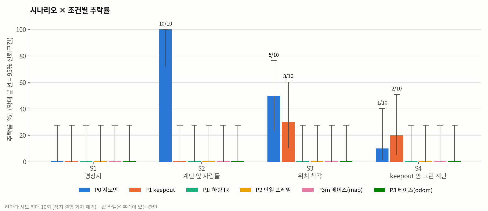
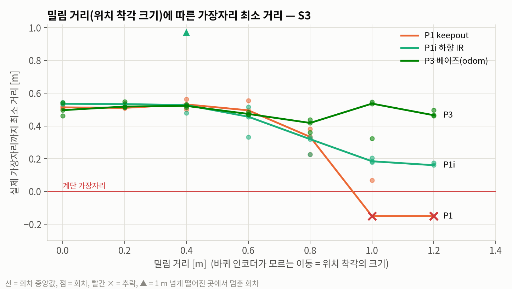

# 보이지 않는 계단 — 발표 자료용 정리 (2026-10-23)

> 로봇내비게이션 텀프로젝트(광운대 2026-2) 발표 자료를 만들기 위한 원재료 문서다.
> **1부 진행 현황**(문제, 방법, 실험, 결과, 용어)과 **2부 판정 기준**(실험 전에 고정한 가설과 규칙)을 한 문서에 모았다.
> 기준일 2026-10-23. 시뮬레이션 총 **1,086회**. 숫자는 모두 결과 폴더(`demo_cliff/results/`)에서 다시 센 값이다.

---

# 1부. 진행 현황

## 1. 한눈에 보기

| 항목 | 내용 |
|---|---|
| 문제 | 건물용 로봇의 2D LiDAR 지도에는 내려가는 계단이 '평평한 바닥'으로 찍힌다. 사람이 길을 막거나, 위치를 착각하거나, 계단 표시를 빠뜨리거나, 뒤로 물러날 때 로봇이 계단으로 갈 수 있다 |
| 현장 대책 | 산업용 AMR은 지도에 금지구역(keepout)을 그리고, 로봇청소기는 금지구역과 발밑 IR 센서로 급정지한다. 서빙로봇은 깊이·스테레오 카메라와 LiDAR를 달지만 카메라 데이터 처리 방식은 비공개다 |
| 문제의식 | 깊이카메라가 이미 쓰이는 현실을 전제로, 감지 결과를 Nav2 비용지도에 넣을 때 위치 오차와 후진에서 무엇이 깨지는지 시뮬레이션으로 비교했다. 공개 자료에서 처리 방식을 확인할 수 없는 부분을 공개된 실험으로 드러낸다. |
| 제안 | **"깊이카메라로 앞을 보고 · 여러 장에 걸쳐 쌓아 판단하고 · 로봇 기준 좌표에 기억하는 층"**을 Nav2 비용지도에 넣는다. 금지구역과 하향 IR은 그대로 둔다 |
| 검증 | Gazebo 시뮬레이션 1,086회, 실험 8가지, 비교 방식 11가지 |
| 핵심 결과 | 안전 실패율: 제안 P3i **1 %**, 강화안 P3+ **0 %**, 현장 표준 **13 %**, 지도 금지구역만 **28 %** |
| 정직한 한계 | 평상시 추락률은 현장 표준과 같다(둘 다 0). 시간 단축 효과는 없다. 모두 시뮬레이션이다 |

## 2. 문제

### 2-1. 로봇이 길을 찾는 방식
- **2D LiDAR:** 바닥에서 일정한 높이(보통 20–30 cm)에서 레이저를 수평으로 돌려 주변까지 거리를 잰다.
- **SLAM:** 이 센서로 건물 지도를 미리 만든다.
- **AMCL:** 운행할 때 지도와 LiDAR를 맞춰 보며 자기 위치를 추정한다.
- **Nav2:** ROS 2의 표준 주행 소프트웨어로 경로를 짜고 따라간다.

### 2-2. 계단이 지도에서 사라지는 이유
- 2D LiDAR는 **자기 높이의 수평면만** 본다. 벽, 기둥, 책상 다리는 잘 보인다.
- 내려가는 계단은 그 높이에 아무것도 없다. 레이저는 계단 위 허공을 지나 건너편 벽에 맞는다.
- 그래서 계단 자리가 지도에 **빈 바닥, 곧 지나가도 되는 곳**으로 찍힌다.

### 2-3. 위험해지는 순간 (이 프로젝트의 시나리오)

| 순간 | 무슨 일이 생기나 | 시나리오 |
|---|---|---|
| 사람이 길을 막을 때 | 돌아갈 길을 찾다가 지도에서 '빈 바닥'인 계단 쪽을 고른다 | S2, S5 |
| 밀리거나 미끄러질 때 | 바퀴는 밀린 것을 모른다. 위치를 착각해 계단까지 거리를 잘못 안다 | S3, 미끄러운 바닥 |
| 계단 표시를 빠뜨렸을 때 | 운영자가 금지구역을 칠하지 않은 계단이 있다 | S4, S6, S7, S8 |
| 계단이 어두울 때 | 검은 계단 끝, 깊은 계단통에서 센서 반사가 안 돌아온다 | 검은 계단 |
| 뒤로 물러날 때 | 앞만 보는 센서는 등 뒤 계단을 모른다 | S8 |

### 2-4. 현장은 어떻게 막고 있나

| 분야 | 방식 | 근거 |
|---|---|---|
| 산업용 AMR (MiR) | 지도 위 금지구역 | 매뉴얼: "내려가는 계단과 바닥 구멍을 제때 감지해 멈출 수 없다", 금지구역으로 표시하라 |
| 로봇청소기 (룸바 등) | 하향 IR + 금지구역 | 앞쪽 아래 IR 4개. 검은 카펫·먼지가 센서를 속인다고 제조사가 안내 |
| 서빙로봇 (Keenon, Pudu, Bear) | 깊이·스테레오 카메라 + LiDAR (+ 낙하 센서) | 제품 설명. **카메라 데이터 처리 방식은 비공개** |

### 2-5. 실제 사례
- 2024년 6월 20일, 구미시의 '1호 로봇 주무관'이 **구미시의회 건물 2층 계단** 아래로 약 2 m 떨어져 파손됐다.
- 로봇은 베어로보틱스 기종이었다고 보도됐고, 목격 경위는 "한 자리에서 빙글빙글 돌다가 계단으로 돌진"이었다.
- **원인은 공개되지 않았다.** 이 프로젝트는 원인을 단정하지 않고 "이런 사고가 실제로 일어난다"는 **동기**로만 쓴다. 핵심 근거는 MiR 매뉴얼이다.

### 2-6. 목표와 범위
> **지도에 보이지 않는 계단을, 로봇이 자기 위치를 잘못 알고 있을 때에도 피하게 만든다.**

| 하는 것 | 하지 않는 것 |
|---|---|
| 낭떠러지를 놓치지 않으면서 가짜 낭떠러지는 줄이기 | 바퀴 슬립 자체를 줄이기 (구동 제어 주제) |
| 슬립·밀림으로 위치가 틀어져도 **견디는** 기억 방식 | 실제 로봇 하드웨어 실험 |
| 현장 방식과의 정량 비교 | 구미 사고의 원인 규명 |

## 3. 제안 방법

### 3-1. 전체 구조

```
산업용 AMR · 로봇청소기:  [지도 금지구역] ────────────────────────────────────────────────────────────── [하향 IR 급정지]
서빙로봇 (제품 설명):     [깊이·스테레오 카메라 + LiDAR (+ 낙하 센서)] ─ (처리 방식 비공개)
이 프로젝트 (P3i):        [지도 금지구역] ─ [깊이카메라: 앞을 보고 · 쌓아서 판단 · 로봇 기준으로 기억] ─ [하향 IR 급정지]
                                            └ Nav2 비용지도에 넣을 때 무엇이 깨지는지 비교한다
```

현장 방식을 버리지 않고 그 위에 얹는다. 깊이카메라가 이미 쓰이는 현실을 전제로, 감지 결과를 Nav2 비용지도에 넣을 때 위치 오차와 후진에서 무엇이 깨지는지 시뮬레이션으로 비교했다. 공개 자료에서 처리 방식을 확인할 수 없는 부분을 공개된 실험으로 드러낸다.

아래 표의 '현장' 두 열은 AMR·로봇청소기 방식이다(2-4절). 서빙로봇 카메라는 처리 방식이 비공개라 표에 넣지 않았고, 실험의 P2는 그 대용(가정)이다.

| | 현장: keepout | 현장: 하향 IR | 제안 |
|---|---|---|---|
| 무엇을 믿나 | 사람이 그린 지도 | 지금 바로 발밑 | 지금 눈앞 2.5 m를 직접 관측 |
| 언제 아나 | 미리. 단, **자기 위치가 맞을 때만** | **몸체 끝이 가장자리에 닿을 때** | 약 2.5 m 앞에서 (판정까지 약 0.5초) |
| 어떻게 피하나 | 경로 계획에서 제외 | 전진 급정지 | 경로를 다시 짠다 |
| 어떻게 판단하나 | 판단 안 함 | 순간값 | 여러 장에 걸쳐 증거를 쌓는다 |
| 기억은 어디에 | 지도 좌표에 고정 | 없음 | 바퀴 기준 좌표 |

### 3-2. 1단계: 깊이카메라로 앞 바닥을 잰다
- 몸통 높이 **0.6 m**에 카메라를 **45° 아래로** 기울여 단다. 해상도 160×120, 초당 10장, 수평 화각 86°.
- 픽셀마다 광선을 따라가 그 점이 바닥보다 얼마나 낮은지 계산한다. 로봇 앞 **0.3–3.0 m** 바닥만 쓴다.
- 바닥을 **10 cm 칸**으로 나누고, 칸마다 이번 화면에서 본 것을 셋 중 하나로 정한다.

| 관측 | 조건 (칸 안 픽셀 비율) | 뜻 |
|---|---|---|
| 낮음 | 바닥보다 8 cm 넘게 아래에서 반사된 픽셀이 30 % 초과 | 낭떠러지 같다 |
| 바닥 | 바닥 높이(±8 cm)에서 반사된 픽셀이 70 % 초과 | 바닥이다 |
| 값 없음 | 반사가 안 돌아온 픽셀이 50 % 초과 | 검은 바닥일 수도, 깊은 낭떠러지일 수도 있다 |

### 3-3. 2단계: 베이즈 필터로 확신이 쌓일 때까지 기다린다
칸마다 '낭떠러지일 가능성' 점수(로그오즈)를 매 화면 고친다.

| 이번 화면 | 점수 변화 |
|---|---|
| 낮음 | +0.9 |
| 바닥 | −0.7 |
| 값 없음 | +0.35 (단 1.2를 넘지 못함) |

- 점수는 −2.5에서 3.5 사이로 묶는다. **2.0을 넘으면 낭떠러지**로 판정한다.
- 판정되려면 최소 **3장 연속으로 낮게** 보여야 한다(0.2–0.3초).
- 햇빛 때문에 한두 장 튄 값은 판정까지 못 간다. 다시 바닥으로 보이면 점수가 내려간다.
- **효과:** 가짜 낭떠러지를 44배 줄인다(221,584 → 4,975 셀-프레임).
- **비용:** 판정이 약 0.55초 늦어지지만, 그동안 로봇은 0.2 m만 간다. 판정 시점에도 가장자리까지 2.3 m 이상 남아 있다. 계산량은 화면 1장당 0.13 ms다.

### 3-4. 3단계: 바퀴 기준 좌표(odom)에 기억한다
- 카메라는 앞만 본다. 몸을 돌리거나 뒤로 물러나면 가장자리가 시야에서 사라지므로 **기억**이 필요하다.
- **지도 좌표(map)에 기억하면 문제가 생긴다.** 위치를 착각한 채 본 가장자리가 지도의 틀린 자리에 저장된다. 위치가 바로잡히면 멀쩡한 바닥에 **유령 낭떠러지**가 남아 로봇을 가둔다.
- **바퀴 기준 좌표에 기억하면** 위치추정이 갑자기 고쳐져도 기억이 로봇 몸 기준으로 맞는 자리에 남는다. ROS 표준(REP-105)도 odom은 연속, map은 불연속이라고 정의한다.

### 3-5. 4단계: Nav2에 금지구역으로 넣는다
- 판정된 칸으로 실시간 금지구역 지도를 만들어 Nav2의 두 번째 **keepout filter**로 보낸다. 로컬·전역 비용지도 모두에 들어간다.
- 가장자리 **0.3 m 안은 완전 금지**(비용 254), **0.7 m까지는 '가까울수록 비싼 길'**(90 → 15)이다. Nav2는 그곳을 피해 경로를 다시 짠다.
- Nav2의 후진·회전 복구 동작도 로컬 비용지도로 충돌을 검사하므로, 기억된 낭떠러지를 보고 멈춘다.

### 3-6. 5단계: 마지막 층, 하향 IR (P3 → P3i)
- 반사가 전혀 없는 계단은 카메라가 못 본다(검은 계단 실험). 그래서 하향 IR을 마지막 방어선으로 남겼다.
- IR 4개를 몸체 앞쪽(±20°, ±60°, 중심에서 0.24 m)에 바닥 위 2.5 cm 높이로 단다. 초당 20회, 7 cm보다 멀거나 반사가 없으면 낭떠러지다.
- 2회 연속 같은 판정일 때만 전진을 막는다.
- IR은 검은 바닥을 '낭떠러지'로 오인하는 쪽으로 틀리므로, 검은 계단에서는 오히려 안전하게 작동한다.

### 3-7. 강화안 P3+ (팀원 피드백 반영, 10/21)

| 추가 기능 | 하는 일 | 설정값 |
|---|---|---|
| 3상태 판정 | '값 없음'은 낭떠러지 증거도 바닥 증거도 아니다(점수 안 바꿈). 칸을 낭떠러지 / 바닥 / **모름**으로 나눈다 | – |
| 정지거리 속도 상한 | 앞쪽 통로(폭 ±0.25 m, 3 m)에서 처음 만나는 '모름'·'낭떠러지' 칸까지 거리로 속도를 제한한다 | v = a(−t + √(t² + 2d/a)), a = 2 m/s²(Nav2 설정), IR 정지 가능 속도 v_IR = 0.37 m/s |
| IR 기억 + 후진 | IR이 본 지점을 기억에 낭떠러지로 영구 기록(그 한 칸)하고 뒤로 물러난 뒤 다시 경로를 짠다 | 후진 0.4 m (금지 0.3 + 반지름 0.25 − IR 위치 0.24 = 최소 0.31 m) |
| 지면 평면 추정 | 0.3–1.2 m 앞 점들로 바닥 평면을 RANSAC으로 맞추고, 높이를 그 평면 기준으로 잰다 | 점 150개 이상, 기울기 5° 안, inlier 60 % 이상, 평활, 0.3° 미만은 보정 안 함 |
| 거리별 임계값 | 먼 거리는 '낮음' 기준을 높인다 | τ(d) = max(8 cm, 3·d·σφ), σφ = 1° |
| 시점 변화 게이트 | 5 cm 또는 3° 움직였을 때만 증거를 센다 (같은 자리 반복 관측 무시) | – |

## 4. 검증 방법

### 4-1. 시뮬레이션 환경


*위에서 내려다본 Gazebo 화면 (S2, 출발 12초 뒤)*
- **아래 가로 복도:** 출발점은 왼쪽 끝, 오른쪽 모퉁이에서 위로 꺾는다.
- **오른쪽 아래 계단:** 계단 A. 꺾지 않고 직진하면 떨어진다.
- **파란 원기둥:** 사람. **흰 원:** 로봇.
- **위쪽 세로 복도:** 가지 복도. 노란 구역은 창가 햇빛, 맨 위는 계단 B.
- **왼쪽 가운데 사각형:** 사무실(목적지). **검은 사각형:** 검은 매트.

| 요소 | 사양 |
|---|---|
| 도구 | ROS 2 Humble + Gazebo Classic 11 + Nav2 (기본 설정: AMCL 2,000 입자, NavFn, DWB, 복구 동작 회전 → 대기 → 0.3 m 후진) |
| 지도 | slam_toolbox로 직접 만든 지도 (계단이 빈 바닥으로 찍힘) |
| 로봇 | 서빙로봇형 두 바퀴. 반지름 0.25 m, 최고속도 0.45 m/s, 가속 1.0 m/s², 감속 2.0 m/s². 270° LiDAR(8 m), 깊이카메라, 하향 IR 4개 |
| 월드 | 복도 → 모퉁이 → 가지 복도 → 사무실. 계단 A(모퉁이 앞), 계단 B(사무실 문 옆), 깊이 2 m |
| 센서 결함 주입 | Gazebo는 적외선 흡수·햇빛을 그리지 못해 직접 넣었다. 검은 매트는 깊이 결측 75 %(IR도 같은 확률로 헛감지), 햇빛 구역은 깊이 이상치 15 %. 판정 알고리즘은 이 위치를 모른다 |
| 추락 판정 | 시뮬레이터의 실제 위치 기준으로 높이 −10 cm 미만 또는 34° 넘게 기울어짐 |

### 4-2. 시나리오

| 시나리오 | 내용 |
|---|---|
| S1 평상시 | 방해 없음 |
| S2 사람들 | 모퉁이(계단 A 옆)를 사람 4명이 막고, 45초 뒤 흩어진다 |
| S3 위치 착각 | 복도 중간에서 로봇이 앞으로 0.8–1.0 m 밀린다(바퀴는 모름) |
| S4 표시 누락 | 사무실 문 앞을 4명이 막아 계단 B 쪽으로 돌아가야 한다. 계단 B에는 keepout이 없다 |
| S5 움직이는 사람 | 6명이 무작위 위치·시각에 나타나 걸어 다닌다. 로봇 앞에선 멈춰 비켜 주고, 계단·벽은 피한다 |
| S6 움직이는 사람 + 누락 | S5 + 계단 B keepout 누락 |
| S7 계단 옆 목적지 | 계단 A 모서리 너머(가장자리에서 0.55 m)로 간다. 계단 A keepout 누락 |
| S8 계단 옆에서 비켜 주기 | S7 지점에 도착하면 앞에 사람이 나타나고, 로봇이 0.6–0.9 m 뒤로 물러난다(등 뒤가 계단). 그다음 사무실로 간다 |

### 4-3. 비교한 방식
앞 단계에 하나씩 더하는 구조다. P1 이후는 모두 keepout을 포함한다.

| 방식 | 구성 | 역할 |
|---|---|---|
| P0 | SLAM 지도만 | 대책 없음 |
| P1 | + keepout (계단 + 30 cm) | 산업용 로봇식 |
| P1i | P1 + 하향 IR | **현장 표준** |
| P2 | P1 + 깊이카메라, 한 장씩 판정, 기억 없음 | 서빙로봇 처리의 대용 |
| P2o | P2 + 바퀴 기준 기억 | 2×2 설계 |
| P3n | P1 + 깊이카메라 + 베이즈, 기억 없음 | 2×2 설계 |
| P3m | P1 + 깊이카메라 + 베이즈, 지도 좌표 기억 | 기억 좌표 비교 |
| P3 | P1 + 깊이카메라 + 베이즈, 바퀴 기준 기억 | 처음 제안 |
| **P3i** | **P3 + 하향 IR** | **최종 제안** |
| **P3+** | P3i + 3상태 · 속도 상한 · IR 기억 · 평면 추정 | 피드백 반영 강화안 |
| P3h | P3 + '값 없음' 칸을 비싼 길로 | 개선안 시도 (채택 안 함) |

### 4-4. 실험 목록

| # | 실험 | 무엇을 바꿨나 | 회차 | 날짜 |
|---|---|---|---|---|
| 1 | 본 실험 | S1–S4 × P0–P3 6방식 × 시드 10 | 240 | 10/14–15 |
| 2 | 값 바꿔 보기 | 밀림 거리 0–1.2 m, 검은 매트 결측 0–90 % | 87 | 10/15 |
| 3 | 검은 계단 | 계단 구멍으로 들어간 광선 결측 50–100 % | 118 | 10/18–20 |
| 4 | 미끄러운 바닥 | 계단 A 앞 모퉁이 마찰 μ 0.05·0.02 | 151 | 10/18 |
| 5 | 움직이는 사람 | S5·S6 × 7방식 | 140 | 10/19–20 |
| 6 | 기억 시나리오 | S7·S8 × 6방식 | 120 | 10/20 |
| 7 | 개선안 P3h | 보통 S1–S4 | 40 | 10/20 |
| 8 | 피드백 방어 | P3+, 2×2 설계(P2o·P3n), 가속 연동 기울기 오차 | 190 | 10/21–22 |
| | **합계** | | **1,086** | |

- **시드:** 사람 위치, 밀림 거리, 사람 동선을 똑같이 재현하는 번호다. 같은 시드끼리는 상황이 같고 방식만 다르다.
- **회차 시간:** 실측 약 1.2–1.5분이다.

### 4-5. 무엇을 쟀나

| 지표 | 뜻 |
|---|---|
| 추락 | 높이 −10 cm 미만 또는 34° 넘게 기울어짐 |
| 걸침 | 떨어지진 않았지만 로봇 중심이 가장자리 15 cm 안까지 감 (반지름 25 cm라 몸체가 허공에 걸침) |
| **안전 실패** | 추락 또는 걸침 (**주 지표**) |
| 도착 / 갇힘 / 실패 | 목적지 도착 / 가장자리 근처에서 더 못 감 / 그 밖의 이유로 못 감 |
| 가장자리 최소 거리 | 한 회차 동안 로봇 중심이 계단 가장자리에 가장 가까이 간 거리 |
| 가짜 낭떠러지 | 멀쩡한 바닥을 낭떠러지로 판정한 횟수 (칸 × 화면 수) |
| odom 어긋남 | 바퀴 회전으로 잰 위치가 실제 위치에서 틀어진 정도 |
| 유령 칸 | 기억이 밀려 계단 앞 10–70 cm 바닥에 찍힌 낭떠러지 칸 수 |

### 4-6. 실험 장치 결함 처리
- **증상:** 시뮬레이션 안의 통신 문제로 Nav2가 위치 정보(TF)를 놓치는 회차가 11–16 % 있었다.
- **판정:** 로그의 TF 경고 줄 수로 가른다(정상 0–8줄, 결함 40줄 이상).
- **처리:** 같은 시드로 다시 돌린다. 추가 실험부터는 원본을 지우지 않고 보관했다(3–8번에서 129회).
- **보수적 재분류:** TF 경고 14초 넘게 전부터 이미 멈춰 있던 결함 회차는 **실제 실패**로 다시 센다(8회).
- **공개:** 결함으로 뺀 회차 중 안전 실패였던 것은 모두 공개한다(7-3).

## 5. 결과

### 5-1. 실험 전체 합계 (주 지표)

| 방식 | 보통 | 검은 계단 | 미끄러운 바닥 | 움직이는 사람 | 계단 옆·비켜 주기 | 기울기 주입 | **안전 실패 합계** | 도착률 |
|---|---|---|---|---|---|---|---|---|
| P1 keepout | 🔴 7/40 | 🔴 7/20 | 🔴 8/20 | 🔴 1/20 | 🔴 10/20 | – | 🔴 **33/120 (28 %)** | 66 % |
| P1i 현장 표준 | 0/40 | 0/20 | 🔴 6/20 | 0/20 | 🔴 10/20 | – | 🔴 **16/120 (13 %)** | 69 % |
| P2 단일 프레임 | 0/40 | 0/20 | 0/20 | 0/20 | 🔴 9/20 | 0/20 | **9/140 (6 %)** | 89 % |
| P2o 단일 프레임 + 기억 | 0/20 | – | – | – | 0/10 | – | 0/30 | **30 %** |
| P3n 필터, 기억 없음 | 0/20 | – | – | – | 🔴 10/10 | – | 🔴 10/30 (33 %) | 83 % |
| P3 | 0/40 | 🔴 8/20 | 🔴 1/20 | 0/20 | 0/20 | 0/20 | **9/140 (6 %)** | 88 % |
| **P3i 최종 제안** | 0/30 | 🔴 1/20 | 0/20 | 0/20 | 0/20 | – | **1/110 (1 %)** | 88 % |
| **P3+ 강화안** | 0/40 | 0/20 | – | – | 0/10 | 0/20 | **0/90 (0 %)** | 88 % |

- 서로 다른 실험을 더한 **참고 수치**다(미리 정한 판정은 6장).
- P3i 대 현장 표준 P1i: p = 0.0002. P3i 대 P2: p = 0.02.
- P2와 P3는 약점이 서로 반대다. P2는 **뒤로 물러날 때**, P3는 **검은 계단에서** 무너진다. P3i·P3+는 둘 다 막는다.

### 5-2. 본 실험 (S1–S4, 방식별 40회)

| 방식 | 추락률 (95 % 신뢰구간) | 도착률 | 가장자리 최소 | 가짜 낭떠러지 |
|---|---|---|---|---|
| P0 지도만 | 🔴 **40 %** (26–55 %) | 60 % | 0.01 m | – |
| P1 keepout | 🔴 **12 %** (5–26 %) | 82 % | 0.06 m | – |
| P1i keepout + IR | 0 % | 85 % | 0.17 m | (IR 헛정지 회차당 약 10회) |
| P2 단일 프레임 | 0 % | **98 %** | 0.27 m | **221,584** |
| P3m 지도 좌표 기억 | 0 % | 72 % | 0.29 m | 15,950 |
| P3 바퀴 기준 기억 | 0 % | 92 % | 0.30 m | 4,975 |

- **S2(사람이 모퉁이를 막음):** 지도만 쓰면 **10/10 추락**한다. 평상시 S1은 0/10이다.
- **S3(위치 착각):** 지도 좌표 기억은 **10/10 갇혔고**, 바퀴 기준 기억은 10/10 도착했다.




### 5-3. 값 바꿔 보기


| 밀림 거리 | 0–0.6 m | 0.8 m | 1.0 m | 1.2 m |
|---|---|---|---|---|
| 위치추정 최대 오차 | 12–62 cm | 78–102 cm | 97–300 cm | 120–125 cm |
| P1 keepout | 추락 0 | 0/3 | 🔴 2/3 | 🔴 3/3 |
| P1i keepout + IR | 추락 0 | 0/3 | 0/3 | 🔴 1/3 |
| P3 | 추락 0 | 0/3 | 0/3 | 0/3 |


| 검은 매트 결측률 | 0 % | 50 % | 75 % | 90 % |
|---|---|---|---|---|
| P2 가짜 낭떠러지 | 813 | 2,606 | 4,633 | 5,423 |
| P3 가짜 낭떠러지 | 12 | 20 | 9 | 11 |

### 5-4. 추가 실험 핵심

| 실험 | 핵심 결과 |
|---|---|
| **검은 계단** | 반사가 전혀 없으면 P3가 30 % 추락했다(계단 칸을 4 %만 맞힘). 결측 90 %까지는 괜찮았다. P2는 0/20(값 없음을 낭떠러지로 봄), P3i는 1/20, P3+는 0/20 |
| **미끄러운 바닥** (μ 0.02, 얼음 수준) | keepout, keepout + IR 각각 6/10 추락했다. IR은 몸체 끝에서야 감지해서 미끄러지는 로봇을 못 세운다(제동 거리 약 0.5 m). P3i 0/20. 지도 좌표 기억 도착 40 % 대 바퀴 기준 90 % |
| **움직이는 사람** | 140회 모두 사람이 1 m 안까지 왔다. 대책 없는 로봇 60 % 추락. 대책이 있으면 모두 안 떨어졌다. keepout 계열은 도착 45–60 %, 카메라 계열은 75–85 %. 제안이 가장자리에서 더 멀리 다녔다(p ≤ 0.012) |
| **기억 시나리오** | 계단을 등지고 비켜 줄 때 P1·P1i·P2는 9–10/10이 계단으로 물러났다. 기억 있는 P3·P3i·P3h는 30회 모두 멈췄다. 모서리를 돌아가는 S7은 차이 없음 |
| **개선안 P3h** | 검은 계단 3/20 (P3 8/20, p = 0.16 → 유의하지 않음). 채택 안 함 |

### 5-5. 피드백 방어 실험 (10/21–22)

| 피드백이 지적한 약점 | 방어 | 결과 | 판정 |
|---|---|---|---|
| **값이 안 나오는 낭떠러지**는 설계상 못 잡는다 | P3+ (3상태·속도 상한·IR 기억·후진) | 검은 계단 **0/20** (P3 8/20, p = 0.003). 보통 0/40, 비켜 주기 0/10 | ✅ 막힘 |
| **P2와 P3 비교는 필터와 기억이 같이 바뀐다** | 2×2 설계 (P2o, P3n) | 필터 없이 기억 → **도착 20 %** (가짜 칸이 쌓여 길이 막힘). 기억 없이 필터 → **비켜 주기 10/10 실패** | ✅ 필터와 기억이 **각각 따로** 필요하다 |
| **시간 누적은 상관된 오차를 못 거른다** (가속할 때 차체 기울기) | 기울기 오차 주입(3°/(m/s²)) + 평면 추정 | P3 가짜 낭떠러지 **88 → 883 (10배)**. 안전 실패 0, 도착 영향 없음. 평면 추정은 증가를 막았지만 도착률 70 % | ⚠️ 피드백이 맞지만 피해 제한적 |

**P3+의 대가:** 검은 매트에서 IR이 헛감지할 때마다 기록하고 물러나서 느려진다.

| 상황 | P3 도착 시간 | P3+ 도착 시간 |
|---|---|---|
| S1 평상시 | 27.5 s | 33.1 s |
| S2 사람이 막음 | 63.1 s | **94.6 s** |
| S3 위치 착각 | 52.6 s | 62.9 s |
| S4 표시 누락 | 52.2 s | 52.6 s |

**피드백 원안에서 바꾼 값 (시험으로 확인한 이유):**

| 항목 | 원안 | 바꾼 값 | 이유 |
|---|---|---|---|
| IR 후진 | 0.2 m | **0.4 m** | 0.2 m로는 금지 띠 안에 남아 컨트롤러가 '유효한 경로 없음'으로 갇혔다 |
| IR 기록 범위 | (명시 없음) | **그 한 칸, 금지 띠 없이 비용만** | 넓게 기록하니 검은 매트 옆 좁은 복도가 막혔다. IR은 위치가 cm 단위로 정확하다 |
| 지면 평면 추정 | 매 프레임 RANSAC | **넓은 바닥에서만, 평활, 0.3° 미만 무시** | 먼 거리 외삽 잡음이 가장자리 앞에 가짜 낭떠러지를 만들었다 |
| 기울기 오차 강도 | 1.5°/(m/s²) | **3°** | 1.5°는 3 m 앞 오차 7.1 cm로 판정 기준 8 cm 아래라 효과가 없었다 |
| 속도 상한 감속값 | 가정 0.5 m/s² | **2.0 m/s²** (Nav2 설정) | 피드백 지시대로 실제 설정값 사용. 상한 0.37 m/s |

### 5-6. 주장 판정

| 주장 | 판정 | 근거 |
|---|---|---|
| ① 지도만 쓰면 특정 상황에서 떨어진다 | ✅ 확실 | 사람이 막으면 10/10 (평상시 0/10, p < 0.001), 움직이는 사람 60 % |
| ② keepout만으로는 부족하다 | ✅ 확실 | 안전 실패 28 % (위치 착각, 표시 누락, 미끄러움, 뒤로 물러나기) |
| ③ 카메라 판단에 시간 누적(필터)이 필요하다 | ✅ 지지 (10/22 갱신) | 필터 없이 기억하면 도착 20 % 대 필터 있으면 90 % → "필터는 기억의 전제조건" |
| ④ 기억은 바퀴 기준 좌표에 둬야 한다 | ✅ 확실 | 위치 착각 10/10 대 0/10, 미끄러운 바닥 도착 90 % 대 40 % |
| ⑤ 기억 자체가 필요하다 | ✅ 확실 | 기억 없으면 뒤로 물러날 때 10/10 실패 대 0/10 (p < 0.001) |

### 5-7. 제안의 이점, 어디까지 말할 수 있나

| 말할 수 있다 | 말하면 안 된다 |
|---|---|
| 실험 전체에서 안전 실패가 가장 적다 (P3i 1 %, P3+ 0 % 대 현장 표준 13 %) | "평상시에도 현장 표준보다 덜 떨어진다" (둘 다 0) |
| 필터와 기억이 각각 왜 필요한지 따로 보였다 (2×2 설계) | "더 빨리 도착한다" (P3i는 같고 P3+는 느림) |
| 미끄러움, 위치 착각, 뒤로 물러나기, 검은 계단 같은 **악조건에서 더 버틴다** | "실제 로봇에서도 그렇다" (시뮬레이션만) |
| 가장자리 여유를 더 확보한다 (보통·움직이는 사람 두 실험에서 재현, p ≤ 0.012) | "상관된 오차까지 해결했다" (평면 추정은 이점 없음) |

## 6. 남은 약점과 한계

| 항목 | 상태 |
|---|---|
| P3+가 검은 매트(IR 헛감지)에서 느려짐 | 미해결. 같은 지점을 두 번 확인해야 기록하는 방식 등 필요 |
| P3i의 IR은 전진만 막는다 (회전·후진 중 검은 계단 추락 1회) | P3+의 IR 기억·후진으로 해결 (검은 계단 0/20) |
| 가속 기울기 같은 상관된 오차 | 가짜 낭떠러지는 늘지만 실패로 이어지지 않음 |
| 월드가 하나뿐 (설정을 보며 조정 → 과적합 우려) | 미해결. 두 번째 월드 필요 |
| 실제 센서 오차 (결함은 직접 주입) | 미해결. 실제 깊이 영상 검증 필요 |
| 사람은 원기둥, 마찰 모델 단순 (실제 젖은 타일로는 안 미끄러짐) | 한계로 명시 |
| 비켜 주기(S8)는 물러나기 명령을 시나리오에서 준 표적 시험 | 범위를 좁혀 말함 |
| 기여가 교과서 부품의 조합이다 (로그오즈 격자, odom 로컬 지도) | 기여를 **"실패 원인을 체계적으로 검증하고, 필터와 기억이 각각 왜 필요한지 정량화했다"**로 잡는다 |

## 7. 실험 장치 결함과 공개
- 추가 실험(3–8번)에서 결함으로 다시 돌린 회차는 **129회**다. 원본은 `results/*_faults/`에 보관했다.
- **결함으로 뺀 회차 중 안전 실패였던 것:**
  - 제안 계열: P3 2회, P3i 1회, P3h 3회
  - 비교군: P2 3회, P2o 1회, P3n 1회
  - 모두 TF 경고가 추락 **전에** 시작됐다(컨트롤러가 위치를 놓친 상태).
  - 보수적으로 포함하면 P3i는 2/111(2 %)이다.
- **보수적 재분류 8회**(P3+ 4회, P2o 4회): TF 경고 전에 이미 갇혀 있던 실제 실패다.
  - P3+ 4회는 모두 안전했다(가장자리 0.37 m 이상).
  - 반영하면 P3+ 도착률은 검은 계단 95 → 90 %, 보통 90 → 88 %다.
- **고친 버그:**
  1. 마스크 파일 누락
  2. 추락 순간 시뮬 정지 판정
  3. 대기 중 메시지 처리
  4. 판정기 파라미터 중복 선언
  5. IR 노드가 넘어지는 순간 죽던 문제: 기존 77회 모두 로봇이 이미 가장자리 6 cm 안에 걸친 뒤라 결론 영향 없음

## 8. 다음 할 일과 일정

| 순위 | 할 일 | 시점 |
|---|---|---|
| 1 | Proposal 자료 준비 | 10/26 주 |
| 2 | 최종 제안을 P3i로 할지 P3+로 할지 결정 (안전 대 시간) | Proposal 전 |
| 3 | P3+의 검은 매트 대책 → S2 재시험 | Proposal 전후 |
| 4 | P3i·P3+를 미끄러운 바닥·움직이는 사람·S1까지 채우기 | 최종 발표 전 |
| 5 | 두 번째 월드 (설정 고정) | 최종 발표 전 |
| 6 | 실제 깊이카메라 영상으로 오프라인 검증 | 가능하면 |

**일정:** Proposal 10/26 주 · 최종 발표 12/2·12/7. OT 기준 11/30일 수도 있어 확인이 필요하다.

---

# 2부. 판정 기준 (실험 전에 고정한 가설과 규칙)

> 2026-10-20에 결과를 보기 **전에** 적어 두었다(원본: `보이지 않는 계단 — 판정 기준 (2026-10-20).md`).
> 그때까지는 여러 지표를 사후에 비교해 "유리한 지표만 골라 말한다"는 비판이 가능했다. 그래서 그 뒤의 실험(6–8번)은 이 기준으로만 판정했다.

## 1. 지표

| 구분 | 지표 | 정의 |
|---|---|---|
| **주 지표** | **안전 실패율** | 추락 **또는** 걸침인 회차의 비율. 추락 = 높이 −10 cm 미만 또는 34° 넘게 기울어짐. 걸침 = 떨어지지 않았지만 로봇 중심이 계단 가장자리 15 cm 안까지 감(`min_edge < 0.15`) |
| **부 지표** | **도착률** | 목적지에 도착한 회차의 비율 (두 구간 시나리오는 마지막 목적지 기준) |
| 참고 지표 | 가장자리 최소 거리, 도착 시간, 가짜 낭떠러지, IR 헛정지 | 판정에는 쓰지 않고 설명에만 쓴다 |

- **왜 걸침까지 포함하나:** 뒤로 물러나다 가장자리를 넘은 로봇은 높이 기준 '추락' 전에 걸린 채 멈추는 경우가 많다. 실제로는 몸체가 허공에 걸린 위험한 상태라 함께 센다.

## 2. "이점이 있다"의 판정 규칙
- **비교 방법:** 같은 시드끼리 비교한다. 같은 시드는 사람 위치, 동선, 목적지 흔들림이 같다.
- **이점 있음:** 안전 실패율이 비교 대상보다 낮고, 차이가 통계적으로 유의하며(Fisher 정확 검정, 양측 p < 0.05), 도착률이 비교 대상보다 **10 %p 넘게 낮지 않다**.
- **동등:** 안전 실패율 차이가 유의하지 않고, 도착률 차이가 10 %p 이내다.
- **불리:** 안전 실패율이 유의하게 높거나, 도착률이 10 %p 넘게 낮다.
- **결함 처리:**
  - 장치 결함 회차(TF 경고 기준)는 같은 시드로 다시 돌리고 원본을 보관한다.
  - 결함으로 뺀 회차에 추락이나 걸침이 있으면 보수적 수치도 함께 적는다.
  - TF 경고 전부터 이미 갇혀 있던 회차는 실제 실패로 다시 센다(10/22 추가).

## 3. 가설과 결과

### H1. 기억이 필요한 상황에서는 기억 없는 카메라가 무너진다
- **시나리오:** S7(계단 옆 목적지), S8(계단을 등지고 뒤로 비켜 주기). 둘 다 계단 A keepout 누락.
- **예측:** P2(기억 없음)와 IR(앞만 감지)은 안전 실패율이 높고, P3 계열(바퀴 기준 기억)은 낮다.
- **결과: ✅ 지지**

| 방식 | S7 | S8 |
|---|---|---|
| P1 keepout | 0/10 | 🔴 10/10 |
| P1i keepout + IR | 0/10 | 🔴 10/10 |
| P2 기억 없음 | 0/10 | 🔴 9/10 |
| P3 · P3i · P3h | 0/10씩 | **0/10씩** (30회 모두 물러나다 계단 앞에서 멈춤) |

  - P3 계열은 P2, P1i, P1 모두에 대해 **이점**이다(0/20 대 9–10/20, p ≤ 0.001, 도착 100 % 대 50–60 %).
  - **단서:** S7에서는 차이가 없었고, S8은 물러나기 명령을 시나리오에서 준 **표적 시험**이다. "뒤로 움직일 때 기억이 필요하다"로 범위를 좁혀 말한다.

### H2. 개선안 P3h는 P3의 검은 계단 약점을 메우면서 평상시 성능을 잃지 않는다
- **P3h:** '값 없음'이 쌓인 주의 칸을 Nav2에 '비싸지만 지나갈 수 있는 길'로 보낸다.
- **예측 1:** 검은 계단에서 P3(8/20)보다 안전 실패율이 유의하게 낮다.
- **예측 2:** 평상시 도착률이 P3(92 %)보다 10 %p 넘게 낮지 않다.
- **결과: ❌ 불지지**
  - 예측 1 미충족: 3/20 대 8/20, p = 0.16.
  - 예측 2 충족: 98 % 대 92 %.
  - 그래서 채택하지 않았다.

### H3. 피드백 1의 예측 (팀원이 10/19에 실험 전에 적은 예측, 같은 규칙으로 판정)

| 예측 | 결과 | 판정 |
|---|---|---|
| P3+는 검은 계단에서 P3보다 안전하다 | 0/20 대 8/20, p = 0.003 | ✅ 지지 |
| P2o(필터 없이 기억)는 가짜 칸이 쌓여 막힌다 → "필터는 기억의 전제조건" | 평상시 도착 20 % 대 P2 100 % | ✅ 지지 |
| P3n(기억 없이 필터)은 뒤로 움직일 때 떨어진다 → "기억이 필요하다" | 비켜 주기 10/10 실패 대 P3 0/10 (p < 0.001) | ✅ 지지 |
| 가속할 때 차체 기울기 같은 상관된 오차는 시간 누적으로 걸러지지 않는다 | P3 가짜 낭떠러지 10배 증가, 단 안전 실패 0 | ⚠️ 맞지만 피해 제한적 |

## 4. 비교 대상
- **현장 방식:** P1(keepout), P1i(keepout + IR, 현장 표준)
- **카메라 대조:** P2(단일 프레임, 기억 없음), P2o(단일 프레임 + 기억), P3n(필터, 기억 없음)
- **제안 계열:** P3, P3i(+IR, 최종 제안), P3+(강화안), P3h(개선안 시도)

## 5. 기준 고정 전후 구분 (발표 때 밝힐 것)

| 구분 | 실험 | 판정 방식 |
|---|---|---|
| 기준 고정 전 (탐색) | 1–5번 (본 실험, 값 바꿔 보기, 검은 계단, 미끄러운 바닥, 움직이는 사람) | 여러 지표를 사후 비교. 5-1 합계는 주 지표로 다시 센 참고 수치 |
| 기준 고정 후 (확인) | 6–8번 (기억 시나리오, 개선안 P3h, 피드백 방어) | 2부의 규칙으로만 판정 |

---

# 부록 A. 용어

| 용어 | 뜻 |
|---|---|
| 2D LiDAR | 한 높이에서 레이저를 수평으로 돌려 거리를 재는 센서 |
| SLAM | 센서로 지도를 만들면서 동시에 그 안에서 자기 위치를 찾는 기술 |
| AMCL | 미리 만든 지도와 LiDAR를 맞춰 보며 로봇 위치를 추정하는 방법 (입자 필터) |
| Nav2 | ROS 2의 표준 자율주행 소프트웨어 (경로 계획 NavFn, 경로 추종 DWB, 복구 동작) |
| 비용지도 (costmap) | Nav2가 칸마다 '지나가기 어려운 정도'(0–254)를 매긴 지도. 254는 금지. 로컬(주변)과 전역(전체) 두 장 |
| keepout (금지구역) | 지도 위에 사람이 칠해 두는 진입 금지 구역. Nav2의 keepout filter로 비용지도에 넣는다 |
| 하향 IR 센서 | 바닥을 향해 적외선을 쏘고, 반사가 안 오면 낭떠러지로 보는 센서 (로봇청소기 방식) |
| 깊이카메라 | 픽셀마다 거리를 재는 카메라 |
| 베이즈 필터 / 로그오즈 | 새 관측이 들어올 때마다 확률(점수)을 고쳐 가며 판단하는 방법. 로그오즈는 확률 p를 ln(p/(1−p))로 바꾼 값이라 더하기로 갱신된다 |
| map / odom 좌표 | map은 지도 기준 위치(위치추정이 고쳐지면 갑자기 바뀔 수 있음), odom은 바퀴 회전으로 잰 위치(매끄럽지만 밀림·슬립은 모름) |
| REP-105 | ROS의 좌표계 규약. odom은 연속, map은 불연속일 수 있다고 정의 |
| 유령 낭떠러지 | 위치 오차 때문에 기억이 틀린 자리에 남아 멀쩡한 바닥이 낭떠러지로 표시되는 현상 |
| 3상태 판정 | 칸을 낭떠러지 / 바닥 / 모름으로 나누는 것. '값 없음'을 모름으로 둔다 |
| 정지거리 속도 상한 | 남은 거리 d 안에 멈출 수 있는 최대 속도 v = a(−t + √(t² + 2d/a)) (a 감속, t 반응 지연) |
| RANSAC | 잡음 섞인 점들에서 무작위로 뽑아 맞춰 보기를 반복해 가장 많은 점이 맞는 모델(여기서는 바닥 평면)을 찾는 방법 |
| 셀-프레임 | 바닥 칸 하나를 카메라 화면 한 장에서 한 번 판정한 것 (가짜 낭떠러지를 세는 단위) |
| 마찰계수 μ | 미끄러움의 정도. 작을수록 미끄럽다 (마른 바닥 0.6–1, 젖은 타일 0.2–0.4, 얼음 0.02–0.05) |
| 시드 | 무작위 요소를 똑같이 재현하는 번호 |
| sweep | 값 하나를 단계별로 바꿔 가며 결과 변화를 보는 실험 |
| 95 % 신뢰구간 | 실제 비율이 있을 법한 범위. 회차가 적으면 넓어진다 |
| p값 / Fisher 정확 검정 | 두 비율의 차이가 우연으로 나올 확률. 회차가 적을 때 쓰는 정확 검정. 5 % 미만이면 확실한 차이로 본다 |
| 2×2 요인 설계 | 두 요인(필터 유무, 기억 유무)을 각각 따로 바꿔 어느 쪽이 효과를 냈는지 가르는 실험 설계 |
| TF | ROS에서 좌표계 사이 변환을 주고받는 체계. 이게 늦으면 Nav2가 위치를 놓친다 |

# 부록 B. 슬라이드 구성 제안

| # | 슬라이드 | 쓸 내용 |
|---|---|---|
| 1 | 제목 | 보이지 않는 계단 — 2D LiDAR 지도의 낭떠러지 사각지대 |
| 2 | 문제 제기 | 1부 2-2(왜 안 보이나), 2-5(사례), MiR 매뉴얼 문장 |
| 3 | 위험한 순간 | 1부 2-3 표 |
| 4 | 현장 대책과 한계 | 1부 2-4 + 3-1 비교표 |
| 5 | 제안 구조 | 1부 3-1 층 그림 |
| 6 | 판단 방법 | 3-2(칸 판정), 3-3(점수 표), 3-4(기억 좌표 그림) |
| 7 | 실험 환경 | 4-1 위에서 본 화면 + 4-2 시나리오 |
| 8 | 비교 방식·실험 목록 | 4-3, 4-4 |
| 9 | 판정 기준 | 2부 1–2 (실험 전 고정) |
| 10 | 본 실험 결과 | 5-2 + 그림 1·2 |
| 11 | 악조건 결과 | 5-4 (검은 계단, 미끄러움, 움직이는 사람) |
| 12 | 필터와 기억의 분리 | 5-5의 2×2 결과 (가장 강한 장면) |
| 13 | 전체 합계 | 5-1 표 |
| 14 | 주장 판정 | 5-6 + 2부 3 (H1–H3) |
| 15 | 한계와 정직성 | 6, 7장 (결함 공개 포함) |
| 16 | 다음 할 일 | 8장 |

# 부록 C. 자료 위치 (`demo_cliff/results/`)
- **실험별 분석표:**
  - 본 실험 `final_2026-10-15/analysis.md`
  - 검은 계단 `darkstair/analysis.md`
  - 미끄러운 바닥 `wetfloor/analysis.md`
  - 움직이는 사람 `walkers/analysis.md`
  - 기억·개선안 `memory/analysis.md`
  - 피드백 방어 `fb1/analysis.md`
- **그림:** `final_2026-10-15/figures/` (그림 5장), `doc_img/overhead_S2.png`
- **결함 원본:** `darkstair_faults/`, `wetfloor_faults/`, `walkers_faults/`, `memory_faults/`, `fb1_faults/`
- **회차별 영상:** 각 회차 폴더의 `video.mp4`
- **참고:** MiR250 매뉴얼, Roomba(Wikipedia), Keenon T8, Pudu BellaBot 제품 설명, 구미 사례 보도(YTN 2024-06-27, 인사이트 2024-06-26), REP-105
