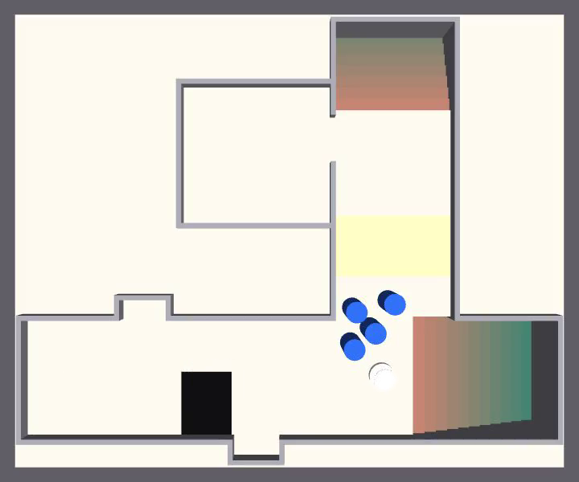
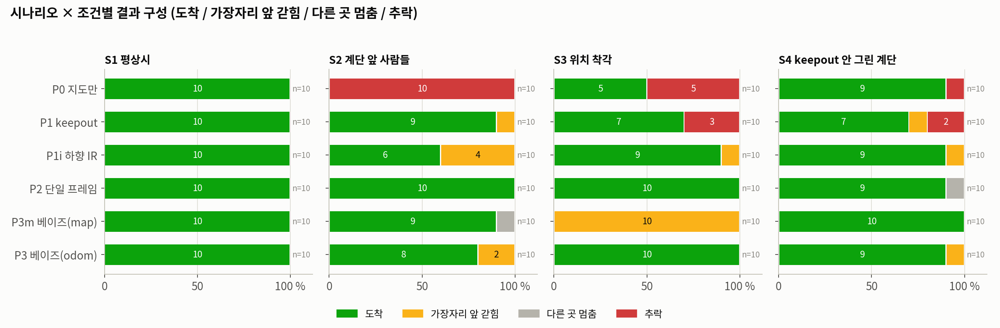
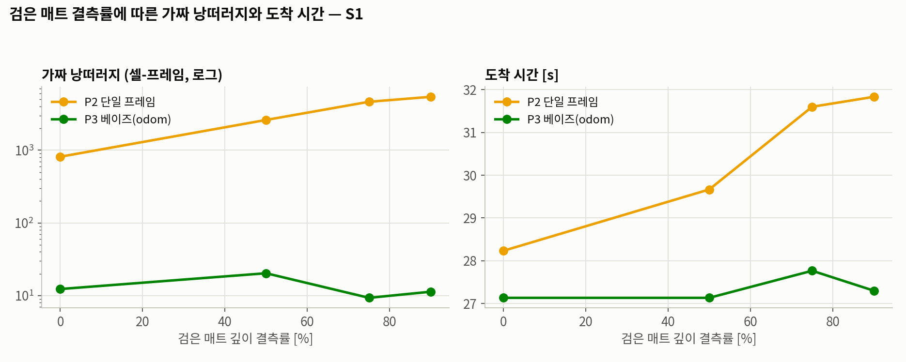

# 보이지 않는 계단 — 진행 현황 · 판정 기준 · 진행 현황 요약 (합본, 2026-10-23)

> 세 문서를 순서대로 합쳤다: ① 진행 현황 (10-18, 방법·용어 상세) ② 판정 기준 (10-20, 실험 전 고정) ③ 진행 현황 요약 (10-22, 최신 결과).
> 10-18 이후 결과(움직이는 사람, 기억 시나리오, 피드백 방어)는 ③에 있다.

---

## 보이지 않는 계단 — 진행 현황 (2026-10-18)

> 로봇내비게이션 텀프로젝트. 이 프로젝트를 처음 보는 사람도 따라올 수 있게, 문제의식부터 실험, 결과, **알려진 약점과 예상 반박**, 다음 할 일까지 정리했다.
> 이 판은 `— 진행 현황 (2026-10-17).md`를 대체한다. 그 뒤에 바뀐 것은 세 가지다.
> 1. 추가 실험 두 개: **검은 계단**, **미끄러운 바닥**
> 2. 제안 방식을 **P3 → P3i**(하향 IR 추가)로 변경
> 3. **"제안의 이점이 정말 확실한가"**를 기준별로 통계 판정

---

### 0. 한눈에 보기
1. **문제:** 건물용 로봇이 쓰는 2D LiDAR 지도에는 내려가는 계단이 '평평한 바닥'으로 찍힌다. 그래서 사람이 길을 막거나, 로봇이 자기 위치를 착각하거나, 운영자가 계단 표시를 빠뜨리면 로봇이 계단으로 갈 수 있다.
2. **제안:** 현장에서 쓰는 두 겹 방어(지도 금지구역 + 발밑 IR 센서) 사이에, **2.5 m 앞을 깊이카메라로 보고, 여러 장에 걸쳐 증거를 쌓아 판단하고, 로봇 기준 좌표에 기억하는 층**을 넣었다(P3i).
3. **한 일:** Gazebo 시뮬레이션 **576회**. 본 실험 240회, 값 바꿔 보기 87회, 검은 계단 98회, 미끄러운 바닥 151회.
4. **확실하게 말할 수 있는 이점은 두 가지:**
   - 평상시 **가장자리에서 더 멀리 떨어져 다닌다**(안전 여유).
   - **아주 미끄러운 바닥**에서 덜 떨어지고 더 많이 도착한다.
5. **말하면 안 되는 것:**
   - 평상시 추락률은 현장 표준(keepout + IR)과 **같다**. 둘 다 0이다.
   - **시간 단축 효과는 없다.**
   - 깊이값이 전혀 안 돌아오는 검은 계단에서는 카메라 층이 뚫린다. 그래서 IR을 마지막 층으로 남겼다.

---

### 1. 문제: 왜 계단이 안 보이나

#### 1-1. 로봇이 길을 찾는 방식
- 서빙·안내·배송 로봇은 대부분 **2D LiDAR**로 주변을 본다. 바닥에서 일정한 높이(보통 20–30 cm)에서 레이저를 수평으로 한 바퀴 돌려 쏘고, 벽까지의 거리를 잰다.
- 로봇은 이 센서로 건물 지도를 미리 만들고(**SLAM**), 운행할 때는 지도와 LiDAR를 맞춰 보며 자기 위치를 추정하고(**AMCL**), 경로를 짠다(**Nav2**, ROS 2의 표준 주행 소프트웨어).

#### 1-2. 계단이 지도에서 사라지는 이유
- 2D LiDAR는 **자기 높이에 있는 것만** 본다. 벽, 기둥, 책상 다리는 잘 보인다.
- 내려가는 계단은 레이저 높이에 아무것도 없다. 레이저는 계단 위 허공을 지나 건너편 벽에 맞는다.
- 그래서 계단 자리가 지도에 **빈 바닥, 곧 지나가도 되는 곳**으로 찍힌다.

#### 1-3. 언제 위험해지나
평소에는 경로가 계단을 지나지 않아 문제가 드러나지 않는다. 다음 순간에 위험해진다.

| 순간 | 무슨 일이 생기나 | 이 프로젝트의 시나리오 |
|---|---|---|
| 사람이 길을 막을 때 | 돌아갈 길을 찾다가 지도에서 '빈 바닥'인 계단 쪽을 고른다 | S2 |
| 로봇이 밀리거나 미끄러질 때 | 바퀴는 밀린 것을 모른다. 자기 위치를 착각해 계단까지의 거리를 잘못 안다 | S3, 미끄러운 바닥 실험 |
| 계단 표시를 빠뜨렸을 때 | 운영자가 지도에 계단을 금지구역으로 칠해 두지 않은 곳이 있다 | S4 |
| 계단이 어두워 센서에 안 잡힐 때 | 검은 계단 끝이나 깊은 계단통에서 반사가 안 돌아온다 | 검은 계단 실험 |

#### 1-4. 실제 사례
- 2024년 6월 20일 오후 4시쯤, 구미시의 '1호 로봇 주무관'이 **구미시의회 건물 2층 계단** 아래로 약 2 m 떨어져 파손된 채 발견됐다.
- 로봇은 베어로보틱스의 최신 기종이었다고 보도됐다.
- 목격된 경위는 "한 자리에서 빙글빙글 돌다가 계단으로 돌진"이었다.
- **공식 원인은 공개되지 않았다.** 이 프로젝트는 원인을 단정하지 않는다. "이런 사고가 실제로 일어난다"는 **동기**로만 쓴다. 그 로봇에는 낙하 센서가 있었을 수 있어서, "센서가 없어서 난 사고"로 연결하면 안 된다.
- 문제의식의 더 단단한 근거는 산업용 로봇 제조사 MiR의 매뉴얼이다. 매뉴얼에는 로봇이 "내려가는 계단과 바닥 구멍을 제때 감지해 멈출 수 없다"고 적혀 있다(1-5).

#### 1-5. 현장은 어떻게 막고 있나

| 분야 | 쓰는 방식 | 근거 |
|---|---|---|
| 산업용 AMR (MiR) | **지도 위 금지구역(keepout)**만 | 매뉴얼: 계단과 구멍을 감지 못 하니 금지구역으로 표시하고 지도를 최신으로 유지하라 |
| 로봇청소기 (룸바 등) | **하향 IR 낙하 센서** + 앱에서 그리는 금지구역 | 룸바는 앞쪽 아래에 IR 4개. 제조사도 검은 카펫과 먼지가 센서를 속인다고 안내한다 |
| 서빙로봇 (Keenon, Pudu, Bear) | 깊이·스테레오 카메라 + LiDAR (+ 낙하 센서) | 제품 설명. **카메라 데이터 처리 방식은 공개하지 않음** |

---

### 2. 제안은 현장 방식과 무엇이 다른가

```
현장:  [지도 금지구역(keepout)] ──────── (빈 구간) ──────── [하향 IR 급정지]
제안:  [지도 금지구역(keepout)] ─ [깊이카메라: 앞을 보고 · 쌓아서 판단 · 기억 → 경로 재계획] ─ [하향 IR 급정지]
```

현장 방식을 버리는 게 아니라, **두 방식 사이의 빈 구간을 메우는 층을 더한 것**이다.

| | 현장: keepout | 현장: 하향 IR | 제안 (P3i) |
|---|---|---|---|
| 무엇을 믿나 | 사람이 그린 지도 | 지금 바로 발밑 | 지금 눈앞 2.5 m를 직접 관측 |
| 언제 아나 | 미리 앎. 단, **자기 위치가 맞을 때만** | **몸체 끝이 가장자리에 닿을 때** | 약 2.5 m 앞에서 (판정까지 약 0.5초) |
| 어떻게 피하나 | 경로 계획에서 제외 | 전진 급정지 | 경로를 다시 짬 (0.3 m 금지 + 0.7 m까지 비싼 길) |
| 어떻게 판단하나 | 판단 안 함 (고정) | 순간값 | 여러 장에 걸쳐 증거를 쌓음 |
| 기억은 어디에 | 지도 좌표에 고정 | 기억 없음 | 바퀴 기준 좌표 (위치추정이 틀어져도 로봇 기준으로 맞게 유지) |

- 서빙로봇들도 카메라를 단다. 그래서 차이는 "카메라를 달았냐"가 아니라 **카메라 데이터를 어떻게 처리하냐**에 있다.
- 실험의 P2(화면 한 장씩 판정, 기억 없음)가 공개되지 않은 그 처리 방식의 대용이다.

---

### 3. 목표와 범위

> **한 줄 목표: 지도에 보이지 않는 계단을, 로봇이 자기 위치를 잘못 알고 있을 때에도 피하게 만든다.**

| 하는 것 | 하지 않는 것 |
|---|---|
| 낭떠러지를 놓치지 않으면서 가짜 낭떠러지는 줄이기 | 바퀴 슬립 자체를 줄이기 (구동 제어 쪽의 다른 주제) |
| 슬립·밀림으로 위치가 틀어져도 **견디는** 기억 방식 | 실제 로봇 하드웨어 실험 (시뮬레이션만) |
| 현장 방식과의 정량 비교 | 구미 사고의 원인 규명 |

---

### 4. 제안 방법

#### 4-1. 깊이카메라로 앞 바닥을 잰다
- 몸통 높이 0.6 m에 카메라를 45° 아래로 기울여 단다. 해상도 160×120, 초당 10장. 로봇 앞 0.3–3.0 m 바닥을 쓴다.
- 바닥을 10 cm 칸으로 나누고, 칸마다 이번 화면에서 본 것을 셋 중 하나로 정한다.
  - **낮음:** 바닥보다 8 cm 넘게 아래에서 반사됨
  - **바닥:** 바닥 높이에서 반사됨
  - **값 없음:** 반사가 안 돌아옴. 검은 매트일 수도, 깊은 낭떠러지일 수도 있다

#### 4-2. 베이즈 필터로 확신이 쌓일 때까지 기다린다 (시간 누적)

| 이번 화면에서 본 것 | 칸의 점수 변화 |
|---|---|
| 낮음 | +0.9 |
| 바닥 | −0.7 |
| 값 없음 | +0.35, 단 1.2를 넘지 못함 |

- 점수가 **2.0을 넘으면 낭떠러지**로 판정한다. 최소 3장 연속으로 낮게 보여야 한다.
- 햇빛 때문에 한두 장 튄 값은 판정까지 가지 못한다.
- **값 없음만으로는 판정되지 않는다**(1.2에서 멈춤). 검은 매트를 견디려는 설계다. 이 선택의 대가는 7장(검은 계단)에서 드러났다.

#### 4-3. 바퀴 기준 좌표(odom)에 기억한다
- 카메라는 앞만 본다. 몸을 돌리면 가장자리가 시야에서 사라지므로 기억이 필요하다.
- **지도 좌표에 기억하면(P3m)** 위치를 착각한 상태에서 본 가장자리가 지도의 틀린 자리에 저장된다. 위치가 바로잡히면 멀쩡한 바닥 위에 **'유령 낭떠러지'**가 남아 로봇을 가둔다.
- **바퀴 기준 좌표에 기억하면(P3)** 위치추정이 갑자기 고쳐져도 기억이 로봇 몸 기준으로 맞는 자리에 남는다.

#### 4-4. Nav2에 금지구역으로 넣는다
판정된 칸으로 실시간 금지구역 지도를 만든다. 가장자리 0.3 m 안은 완전 금지, 0.7 m까지는 '가까울수록 비싼 길'로 만들어 Nav2가 미리 돌아가게 한다.

#### 4-5. 마지막 층: 하향 IR (P3 → P3i로 변경)
- 검은 계단 실험(7장)에서, 반사가 아예 없는 계단은 깊이카메라 층이 못 본다는 것이 확인됐다.
- 그래서 현장에서 쓰는 하향 IR을 마지막 방어선으로 남겼다. 이것이 **P3i**다.
- IR은 검은 바닥을 '낭떠러지'로 오인하는 쪽으로 틀리므로, 검은 계단에서는 오히려 안전하게 작동한다.

---

### 5. 검증 방법

#### 5-1. 시뮬레이션 환경


*위에서 내려다본 Gazebo 화면 (S2 상황, 출발 12초 뒤)*
- **아래 가로 복도:** 출발점은 왼쪽 끝. 오른쪽 모퉁이에서 위로 꺾는다.
- **오른쪽 아래 주황·초록 계단:** 계단 A. 모퉁이에서 꺾지 않고 직진하면 떨어진다.
- **파란 원기둥:** 모퉁이를 막은 사람 4명. **흰 원:** 로봇.
- **위쪽 세로 복도:** 가지 복도. 노란 구역은 창가 햇빛, 맨 위 계단은 계단 B.
- **왼쪽 가운데 사각형:** 사무실(목적지). 문은 오른쪽 벽에 있다.
- **검은 사각형:** 검은 매트.
- 미끄러운 바닥 실험의 젖은 구간은 사람들이 서 있는 모퉁이 일대다.

- **도구:** ROS 2 Humble + Gazebo Classic 11 + Nav2 (기본 설정). 지도는 slam_toolbox로 직접 만들었다(계단이 빈 바닥으로 찍힌 지도).
- **로봇:** 서빙로봇형 두 바퀴 로봇. 최고속도 0.45 m/s, 270° LiDAR, 깊이카메라, 하향 IR 4개.
- **센서 결함 주입:** Gazebo는 검은 바닥의 적외선 흡수나 햇빛 간섭을 그리지 못한다. 그래서 검은 매트(깊이 결측 75 %)와 햇빛 구역(이상치 15 %)은 정해 둔 위치에 결함을 직접 넣었다. 판정 알고리즘은 이 위치를 모른다.

#### 5-2. 상황과 방식

| 상황 | 내용 |
|---|---|
| S1 평상시 | 방해 없음 |
| S2 사람들 | 모퉁이(계단 A 옆)를 사람 4명이 막고, 45초 뒤 흩어진다 |
| S3 위치 착각 | 복도 중간에서 로봇이 앞으로 0.8–1.0 m 밀린다. 바퀴는 모른다 |
| S4 표시 누락 | 사무실 문 앞을 4명이 막아 계단 B 쪽으로 돌아가야 한다. 계단 B에는 keepout이 없다 |

방식은 앞 단계에 하나씩 더하는 구조다. P1 이후는 모두 keepout을 포함한다.

| 방식 | 구성 | 의미 |
|---|---|---|
| P0 | SLAM 지도만 | 대책 없음 |
| P1 | + keepout (계단 + 30 cm) | 산업용 AMR식 |
| P1i | P1 + 하향 IR 4개 | **현장 표준** (이중 방어) |
| P2 | P1 + 깊이카메라, 매 화면 따로 판정 | 시간 누적·기억 없음 (서빙로봇 처리 방식의 대용) |
| P3m | P1 + 깊이카메라 + 베이즈, 기억은 지도 좌표 | 기억 좌표만 다른 비교군 |
| P3 | P1 + 깊이카메라 + 베이즈, 기억은 바퀴 기준 좌표 | 처음 제안 |
| **P3i** | **P3 + 하향 IR** | **최종 제안** (10/17 추가) |

#### 5-3. 무엇을 쟀나

| 지표 | 뜻 |
|---|---|
| 추락 | 시뮬레이터의 실제 위치 기준으로 높이가 10 cm 넘게 내려가거나 34° 넘게 기울면 추락 |
| 걸침 | 떨어지진 않았지만 로봇 중심이 가장자리 15 cm 안까지 간 경우. 반지름이 25 cm라 몸체가 허공에 걸친 상태 |
| 도착 / 갇힘 / 실패 | 목적지 도착 / 가장자리 근처에서 더 못 감 / 그 밖의 이유로 못 감 |
| 가장자리 최소 거리 | 한 회차 동안 로봇 중심이 계단 가장자리에 가장 가까이 간 거리 (안전 여유) |
| 가짜 낭떠러지 | 멀쩡한 바닥을 낭떠러지로 판정한 횟수 (칸 × 화면 수) |
| odom 어긋남 | 바퀴 회전으로 잰 위치가 실제 위치에서 얼마나 틀어졌나 (미끄러짐의 크기) |
| 유령 칸 | 기억된 낭떠러지가 밀려서 계단 앞 10–70 cm 바닥에 찍힌 칸 수 |

**통계:**
- 같은 시드끼리 짝지어 비교했다.
- 비율 차이가 우연으로 나올 확률(**p값**)이 5 % 미만이면 "확실"로 본다.
- 비율에는 **95 % 신뢰구간**(실제 비율이 있을 법한 범위)을 붙였다.

#### 5-4. 실험 장치 결함 처리
- **증상:** 시뮬레이션 안의 통신 문제로 Nav2가 로봇 위치 정보(TF)를 놓치는 회차가 있다.
  - 통신 설정을 바꾼 뒤 본 실험에서 약 7 %, 추가 실험에서 11–16 %였다.
- **판정:** 로그의 TF 경고 줄 수로 가른다. 정상 회차는 0–8줄, 결함 회차는 40줄 이상이다.
- **처리:** 결함 회차는 같은 시드로 다시 돌린다.
  - 본 실험은 결함 회차를 지웠다.
  - 추가 실험부터는 **지우지 않고 따로 보관**한다(`results/*_faults/`).
- 결함으로 뺀 회차 중 추락이 있었던 경우는 7-5와 8-5에 모두 공개했다.

---

### 6. 본 실험 결과 (보통 상황, 각 10회)

#### 6-1. 상황 × 방식

| | P0 | P1 | P1i | P2 | P3m | P3 | P3i (추가) |
|---|---|---|---|---|---|---|---|
| **S1** 평상시 | 도착 10 | 도착 10 | 도착 10 | 도착 10 | 도착 10 | 도착 10 | 미실시 |
| **S2** 사람들 | 🔴 **추락 10** | 도착 9 · 갇힘 1 | 도착 6 · **갇힘 4** | 도착 10 | 도착 9 · 멈춤 1 | 도착 8 · 갇힘 2 | 도착 10 |
| **S3** 위치 착각 | 🔴 **추락 5** · 도착 5 | 🔴 **추락 3** · 도착 7 | 도착 9 · 갇힘 1 | 도착 10 | **갇힘 10** | 도착 10 | 도착 8 · 갇힘 2 |
| **S4** 표시 누락 | 🔴 추락 1 · 도착 9 | 🔴 **추락 2** · 도착 7 · 갇힘 1 | 도착 9 · 갇힘 1 | 도착 9 · 멈춤 1 | 도착 10 | 도착 9 · 갇힘 1 | 도착 10 |

#### 6-2. 방식별 합계

| 방식 | 추락률 (95 % 신뢰구간) | 도착률 | 가장자리 최소 거리 | 가짜 낭떠러지 |
|---|---|---|---|---|
| P0 지도만 | 🔴 **40 %** (26–55 %) | 60 % | 0.01 m | – |
| P1 keepout | 🔴 **12 %** (5–26 %) | 82 % | 0.06 m | – |
| P1i keepout + IR | 0 % (0–9 %) | 85 % | 0.17 m | (IR 헛정지 회차당 약 10회) |
| P2 단일 프레임 | 0 % (0–9 %) | **98 %** | 0.27 m | **221,584** |
| P3m 베이즈 (지도 좌표) | 0 % (0–9 %) | 72 % | 0.29 m | 15,950 |
| P3 베이즈 (바퀴 기준 좌표) | 0 % (0–9 %) | 92 % | 0.30 m | 4,975 |
| P3i 베이즈 + IR (S2–S4, 30회) | 0 % (0–11 %) | 93 % | 0.27 m | (IR 헛정지 회차당 약 12회) |




#### 6-3. 값을 바꿔도 결론이 같은가 (칸마다 3회)


| 밀림 거리 | 0–0.6 m | 0.8 m | 1.0 m | 1.2 m |
|---|---|---|---|---|
| 위치추정 최대 오차 | 12–62 cm | 78–102 cm | 97–300 cm | 120–125 cm |
| P1 keepout | 추락 0 | 0/3 | 🔴 2/3 | 🔴 3/3 |
| P1i keepout + IR | 추락 0 | 0/3 | 0/3 | 🔴 1/3 |
| P3 | 추락 0 | 0/3 | 0/3 | 0/3 |



| 검은 매트 결측률 | 0 % | 50 % | 75 % | 90 % |
|---|---|---|---|---|
| P2 가짜 낭떠러지 · 도착 시간 | 813 · 28 s | 2,606 · 30 s | 4,633 · 32 s | 5,423 · 32 s |
| P3 가짜 낭떠러지 · 도착 시간 | 12 · 27 s | 20 · 27 s | 9 · 28 s | 11 · 27 s |

#### 6-4. 주장별 판정 (본 실험 기준)

| 주장 | 판정 | 근거 |
|---|---|---|
| ① 지도만 쓰면 특정 상황에서 떨어진다 | ✅ 확실 | 평상시 0/10인데 사람이 막으면 **10/10** 추락 (p < 0.001) |
| ② keepout만으로는 부족하다 | ✅ 지지 | 위치 착각 3/10, 표시 누락 2/10 추락. 밀림 1.0 m부터 무너짐 |
| ③ 센서로 보되 필터가 필요하다 | ⚠️ 부분 지지 | 필터는 가짜 낭떠러지를 44배 줄인다. 하지만 필터 없는 P2도 안 떨어졌고, **검은 계단에서는 P2가 더 안전했다**(7장) |
| ④ 기억은 바퀴 기준 좌표에 둬야 한다 | ✅ 확실 | 위치 착각에서 지도 좌표 기억은 **갇힘 10/10**, 바퀴 기준은 **도착 10/10** (p < 0.001). 미끄러운 바닥에서도 도착률 40 % vs 90 % (8장) |

---

### 7. 추가 실험 ① 검은 계단 (10/17–18)

#### 7-1. 왜 했나
제안 방식은 '값 없음'만으로는 낭떠러지로 판정하지 않는다. 그러면 **반사가 전혀 안 돌아오는 계단**(검은 계단 끝, 검은 카펫, 깊은 계단통)은 못 보는 것 아닌가? 이것이 가장 치명적인 예상 반박이었다.

#### 7-2. 어떻게 했나
- 계단 구멍 안으로 들어간 깊이카메라 광선이 정해진 확률로 반사를 못 받게(결측) 했다.
- 본 실험은 결측 100 %로 S3·S4에서 했다. keepout이 어긋나거나 없어서 카메라만이 계단을 막을 수 있는 상황이다. P2, P3, P3i × 10회.
- 값 바꿔 보기: 결측 50·70·90 %, P3, 3회.
- P1·P1i는 카메라를 쓰지 않으므로 본 실험 결과를 그대로 비교에 썼다.

#### 7-3. 결과 (S3 + S4, 각 20회)

| 방식 | 계단 | 추락 | 걸침 | 도착 | 계단 칸을 맞힌 비율 |
|---|---|---|---|---|---|
| P1 keepout | (색과 무관) | 🔴 5/20 | 2 | 70 % | – |
| P1i keepout + IR | (색과 무관) | 0/20 | 0 | 90 % | – |
| P2 단일 프레임 | 검은 계단 | **0/20** | 0 | **100 %** | 97 % |
| P3 | 보통 계단 | 0/20 | 0 | 95 % | 92 % |
| P3 | **검은 계단** | 🔴 **6/20** (30 %) | 2 | 60 % | **4 %** |
| P3i | 보통 계단 | 0/20 | 0 | 90 % | – |
| P3i | **검은 계단** | 1/20 (5 %) | 0 | 90 % | – |

| 계단 결측률 (P3, 6회씩) | 50 % | 70 % | 90 % | 100 % |
|---|---|---|---|---|
| 추락 | 0/6 | 0/6 | 0/6 | 🔴 2/6 |

#### 7-4. 알게 된 것
1. **반박이 사실이었다.** 반사가 완전히 없는 계단에서 P3는 계단 칸을 4 %만 맞혔고, 30 %가 떨어졌다. keepout만 쓴 경우(25 %)와 같은 수준이다. 보통 계단 대비 차이는 확실하다(p = 0.02).
2. **약점은 좁다.** 결측 90 %까지는 한 번도 안 떨어졌다. 점수가 1.2에 머물러 있으면 정상 값 한 번(+0.9)만 들어와도 2.0을 넘기 때문이다. 즉 반사가 **거의 전혀** 없을 때만 뚫린다.
3. **필터 없는 P2가 오히려 안전했다.** 값 없음을 바로 낭떠러지로 보기 때문이다. 검은 매트에는 약하고 검은 계단에는 강한, P3와 정반대 성격이다.
4. **IR을 더한 P3i는 6/20 → 1/20으로 줄였다.** 다만 이 차이는 경향(p = 0.09)이지 확정은 아니다. 남은 1회는 IR이 가장자리 3 cm 앞에서 전진을 막아 약 60초 서 있다가, Nav2의 회전·후진 복구 동작으로 넘어간 경우다. **IR은 전진만 막는다.**
5. **계단을 못 보고 가장자리까지 가면, 바퀴 하나가 허공에서 헛돈다.** 그러면 바퀴 기준 좌표가 수 미터, 수십 도씩 틀어져 기억이 망가진다.

#### 7-5. 정직하게 밝힐 점
- **결함으로 다시 돌린 18회 중 1회는 P2의 추락이었다**(S4, 시드 10). TF 경고 48줄이 모두 추락 직전 2.3초에 몰려 있어 결함으로 판단했고, 다시 돌린 회차는 도착했다. 포함하면 P2는 1/20이다.
- 결측 주입은 실제 위치를 써서 넣었는데, 카메라 시각과 약간 어긋나 가장자리 몇 cm는 결측이 덜 들어갔다. 그래서 '100 %'에서도 계단 칸을 4 % 맞혔다.

---

### 8. 추가 실험 ② 미끄러운 바닥 (10/18)

#### 8-1. 왜 했나
위치 착각 시나리오(S3)는 로봇을 **순간이동**시켜 만들었다. "현실의 위치 오차는 미끄러짐이 조금씩 쌓여 생기는데, 그때도 결론이 같은가?"라는 반박에 답하려고 했다.

#### 8-2. 어떻게 했나
- 계단 A 바로 앞 모퉁이 바닥만 마찰계수(μ)를 낮췄다. 로봇이 감속하고 꺾고, S2에서는 사람을 기다리며 제자리 회전하는 곳이다.
- **시뮬의 한계:** Gazebo의 접촉 모델은 마찰 한계를 넘기 전까지 전혀 미끄러지지 않는다.
  - 이 로봇의 가속 한계로는 μ ≈ 0.07 아래부터 미끄러진다. 시험해 보니 μ 0.1도 보통 바닥과 거의 같았다.
  - 그래서 실제 젖은 타일(μ 0.2–0.4)이 아니라 **μ 0.05(비눗물·기름 수준)와 μ 0.02(얼음 수준)**로 했다. **스트레스 시험**으로 읽어야 한다.
- S2 × 6방식 × μ 2단계 × 10회 = 120회.
- 추가로 P3i 보통 바닥 대조 10회, S1(사람 없이 지나가기만) 18회, μ 0.1 확인 3회.

#### 8-3. 미끄러짐은 실제로 생겼다

| μ | odom 방향 어긋남 (중앙값 / 최대) | 위치추정 최대 오차 (중앙값 / 최대) |
|---|---|---|
| 1.0 보통 바닥 | 4.5° / 15° | 13 / 24 cm |
| 0.05 | 19° / 79° | 22 / 68 cm |
| 0.02 | **43° / 180°** | **49 / 132 cm** |

#### 8-4. 결과 (S2, 각 10회)

| 방식 | 보통 바닥 | μ 0.05 | μ 0.02 | 미끄러운 바닥 합계 (20회) |
|---|---|---|---|---|
| P1 keepout | 추락 0 | 🔴 추락 1 · 걸침 1 | 🔴 **추락 6** | 추락 35 % · 도착 65 % |
| P1i keepout + IR | 추락 0 | 추락 0 · 도착 6 | 🔴 **추락 6** | 추락 30 % · 도착 40 % |
| P2 단일 프레임 | 추락 0 | 추락 0 · 도착 10 | 추락 0 · 도착 6 | 추락 0 · 도착 80 % |
| P3m 지도 좌표 기억 | 추락 0 | 추락 0 · 도착 6 | 추락 0 · **도착 2** | 추락 0 · **도착 40 %** |
| P3 | 추락 0 | 추락 0 · **도착 10** | 🔴 추락 1 · 도착 8 | 추락 5 % · **도착 90 %** |
| **P3i** | 추락 0 | 추락 0 · 도착 9 | 추락 0 · 도착 7 | **추락 0** · 도착 80 % |

S1(사람 없이 젖은 모퉁이를 지나가기만 함)에서는 μ 0.02에서도 모든 방식이 0/3 추락이었다. 미끄러움이 위험해지는 건 **계단 옆에서 멈추거나 꺾거나 기다릴 때**다.

#### 8-5. 알게 된 것
1. **IR은 미끄러지는 로봇을 못 세운다.**
   - P1i가 떨어진 6회 중 5회는 추락 직전 속도가 약 0.45 m/s였다. 거의 최고속도로 미끄러져 들어갔다.
   - 얼음에서 제동 거리는 약 0.5 m인데, IR은 몸체 끝에서야 감지한다. keepout 여유(0.3 m)도 미끄러지는 거리보다 짧다.
   - 깊이카메라 방식은 2.5 m 앞에서 판정하고 0.7 m 비용 고리를 둬서 여유가 있었다.
2. **누적 슬립에서도 주장 ④가 성립한다.** 지도 좌표 기억(P3m)은 미끄러울수록 도착이 9 → 6 → 2로 무너졌다. 실패 8회는 모두 계단 A 앞 0.3–0.4 m에서 멈췄다. 바퀴 기준 좌표(P3)는 8 → 10 → 8로 유지됐다(미끄러운 바닥 합계 도착 90 % vs 40 %, p = 0.002).
3. **다만 P3의 기억도 슬립에 면역은 아니다.** 계단 앞 바닥의 유령 칸이 P3와 P3m 모두 비슷하게 늘었다(시간 평균 40 vs 49칸, 보통 바닥 P3는 7칸). 그런데도 결과가 크게 갈린 이유는 **아직 확정하지 못했다.**

#### 8-6. 정직하게 밝힐 점
- **결함으로 다시 돌린 18회 중 3회가 제안 방식의 추락이었다.** P3 2회(μ 0.05, μ 0.1), P3i 1회(μ 0.02)다.
  - 세 회 모두 TF 경고가 추락 **전에** 시작됐다. P3i 회차는 젖은 구간에 닿기도 전인 5초부터 20초 동안 이어졌다.
  - 그래서 장치 결함으로 판단했다(원본 보관).
  - 보수적으로 포함하면 미끄러운 바닥 합계는 **P3 2/20, P3i 1/20**이다.
- **정정:** 앞서 "보통 바닥에서는 odom이 정확하다"고 했으나 정확하지 않았다. 보통 바닥에서도 회차당 방향이 약 4° 어긋난다.

---

### 9. 그 밖의 분석

#### 9-1. 시간 누적의 비용 (판정 지연)

| | P2 단일 프레임 | P3 |
|---|---|---|
| 계단을 처음 본 거리 | 2.78 m | 2.75 m |
| 처음 본 뒤 판정까지 (중앙값) | 0 s | 0.55 s |
| 판정 시점의 가장자리까지 거리 (최소) | 2.57 m | 2.32 m |
| 판정 계산 시간 (화면 1장당) | 0.14 ms | 0.13 ms |

판정이 0.5초쯤 늦어지지만 그 사이 로봇은 약 0.2 m만 간다. 가장자리가 가까이에서 갑자기 드러나는 경우는 시험하지 않았다.

#### 9-2. 가짜 낭떠러지는 두 종류
| 종류 | 원인 | 취약한 방식 | 막는 장치 |
|---|---|---|---|
| 센서형 | 검은 매트 결측, 햇빛 이상치 | 단일 프레임 (P2) | 베이즈 시간 누적 |
| 기억형 (유령) | 위치 오차 (밀림, 슬립, 위치추정 수정, 허공에서 헛도는 바퀴) | 기억을 쓰는 방식, 특히 지도 좌표 (P3m) | 바퀴 기준 좌표 기억 + 다시 봤을 때 바닥이면 지우기 |

#### 9-3. P3가 S3에서 망설인 4회
- 본 실험 S3에서 P3는 10회 모두 도착했지만, 4회는 재시도 끝에 58–144초 걸렸다.
- 이 4회는 밀림이 가장 컸던 회차들이다(0.96–0.99 m).
- 망설이는 동안 햇빛 구역의 이상치가 증거처럼 쌓였다. **같은 자리에서 같은 잡음을 오래 보면 베이즈 필터도 속을 수 있다.**

---

### 10. 제안의 이점은 정말 확실한가

비교 대상은 현장 방식 P1(keepout), P1i(keepout + IR, 현장 표준)와 제안 방식 P3, P3i다. 같은 시드끼리 짝지어 검정했다.

| 기준 | 상황 | 현장 | 제안 | 판정 |
|---|---|---|---|---|
| **가장자리 여유** | 보통 바닥 S2–S4 | P1i 최소 0.17 m | P3i가 30쌍 중 24쌍에서 더 멀리, 중앙값 +9 cm | ✅ **확실** (p = 0.001) |
| **도착률** | 아주 미끄러운 바닥 | P1i 8/20 | P3 18/20 | ✅ **확실** (p = 0.002) |
| 추락률 | 아주 미끄러운 바닥 | P1 7/20, P1i 6/20 | P3i 0/20 | ✅ 유의 (P1 대비 p = 0.008, P1i 대비 0.02). 결함 1회 포함 시 P1i 대비 0.09로 경계 |
| 추락률 | 보통 바닥 | P1 5/40 | P3 0/40 | ⚠️ 경향만 (p = 0.06) |
| 추락률 | 보통 바닥 | P1i 0/40 | P3 0/40, P3i 0/30 | ❌ 차이 없음 |
| 추락률 | 검은 계단 | P1i 0/20 | P3i 1/20 | ❌ 차이 없음 (현장 표준과 동등) |
| 도착률 | 보통 바닥 | 82–85 % | 92–93 % | ⚠️ 경향만 (p = 0.3–0.5) |
| **시간 효율** | 전체 | – | 둘 다 도착한 쌍의 시간 차 중앙값 약 0초 | ❌ **이점 없음** |
| 오작동 | 보통 바닥 | P1i IR 헛정지 회차당 10회 | P3i 12회 | ❌ 줄지 않음 (IR을 같이 쓰므로) |

**주의:** 검정을 10번 넘게 했기 때문에 한두 개는 우연히 p < 0.05가 나올 수 있다. 이 점까지 엄격하게 보면 확실하게 남는 것은 **가장자리 여유**와 **미끄러운 바닥 도착률** 두 가지다.

**발표에서 내세울 주장:**
> "평상시 추락률은 현장 표준과 같다. 대신 **가장자리 여유를 더 확보**해서, **미끄러움이나 위치 착각 같은 악조건에서 더 버틴다**. 시간 효율은 같다."

---

### 11. 문제점과 예상 반박 (상태)

| # | 예상 반박 | 상태 | 현재 답 / 남은 일 |
|---|---|---|---|
| ① | "검은 계단이면 카메라가 못 본다" | ✅ **확인 후 대응** | 사실이었다(P3 추락 6/20). IR을 더한 P3i로 1/20. 남은 약점은 IR이 회전·후진을 못 막는 것 |
| ② | "필터 없는 단일 프레임이 더 낫다" | ⚠️ 부분 | 가짜 낭떠러지 44배, 평상시 4초 차이로 방어한다. 하지만 검은 계단에서는 P2가 더 안전했다. 필터는 "안 떨어지게"가 아니라 "덜 헛보게" 하는 장치로 말한다 |
| ③ | "같은 월드에서 고치고 시험했다" (과적합) | ❌ 미해결 | 두 번째 월드(설정 고정)가 필요하다 |
| ④ | "현실 센서 오차를 모른다" | ❌ 미해결 | 실제 계단 깊이 영상으로 오프라인 검증 (장비 필요) |
| ⑤ | "40회 무사고는 안전 증명이 아니다" | ⚠️ 문구로 대응 | 0/40의 신뢰구간은 0–9 %. 주장을 "현장 대비"로 한정하고, 시드를 20으로 늘리는 방안 |
| ⑥ | "순간이동 밀림은 비현실적이다" | ✅ 대부분 해결 | 미끄러운 바닥에서도 주장 ④ 유지. 단, Gazebo에서는 얼음 수준이어야 미끄러진다 |
| ⑦ | "결함 회차를 빼는 건 골라내기다" | ⚠️ 공개로 대응 | 추가 실험부터 원본을 보관한다. 뺀 추락 4회를 시각 근거와 함께 공개하고 보수적 수치도 같이 적었다 |
| ⑧ | "비교군이 약하다" | ⚠️ 부분 | P1i가 현장 표준 조합이다(10/17 정정). IR 로직이 단순하고(전진만 막음) 기존 오픈소스 방식과는 비교하지 않았다 |
| ⑨ | "새로운 게 뭐냐" | 문구로 대응 | 기여는 새 알고리즘이 아니라 **실패 원인을 체계적으로 검증하고 정량화**한 것 |
| ⑩ | "구미 사례와 연결이 약하다" | 문구로 대응 | 동기로만 쓰고 핵심 근거는 MiR 매뉴얼. 예전 문서의 장소 오기(구미시청) 수정 필요 |
| ⑪ | "뒤나 옆으로 떨어지면?" | ⚠️ **실제로 확인됨** | P3i의 검은 계단 추락 1회가 회전·후진 복구 중이었다. IR 보완 필요 |
| ⑫ | "환경이 단순하다" | ❌ 한계로 명시 | 사람은 원기둥, 마찰 모델 단순 (젖은 타일 수준으로는 안 미끄러짐) |
| ⑬ | "시간 효율은?" | ❌ 이점 없음 | 효율을 주장하지 않는다 |
| ⑭ | "P3i는 본 실험 규모로 다 돌렸나" | ❌ 미완 | S1이 빠져 있다 (보통 바닥 30회만) |

---

### 12. 진행 상황과 다음 할 일

#### 12-1. 완료

| 항목 | 상태 |
|---|---|
| 시뮬레이션 환경 (월드, 로봇, SLAM 지도, Nav2 연동, 통신 안정화) | ✅ |
| 방식 7가지 구현 (P0–P3, P3m, P3i) | ✅ |
| 본 실험 240회 + 값 바꿔 보기 87회 | ✅ |
| 검은 계단 실험 98회 | ✅ (10/18) |
| 미끄러운 바닥 실험 151회 | ✅ (10/18) |
| 분석표, 그림, 회차별 리플레이 리포트, 쇼케이스 | ✅ (추가 실험은 분석표만) |
| 현장 방식 조사, 구미 사례 사실 확인 | ✅ |
| 이점 판정 (기준별 통계) | ✅ (이 문서 10장) |

#### 12-2. 다음 할 일 (우선순위 순)

| 순위 | 할 일 | 막는 반박 | 규모 | 시점 |
|---|---|---|---|---|
| 1 | 발표 문구 정리: 주장 범위, 이점 표현, 구미 사례, 결함 공개 | ⑤⑦⑨⑩⑬ | 문서 | Proposal 전 |
| 2 | P3i 본 실험 S1 채우기 | ⑭ | 10회, 30분 | Proposal 전 |
| 3 | IR이 회전·후진도 막도록 보완 → 검은 계단 다시 확인 | ①⑪ | 코드 + 약 40회 | 최종 발표 전 |
| 4 | 시드 20으로 늘리기 (P1, P1i, P3, P3i × S1–S4) | ⑤ | 약 160회, 8시간 | 최종 발표 전 |
| 5 | 두 번째 월드 (설정 고정) | ③ | 반나절 + 약 120회 | 최종 발표 전 |
| 6 | 실제 깊이카메라 영상으로 오프라인 검증 | ④ | 장비 필요 | 가능하면 |
| 7 | 미끄러운 바닥에서 P3와 P3m이 갈린 원인 분석 | – | 분석 | 가능하면 |

#### 12-3. 일정
- **Proposal:** 10/26 주
- **최종 발표:** 12/2 · 12/7

---

### 부록 A. 용어

| 용어 | 뜻 |
|---|---|
| 2D LiDAR | 한 높이에서 레이저를 수평으로 돌려 거리를 재는 센서 |
| SLAM | 센서로 지도를 만들면서 동시에 그 안에서 자기 위치를 찾는 기술 |
| AMCL | 미리 만든 지도와 LiDAR를 맞춰 보며 로봇 위치를 추정하는 방법 |
| Nav2 | ROS 2의 표준 자율주행(경로 계획·주행) 소프트웨어 |
| keepout (금지구역) | 지도 위에 사람이 칠해 두는 진입 금지 구역 |
| 하향 IR 센서 | 바닥을 향해 적외선을 쏘고, 반사가 안 오면 낭떠러지로 보는 센서 (로봇청소기 방식) |
| 깊이카메라 | 픽셀마다 거리를 재는 카메라 |
| 베이즈 필터 | 새 관측이 들어올 때마다 점수(확률)를 고쳐 가며 판단하는 방법 |
| map / odom 좌표 | map은 지도 기준 위치(위치추정이 고쳐지면 갑자기 바뀔 수 있음), odom은 바퀴 회전으로 잰 위치(매끄럽지만 밀림·슬립은 모름) |
| 유령 낭떠러지 | 위치 오차 때문에 기억이 틀린 자리에 남아, 멀쩡한 바닥이 낭떠러지로 표시되는 현상 |
| 마찰계수 μ | 미끄러움의 정도. 작을수록 미끄럽다 (마른 바닥 약 0.6–1, 젖은 타일 약 0.2–0.4, 얼음 약 0.02–0.05) |
| 시드 | 무작위 요소(사람 위치, 밀림 거리)를 똑같이 재현하는 번호 |
| 95 % 신뢰구간 | 실제 비율이 있을 법한 범위. 회차가 적으면 넓어진다 |
| p값 | 두 방식의 차이가 순전히 우연으로 나올 확률. 5 % 미만이면 "확실한 차이"로 본다 |

### 부록 B. 자료 위치 (`demo_cliff/` 아래)
- **본 실험 확정 결과:** `results/final_2026-10-15/` (분석표, 그림 5장, 회차별 `runs.csv`)
- **검은 계단:** `results/darkstair/analysis.md` · 실행 `run_darkstair.sh` · 분석 `tools/analyze_darkstair.py` · 결함 원본 `results/darkstair_faults/`
- **미끄러운 바닥:** `results/wetfloor/analysis.md` · 실행 `run_wetfloor.sh` · 분석 `tools/analyze_wetfloor.py` · 결함 원본 `results/wetfloor_faults/`
- **회차별 리플레이 리포트 (본 실험):** `python3 -m http.server 8767 --directory results` → `http://localhost:8767/report.html`
- **이전 문서:** `보이지 않는 계단 — 주제 정리.md`, `— 최종 결과 (2026-10-15).md`, `— 프로젝트 개요.md`, `— 진행 현황 (2026-10-17).md`

### 부록 C. 참고 자료
- 구미 사례: [YTN 2024-06-27](https://www.ytn.co.kr/_ln/0103_202406271341462408), [인사이트 2024-06-26](https://www.insight.co.kr/news/472088)
- MiR 매뉴얼 (계단·구멍 감지 불가 경고): [MiR250 Shelf Carrier Quick Start](https://download.astor.com.pl/dokumentacja/Mobile%20Industrial%20Robots/Opcje/MiR%20Shelf/Podręczniki/mir250-shelf-carrier-quick-start-11-en.pdf)
- 로봇청소기 낙하 센서: [Roomba (Wikipedia)](https://en.wikipedia.org/wiki/Roomba), [eufy: Do robot vacuums fall down stairs](https://www.eufy.com/blogs/robovac/do-robot-vacuums-fall-down-stairs)
- 서빙로봇: [Keenon DINERBOT T8 (RobotLAB)](https://www.robotlab.com/store/keenon-dinerbot-t8/), [Pudu BellaBot](https://www.pudurobotics.com/products/bellabot), [Bear Servi 비교 (robotomated)](https://robotomated.com/compare/bear-servi-vs-pudu-kettybot)

---

## 보이지 않는 계단 — 판정 기준 (2026-10-20, 실험 전에 고정)

> 결과를 보기 전에 판정 기준과 가설을 먼저 적어 둔다. 결과를 보고 유리한 기준을 고른다는 비판을 막기 위해서다.
> 이 날짜 이후의 실험(기억 시나리오 S7·S8, 개선안 P3h)은 이 기준으로만 판정한다.

### 1. 지표

| 구분 | 지표 | 정의 |
|---|---|---|
| **주 지표** | **안전 실패율** | 추락 **또는** 걸침인 회차의 비율. 추락은 높이 −10 cm 미만 또는 34° 넘게 기울어짐. 걸침은 떨어지지 않았지만 로봇 중심이 계단 가장자리 15 cm 안까지 간 경우(`min_edge < 0.15`) |
| **부 지표** | **도착률** | 목적지에 도착한 회차의 비율 (두 구간 시나리오는 마지막 목적지 기준) |
| 참고 지표 | 가장자리 최소 거리, 도착 시간, 가짜 낭떠러지, IR 헛정지 | 판정에는 쓰지 않고 설명에만 쓴다 |

### 2. "이점이 있다"의 판정 규칙
- 비교는 **같은 시드끼리** 한다. 같은 시드는 사람 위치, 동선, 목적지 흔들림이 같다.
- **이점 있음:** 안전 실패율이 비교 대상보다 낮고, 차이가 통계적으로 유의하며(Fisher 정확 검정, 양측 p < 0.05), 도착률이 비교 대상보다 10 %p 넘게 낮지 않다.
- **동등:** 안전 실패율 차이가 유의하지 않고, 도착률 차이가 10 %p 이내다.
- **불리:** 안전 실패율이 유의하게 높거나, 도착률이 10 %p 넘게 낮다.
- 장치 결함 회차(TF 경고 기준, 기존과 같음)는 같은 시드로 다시 돌리고 원본을 보관한다. 결함으로 뺀 회차에 추락·걸침이 있으면 보수적 수치도 함께 적는다.

### 3. 이번 실험의 가설

#### H1. 기억이 필요한 상황에서는 기억 없는 카메라(P2)가 무너진다
- **시나리오:** 둘 다 계단 A keepout 누락.
  - **S7 계단 옆 목적지:** 계단 A 모서리 바로 너머(가장자리에서 약 0.55 m)의 목적지로 간다. 모서리를 돌 때 계단이 시야 밖으로 나간다.
  - **S8 계단 옆에서 막힘:** S7 목적지에 도착한 뒤 사무실로 가려는데, 사람들이 가지 복도를 가로막는다(25–40초). 계단을 등진 채 Nav2 복구 동작(회전 → 대기 → 0.3 m 후진)을 반복하게 된다.
- **예측:** P2(기억 없음)와 IR(앞만 감지)은 안전 실패율이 높고, P3·P3i·P3h(바퀴 기준 좌표 기억)는 낮다.
- **판정:** S7+S8에서 P3 계열이 P2보다 안전 실패율이 유의하게 낮으면 H1 지지.

#### H2. 개선안 P3h는 P3의 검은 계단 약점을 메우면서 평상시 성능을 잃지 않는다
- **P3h:** P3에서 '값 없음'이 쌓인 '주의' 칸(점수 0.7–2.0)을 Nav2에 '비싸지만 지나갈 수 있는 길'로 보낸다(주의 칸 + 0.3 m, 비용 값 60/100). 검은 계단 앞에서는 돌아가고, 검은 매트 위로는 필요하면 지나가게 하려는 것이다.
- **예측:**
  - 검은 계단(S3·S4, 결측 100 %)에서 안전 실패율이 P3(8/20)보다 유의하게 낮다.
  - 보통 상황(S1–S4)에서 도착률이 P3(92 %)보다 10 %p 넘게 낮지 않다.
- **판정:** 두 예측이 모두 맞으면 H2 지지.

### 4. 비교 대상
- **현장 방식:** P1(keepout), P1i(keepout + IR, 현장 표준)
- **카메라 대조:** P2(단일 프레임, 기억 없음)
- **제안 계열:** P3, P3i(+IR), P3h(+주의 비용)

---

## 보이지 않는 계단 — 진행 현황 요약 (2026-10-22)

> 로봇내비게이션 텀프로젝트. 처음 보는 사람도 읽을 수 있게 지금까지의 진행 상황을 요약했다.
> 10/20판 이후 **팀원 피드백(feedback1.md)의 치명적 약점 3개에 대한 방어 실험**(190회)을 더했다.
> 방법과 용어를 자세히 보려면 `— 진행 현황 (2026-10-18).md`, 판정 규칙은 `— 판정 기준 (2026-10-20).md`를 보면 된다.

---

### 0. 한눈에 보기
- **문제:** 건물용 로봇이 쓰는 2D LiDAR 지도에는 내려가는 계단이 '평평한 바닥'으로 찍힌다. 그래서 사람이 길을 막거나, 위치를 착각하거나, 계단 표시를 빠뜨리면 로봇이 계단으로 갈 수 있다.
- **제안:** 현장의 두 겹 방어(지도 금지구역 + 발밑 IR) 사이에, **깊이카메라로 2.5 m 앞을 보고 · 여러 장에 걸쳐 쌓아 판단하고 · 로봇 기준 좌표에 기억하는 층**을 넣는다.
  - 최종 제안: **P3i**
  - 피드백을 반영한 강화안: **P3+**
- **한 일:** Gazebo 시뮬레이션 **1,086회**, 실험 8가지.
- **결과(주 지표 = 안전 실패율, 추락 + 걸침):**
  - 제안 계열: P3+ **0 %**(0/90), P3i **1 %**(1/110)
  - 현장 표준 keepout + IR **13 %**(16/120)
  - keepout만 **28 %**(33/120)
- **이번에 새로 증명된 것:** 필터와 기억이 **각각 따로** 필요하다.
  - 필터 없이 기억만 두면 가짜 낭떠러지가 쌓여 80 %가 도착하지 못한다.
  - 기억 없이 필터만 두면 뒤로 물러날 때 10회 모두 실패한다.
- **아직 말하면 안 되는 것:**
  - 평상시 추락률은 현장 표준과 같다(둘 다 0).
  - 시간 단축 효과는 없다. 강화안 P3+는 오히려 느려진다.
  - 모두 시뮬레이션 결과다.

---

### 1. 문제
- 2D LiDAR는 바닥에서 일정한 높이(20–30 cm)의 수평면만 본다. 내려가는 계단은 그 높이에 아무것도 없어서 지도에 **빈 바닥**으로 찍힌다.
- 위험해지는 순간은 네 가지다. 사람이 길을 막을 때, 로봇이 밀리거나 미끄러져 위치를 착각할 때, 계단 표시를 빠뜨렸을 때, 뒤로 물러날 때.
- **현장의 대책:**
  - 산업용 로봇(MiR)은 매뉴얼에 "내려가는 계단을 제때 감지하지 못한다"고 적고 지도에 금지구역을 그리게 한다.
  - 로봇청소기는 하향 IR과 금지구역을 쓴다.
  - 서빙로봇은 깊이카메라를 달지만 처리 방식은 공개하지 않는다.
- **사례:** 2024년 6월, 구미시의회 건물 계단에서 '로봇 주무관'이 떨어졌다. 원인은 공개되지 않아 동기로만 쓴다.

### 2. 제안 방식

```
현장:  [지도 금지구역] ──────────── (빈 구간) ──────────── [하향 IR 급정지]
제안:  [지도 금지구역] ─ [깊이카메라: 앞을 보고 · 쌓아서 판단 · 로봇 기준으로 기억] ─ [하향 IR 급정지]
```

| 구성 | 하는 일 | 근거 (실험) |
|---|---|---|
| 깊이카메라 (0.3–3 m 앞) | 바닥보다 낮은 곳을 찾는다 | IR은 몸체 끝에서야 감지해서 미끄러우면 못 선다 (IR 방식 30 % 추락, 제안 0 %) |
| 베이즈 필터 (시간 누적) | 여러 장 연속으로 낮게 보여야 낭떠러지로 판정 | 필터 없이 기억하면 가짜 낭떠러지가 쌓여 80 %가 못 도착 (6-2 ⑧) |
| 바퀴 기준 좌표(odom) 기억 | 본 낭떠러지를 로봇 기준으로 기억 | 기억이 없으면 뒤로 물러날 때 10/10 실패. 지도 좌표로 기억하면 위치 착각 때 10/10 갇힘 |
| 하향 IR (마지막 층) | 발밑이 비면 급정지 | 반사가 전혀 없는 검은 계단은 카메라가 못 본다 |

**강화안 P3+ (피드백 반영)**
- 위 구성에 다음을 더했다.
  - '값 없음 = 모름'으로 보는 3상태 판정
  - 정지거리 기반 속도 상한
  - IR 감지 지점 기억 + 0.4 m 후진
  - 지면 평면 추정(RANSAC)
  - 움직였을 때만 증거 세기
- 안전은 가장 좋지만(0/90) 검은 매트 앞에서 느려진다(7장).

### 3. 비교한 방식

| 방식 | 구성 | 의미 |
|---|---|---|
| P0 | SLAM 지도만 | 대책 없음 |
| P1 | + keepout (운영자가 그린 금지구역) | 산업용 로봇식 |
| P1i | P1 + 하향 IR | **현장 표준** |
| P2 | P1 + 깊이카메라, 한 장씩 판정, 기억 없음 | 서빙로봇 처리 방식의 대용 |
| P2o | P2 + 바퀴 기준 기억 | 2×2 설계 (필터 없음 · 기억 있음) |
| P3n | P1 + 깊이카메라 + 베이즈, 기억 없음 | 2×2 설계 (필터 있음 · 기억 없음) |
| P3m | P1 + 깊이카메라 + 베이즈, 지도 좌표 기억 | 기억 좌표 비교군 |
| P3 | P1 + 깊이카메라 + 베이즈, 바퀴 기준 기억 | 처음 제안 |
| **P3i** | **P3 + 하향 IR** | **최종 제안** |
| **P3+** | P3i + 3상태 · 속도 상한 · IR 기억 · 평면 추정 | 피드백 반영 강화안 |
| P3h | P3 + '값 없음' 칸을 비싼 길로 | 개선안 시도 (채택 안 함) |

### 4. 판정 기준 (10/20, 실험 전에 고정)
- **주 지표: 안전 실패율** = 추락하거나 걸친(로봇 중심이 가장자리 15 cm 안) 회차의 비율.
- **부 지표: 도착률.**
- **이점의 기준:** 같은 시드끼리 비교해 안전 실패율이 낮고(Fisher 양측 p < 0.05), 도착률이 10 %p 넘게 낮지 않을 때.
- 10/20 이전 실험은 이 기준 없이 사후에 봤다. 6-1 합계는 서로 다른 실험을 더한 **참고 수치**다.

### 5. 실험 목록

| # | 실험 | 무엇을 시험했나 | 회차 | 날짜 |
|---|---|---|---|---|
| 1 | 본 실험 | 평상시, 사람이 막음, 위치 착각(밀림), 계단 표시 누락 | 240 | 10/14–15 |
| 2 | 값 바꿔 보기 | 밀림 거리 0–1.2 m, 검은 매트 결측 0–90 % | 87 | 10/15 |
| 3 | 검은 계단 | 반사가 안 돌아오는 계단 | 118 | 10/18–20 |
| 4 | 미끄러운 바닥 | 계단 앞 모퉁이 마찰 μ 0.05·0.02 | 151 | 10/18 |
| 5 | 움직이는 사람 | 6명이 무작위 위치·시각에 나타나 걸어 다님 | 140 | 10/19–20 |
| 6 | 기억 시나리오 | 계단 옆 목적지, 계단을 등지고 뒤로 비켜 주기 | 120 | 10/20 |
| 7 | 개선안 P3h | 보통 상황 | 40 | 10/20 |
| **8** | **피드백 방어** | **P3+(검은 계단·보통·비켜 주기), 2×2 설계(P2o·P3n), 가속 연동 기울기 오차** | **190** | **10/21–22** |

### 6. 결과

#### 6-1. 실험 전체 합계 (주 지표, 참고 수치)

| 방식 | 보통 | 검은 계단 | 미끄러운 바닥 | 움직이는 사람 | 계단 옆·비켜 주기 | 기울기 주입 | **안전 실패 합계** | 도착률 |
|---|---|---|---|---|---|---|---|---|
| P1 keepout | 🔴 7/40 | 🔴 7/20 | 🔴 8/20 | 🔴 1/20 | 🔴 10/20 | – | 🔴 **33/120 (28 %)** | 66 % |
| P1i 현장 표준 | 0/40 | 0/20 | 🔴 6/20 | 0/20 | 🔴 10/20 | – | 🔴 **16/120 (13 %)** | 69 % |
| P2 단일 프레임 | 0/40 | 0/20 | 0/20 | 0/20 | 🔴 9/20 | 0/20 | **9/140 (6 %)** | 89 % |
| P2o 단일 프레임 + 기억 | 0/20 | – | – | – | 0/10 | – | 0/30 | **30 %** |
| P3n 필터, 기억 없음 | 0/20 | – | – | – | 🔴 10/10 | – | 🔴 10/30 (33 %) | 83 % |
| P3 | 0/40 | 🔴 8/20 | 🔴 1/20 | 0/20 | 0/20 | 0/20 | **9/140 (6 %)** | 88 % |
| **P3i 최종 제안** | 0/30 | 🔴 1/20 | 0/20 | 0/20 | 0/20 | – | **1/110 (1 %)** | 88 % |
| **P3+ 강화안** | 0/40 | 0/20 | – | – | 0/10 | 0/20 | **0/90 (0 %)** | 88 % |

- P3i 대 현장 표준 P1i: p = 0.0002. P3i 대 P2: p = 0.02.
- P3+는 미끄러운 바닥과 움직이는 사람에서는 아직 시험하지 않았다.
- P3+의 결함 재분류 4회(7-3)를 넣으면 0/94, 도착률이 조금 내려간다.

#### 6-2. 실험별 핵심
1. **본 실험:**
   - 지도만 쓰면 40 % 추락. 사람이 모퉁이를 막으면 10/10이 떨어졌다.
   - keepout만 쓰면 12 % 추락.
   - 위치 착각에서 지도 좌표 기억은 10/10 갇히고, 바퀴 기준 기억은 10/10 도착했다.
2. **값 바꿔 보기:** keepout은 밀림 1.0 m부터 무너졌다. 제안은 1.2 m까지 버텼다.
3. **검은 계단:** 반사가 전혀 없으면 P3가 30 % 떨어졌다. IR을 더한 P3i는 1/20, P3+는 0/20이었다.
4. **미끄러운 바닥(얼음 수준):** keepout 계열은 각각 6/10이 떨어졌다(늦게 알아서 제동 거리가 모자람). P3i는 0/20이었다.
5. **움직이는 사람:** 대책 없는 로봇은 60 % 떨어졌다. 대책이 있으면 모두 안 떨어졌고, 제안이 가장자리에서 더 멀리 다녔다(p ≤ 0.012).
6. **기억 시나리오:** 계단을 등지고 뒤로 비켜 줄 때, 기억 없는 방식은 9–10/10이 계단으로 물러났다. 기억 있는 방식은 모두 멈췄다(p ≤ 0.001).
7. **개선안 P3h:** 검은 계단 3/20으로 P3(8/20)보다 줄었지만 유의하지 않아 채택하지 않았다.
8. **피드백 방어 실험:** 7장에 정리했다.

#### 6-3. 주장·가설 판정

| 주장 | 판정 | 근거 |
|---|---|---|
| ① 지도만 쓰면 특정 상황에서 떨어진다 | ✅ 확실 | 사람이 막으면 10/10, 움직이는 사람 60 % |
| ② keepout만으로는 부족하다 | ✅ 확실 | 안전 실패 28 % (위치 착각, 표시 누락, 미끄러움, 뒤로 물러나기) |
| ③ 카메라 판단에 시간 누적(필터)이 필요하다 | ✅ **지지 (10/22 갱신)** | 필터 없이 기억하면(P2o) 도착 20 % 대 필터 있으면(P3) 90 %. "필터는 기억의 전제조건"이다 |
| ④ 기억은 바퀴 기준 좌표에 둬야 한다 | ✅ 확실 | 위치 착각 10/10 대 0/10, 미끄러운 바닥 도착 90 % 대 40 % |
| ⑤ 기억 자체가 필요하다 (10/22 추가) | ✅ 확실 | 기억 없는 P3n은 뒤로 물러날 때 10/10 실패, 기억 있는 P3는 0/10 (p < 0.001) |
| H1 기억이 필요한 상황이 있다 | ✅ 지지 | 뒤로 비켜 주기 0/20 대 9–10/20. 단, 물러나기 명령을 시나리오에서 준 표적 시험이다 |
| H2 개선안 P3h가 검은 계단 약점을 메운다 | ❌ 불지지 | 3/20 대 8/20 (p = 0.16) |

### 7. 피드백 1 대응 (10/21–22)

#### 7-1. 치명적 약점 3개와 결과

| 피드백이 지적한 약점 | 방어 | 결과 | 판정 |
|---|---|---|---|
| **§2-1** 값이 안 나오는 낭떠러지는 설계상 못 잡는다 | P3+: 3상태 + 속도 상한 + IR 기억 + 후진 | 검은 계단 안전 실패 **0/20** (P3 8/20, p = 0.003). 보통 0/40, 비켜 주기 0/10 | ✅ **막힘** (P3 대비 이점, 현장 표준·P3i와 동등) |
| **§2-3** P2와 P3 비교는 필터와 기억이 같이 바뀐다 | 2×2 설계: P2o, P3n | 필터 없이 기억 → 도착 20 %. 기억 없이 필터 → 비켜 주기 10/10 실패 | ✅ **두 예측 모두 맞음.** 필터와 기억이 각각 따로 필요하다 |
| **§2-2** 시간 누적은 상관된 오차를 못 거른다 (가속할 때 차체 기울기) | 기울기 오차 주입 + 지면 평면 추정 | P3 가짜 낭떠러지 **88 → 883 (10배)**. 하지만 안전 실패 0, 도착률 영향 없음. P3+의 평면 추정은 증가를 막았지만 도착률 70 % | ⚠️ **피드백이 맞지만 피해는 제한적.** 평면 추정은 이점 없음 |

#### 7-2. 대가: P3+는 느려진다
| 상황 | P3 도착 시간 | P3+ 도착 시간 |
|---|---|---|
| S1 평상시 | 27.5 s | 33.1 s |
| S2 사람이 막음 | 63.1 s | **94.6 s** |
| S3 위치 착각 | 52.6 s | 62.9 s |
| S4 표시 누락 | 52.2 s | 52.6 s |

원인은 **검은 매트에서 IR이 헛감지**하는 것이다. 감지할 때마다 기록하고 물러나서 복도에서 시간을 잃는다. 로봇청소기가 검은 카펫을 낭떠러지로 보고 못 들어가는 것과 같은 현상이다.

#### 7-3. 피드백 원안에서 바꾼 값 (시험으로 확인한 이유)

| 항목 | 원안 | 바꾼 값 | 이유 |
|---|---|---|---|
| IR 감지 후 후진 | 0.2 m | **0.4 m** | IR 칸 둘레 금지 0.3 m + 반지름 0.25 m − IR 위치 0.24 m = 최소 0.31 m. 0.2 m로는 금지 띠 안에 남아 갇혔다 |
| IR 기록 범위 | (명시 없음, 처음엔 3×3칸) | **그 한 칸, 금지 띠 없이 비용만** | 넓게 기록하면 검은 매트 옆 좁은 복도가 막혔다. IR은 위치가 cm 단위로 정확하다 |
| 지면 평면 추정 | 매 프레임 RANSAC | **넓은 바닥에서만, 평활, 0.3° 미만은 보정 안 함** | 먼 거리로 늘려 쓸 때 잡음이 가장자리 앞에 가짜 낭떠러지를 만들었다 (P3 34개 → P3+ 3,726개였다가 수정 후 24개) |
| 기울기 오차 강도 | 1.5°/(m/s²) | **3°/(m/s²)** | 1.5°는 3 m 앞 오차 7.1 cm로 판정 기준 8 cm 아래라 효과가 없었다 |
| 속도 상한 감속값 | 가정값 0.5 m/s² | **2.0 m/s²** (Nav2 설정값) | 피드백 지시대로 실제 설정값을 넣었다. 그 결과 상한은 0.37 m/s로, 최고속도 0.45 m/s 근처에서만 걸린다 |

### 8. 제안의 이점, 어디까지 말할 수 있나

| 말할 수 있다 | 말하면 안 된다 |
|---|---|
| 실험 전체에서 안전 실패가 가장 적다 (P3i 1 %, P3+ 0 % 대 현장 표준 13 %) | "평상시에도 현장 표준보다 덜 떨어진다" (둘 다 0) |
| 필터와 기억이 각각 왜 필요한지 따로 보였다 (2×2 설계) | "더 빨리 도착한다" (P3i는 같고 P3+는 느리다) |
| 미끄러움, 위치 착각, 뒤로 물러나기, 검은 계단 같은 **악조건에서 더 버틴다** | "실제 로봇에서도 그렇다" (시뮬레이션만) |
| 가장자리 여유를 더 확보한다 (두 실험에서 재현) | "상관된 오차까지 해결했다" (평면 추정은 이점 없음) |

### 9. 남은 약점과 한계

| 항목 | 상태 |
|---|---|
| P3+가 검은 매트(IR 헛감지)에서 느려짐 | 미해결. 같은 지점을 두 번 확인해야 기록하는 방식 등 대책 필요 |
| P3i의 IR은 전진만 막는다 (회전·후진 중 검은 계단 추락 1회) | P3+의 IR 기억·후진으로 해결 (P3+ 검은 계단 0/20) |
| 가속 기울기 같은 상관된 오차 | 가짜 낭떠러지는 늘지만 실패로 이어지지 않음. 평면 추정은 효과가 불분명 |
| 월드가 하나뿐 (과적합 우려) | 미해결 (두 번째 월드 필요) |
| 실제 센서 오차 | 미해결 (실제 깊이 영상 검증 필요) |
| 사람은 원기둥, 마찰 모델 단순 (실제 젖은 타일로는 안 미끄러짐) | 한계로 명시 |
| 비켜 주기 시나리오는 물러나기 명령을 시나리오에서 준 표적 시험 | 범위를 좁혀 말함 |

### 10. 실험 장치 결함과 공개
- 시뮬레이션 안의 통신 문제로 Nav2가 위치 정보(TF)를 놓치는 회차가 11–16 % 있었다. 로그의 TF 경고 수로 판정하고, 같은 시드로 다시 돌렸다.
- 추가 실험(3–8번)에서 다시 돌린 회차는 **129회**이고, 원본은 모두 `results/*_faults/`에 보관했다.
- **보수적 재분류 (10/22):** TF 경고가 시작되기 14초 넘게 전부터 이미 멈춰 있던 결함 회차 8회(P3+ 4회, P2o 4회)는 장치 결함이 아니라 **실제로 갇힌 실패**로 다시 셌다.
  - P3+ 4회는 모두 안전했다(가장자리 0.37 m 이상). 3회는 검은 매트 근처에서 갇혔다.
  - 반영하면 P3+ 도착률은 검은 계단 95 → 90 %, 보통 90 → 88 %, 기울기 주입 70 → 64 %다.
- **결함으로 뺀 회차 중 안전 실패였던 것은 모두 공개한다.**
  - 제안 계열: P3 2회, P3i 1회, P3h 3회
  - 비교군: P2 3회, P2o 1회, P3n 1회
  - 이전 실험분은 전부 TF 경고가 추락 **전에** 시작됐다(컨트롤러가 위치를 놓친 상태).
  - 보수적으로 포함하면 P3i는 2/111(2 %)이다.
- **직접 찾아 고친 버그와 문제:**
  1. 마스크 파일 누락
  2. 추락 순간 시뮬 정지 판정
  3. 대기 중 메시지 처리
  4. 판정기 파라미터 중복 선언 (이번 실험 첫 시험이 무효였음)
  5. IR 노드가 넘어지는 순간 죽던 문제: 기존 77회 확인 결과 모두 로봇이 이미 가장자리 6 cm 안에 걸친 뒤라 결론에 영향 없음

### 11. 다음 할 일

| 순위 | 할 일 | 규모 | 시점 |
|---|---|---|---|
| 1 | Proposal 자료 준비: 6-1, 6-3, 7-1, 8장 중심 | 문서 | 10/26 주 |
| 2 | 최종 제안을 P3i로 할지 P3+로 할지 결정 (안전 대 시간) | 논의 | Proposal 전 |
| 3 | P3+의 검은 매트 대책 (IR 두 번 확인 후 기록 등) → S2 재시험 | 코드 + 약 40회 | Proposal 전 또는 직후 |
| 4 | P3i·P3+를 미끄러운 바닥·움직이는 사람·S1까지 채우기 | 약 90회 | 최종 발표 전 |
| 5 | 예전 문서의 구미 사례 장소 정정 (구미시청 → 구미시의회) | 문서 | Proposal 전 |
| 6 | 두 번째 월드 (설정 고정) | 반나절 + 약 120회 | 최종 발표 전 |
| 7 | 실제 깊이카메라 영상으로 오프라인 검증 | 장비 필요 | 가능하면 |

- **일정:** Proposal 10/26 주 · 최종 발표 12/2 · 12/7 (OT 기준 11/30일 수도 있어 확인 필요 — 피드백 지적)

---

#### 자료 위치 (`demo_cliff/results/`)
- 실험별 분석표:
  - 본 실험 `final_2026-10-15/analysis.md`
  - 검은 계단 `darkstair/analysis.md`
  - 미끄러운 바닥 `wetfloor/analysis.md`
  - 움직이는 사람 `walkers/analysis.md`
  - 기억·개선안 `memory/analysis.md`
  - 피드백 방어 `fb1/analysis.md`
- 결함 원본: `darkstair_faults/`, `wetfloor_faults/`, `walkers_faults/`, `memory_faults/`, `fb1_faults/`
- 관련 문서:
  - `— 진행 현황 (2026-10-18).md` (방법·용어 상세)
  - `— 판정 기준 (2026-10-20).md` (실험 전 고정한 가설과 규칙)
  - `— 진행 현황 요약 (2026-10-20).md` (이전 요약)
  - `~/Downloads/feedback1.md` (팀원 피드백)
