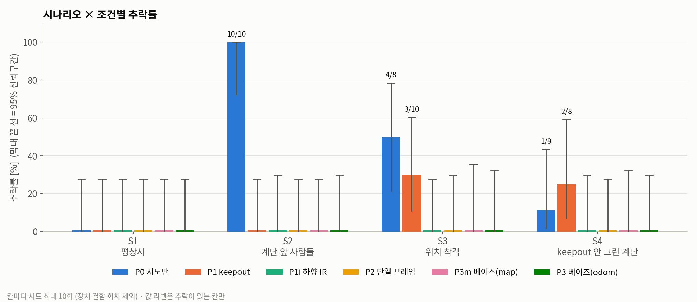
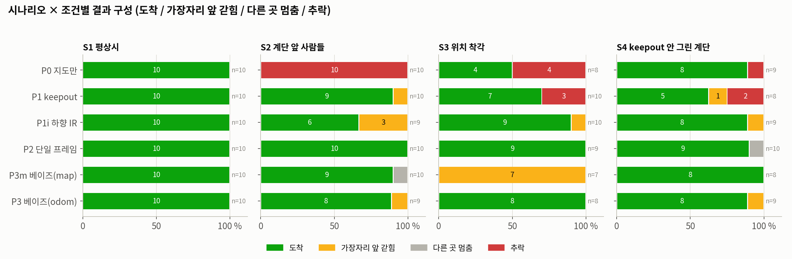
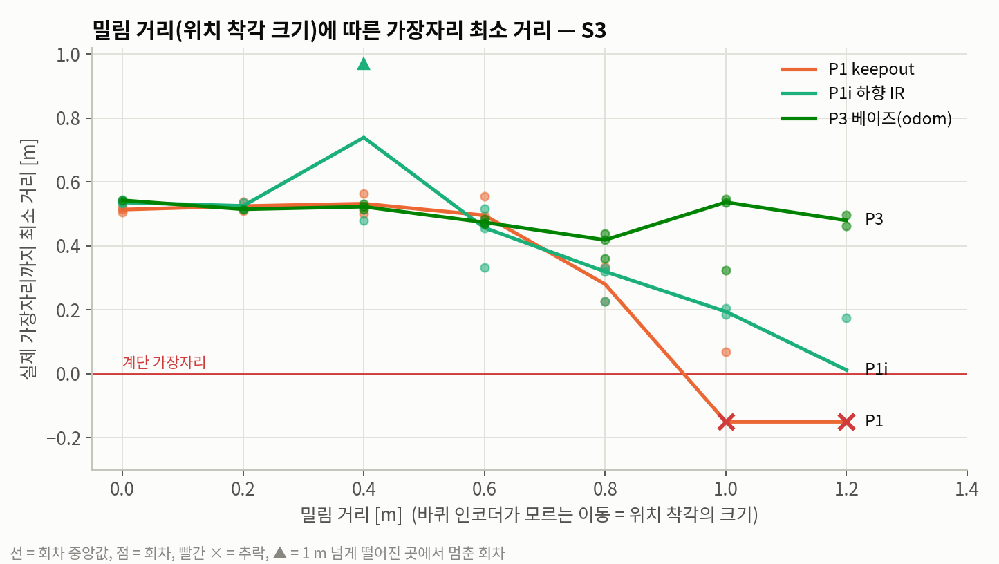
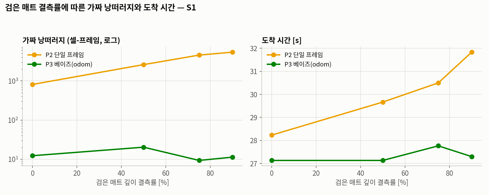

# 보이지 않는 계단 — 중간 결과 (2026-10-14 21:30 기준)

> 배치를 사용자 요청으로 멈춘 시점의 결과. 저장 위치: `demo_cliff/results/snapshot_2026-10-14/` (분석표 `analysis.md`, 그림 5장, 회차별 `runs.csv`).
> 전체 리플레이 리포트: `cd demo_cliff && python3 -m http.server 8767 --directory results` → `http://localhost:8767/report.html`

## 진행 상황
| | 완료 | 목표 | 비고 |
|---|---|---|---|
| 본 실험 (4 시나리오 × 6 조건 × 시드 10) | **223** | 240 | 남은 17회차는 Cyclone DDS 도메인 생성 실패로 결과 없음 → 재실행 필요 |
| sweep (시드 3) | **76** | 87 | 일부 칸이 1–2회뿐 |
| 장치 결함 처리 | 컨트롤러 TF 멈춤 44회차 → 같은 시드로 다시 돌려 모두 채움 | | 결함 회차는 통계에서 제외 |

## 1. 시나리오 × 조건 결과 (결함 제외)

| | P0 지도만 | P1 keepout | P1i 하향 IR | P2 단일 프레임 | P3m 베이즈(map) | P3 베이즈(odom, 제안) |
|---|---|---|---|---|---|---|
| **S1** 평상시 | 도착 10/10 · 27 s | 도착 10/10 · 27 s | 도착 10/10 · 28 s | 도착 10/10 · **31 s** | 도착 10/10 · 28 s | 도착 10/10 · 27 s |
| **S2** 계단 앞 사람들 | 🔴 **추락 10/10** | 도착 9/10 (갇힘 1) | 도착 6/9 (갇힘 3) | 도착 10/10 · 69 s | 도착 9/10 (멈춤 1) | 도착 8/9 (갇힘 1) |
| **S3** 위치 착각 | 🔴 **추락 4/8** | 🔴 **추락 3/10** | 도착 9/10 (갇힘 1) | 도착 9/9 · 38 s | **갇힘 7/7** | 도착 8/8 · 39 s |
| **S4** keepout 누락 | 🔴 추락 1/9 | 🔴 **추락 2/8** | 도착 8/9 (갇힘 1) | 도착 9/10 (멈춤 1) | 도착 8/8 | 도착 8/9 (갇힘 1) |

### 조건별 합계 (전 시나리오)
| 조건 | 추락률 (95% 신뢰구간) | 도착률 |
|---|---|---|
| P0 지도만 | **41 %** (15/37, 26–57 %) | 59 % |
| P1 keepout | **13 %** (5/38, 6–27 %) | 82 % |
| P1i 하향 IR | 0 % (0/38, 0–9 %) | 87 % |
| P2 단일 프레임 | 0 % (0/39, 0–9 %) | 97 % |
| P3m 베이즈(map) | 0 % (0/35, 0–10 %) | **77 %** |
| P3 베이즈(odom) | **0 %** (0/36, 0–10 %) | **94 %** |

## 2. 주장별로 보면

| 주장 | 근거 (지금까지) |
|---|---|
| ① 지도만 쓰면 특정 상황에서 떨어진다 | 평상시 0/10 추락인데 **사람이 모퉁이를 막으면 10/10 추락**, 위치 착각 4/8 |
| ② keepout으로는 부족하다 | 위치 착각 **3/10 추락**, keepout 누락 **2/8 추락**. 떨어지지 않아도 금지구역 경계 안으로 미끄러져 갇히는 회차가 있음 |
| ③ 센서로 보되 필터가 필요하다 | 단일 프레임은 가짜 낭떠러지 **214,437** 셀-프레임(정밀도 80 %), 베이즈는 **2,997**(99.7 %). 평상시 도착 31 s vs 27 s |
| ④ 기억은 odom 프레임에 둬야 한다 | map 프레임 기억(P3m)은 위치 착각 상황에서 **7/7 갇힘**(유령 낭떠러지), odom 프레임(P3)은 **8/8 도착** |
| 반론 1: "IR이면 되지 않나" | IR은 추락 0이지만 갇힘 5회, 가장자리 최소 **0.17 m**까지 접근(P3는 0.30 m). 사람 상황(S2)에선 회차당 급정지 **32회**·정지 18 s |
| 반론 2: "값을 맞춘 것 아닌가" | 아래 sweep |

### 같은 시드끼리 비교 (P3 기준)
- P1 → P3: P1만 추락한 쌍 **5**, P3만 추락한 쌍 0. 둘 다 도착하면 시간 차 −1.1 s
- P2 → P3: 둘 다 도착하면 P3가 1.6 s 빠름
- P1i → P3: 둘 다 도착하면 P3가 1.7 s 느림 (IR이 막는 것은 주로 S2 대기 중이라 도착 시간에는 영향이 작음)

## 3. sweep (반론 2 대응)

| 밀림 거리 | 0.0–0.6 m | 0.8 m | 1.0 m | 1.2 m |
|---|---|---|---|---|
| P1 keepout | 추락 0 | 0/2 (가장자리 0.28 m) | 🔴 **2/3 추락** | 🔴 **3/3 추락** |
| P1i 하향 IR | 추락 0 | 0/3 | 0/2 (0.20 m) | 🔴 1/2 추락 |
| P3 베이즈(odom) | 추락 0 | 0/3 | 0/3 | **0/2** |

- keepout은 위치 오차가 약 1 m(밀림 1.0 m)를 넘으면서 무너진다. IR은 그보다 늦게(1.2 m) 무너진다. P3는 1.2 m까지 추락이 없다.

| 매트 결측률 | 0 % | 50 % | 75 % | 90 % |
|---|---|---|---|---|
| P2 가짜 낭떠러지 / 도착 시간 | 813 / 28 s | 2,606 / 30 s | 4,560 / 30 s | 5,423 / 32 s |
| P3 가짜 낭떠러지 / 도착 시간 | 12 / 27 s | 20 / 27 s | 9 / 28 s | 11 / 27 s (도착 2/3) |

- 결측이 늘수록 단일 프레임의 가짜 낭떠러지는 7배로 늘고 느려진다. 베이즈는 결측률과 무관하게 10–20 수준이다.

## 4. 해석할 때 주의할 점
- **S4에서 P1(2/8)이 P0(1/9)보다 많이 떨어졌다.** 회차 수가 적어 차이라고 보기 어렵다(신뢰구간이 겹침). 대신 '계단 B에 keepout이 없으면 keepout을 그린 로봇도 똑같이 떨어진다'로 읽는다.
- **P3도 S2·S4에서 1번씩 '가장자리 앞 갇힘'**이 있다. 떨어지진 않지만 임무 실패다(제안의 한계로 발표에 포함).
- **sweep은 칸마다 1–3회라 경향만 본다.** 본 실험은 칸마다 7–10회.
- **장치 결함:** Nav2 컨트롤러가 TF를 놓치는 결함이 회차의 약 20 %에서 났다. 판정 기준은 TF 경고 수다(진짜 회차 0–8줄, 결함 40줄 이상). 결함 회차는 같은 시드로 다시 돌려 대체했다.

## 5. 남은 일
1. 결과 없는 본 실험 17회차 + sweep 빈 칸 채우기. 다음 실행부터 `ROS_LOCALHOST_ONLY=1`(Cyclone 도메인 오류 대응)을 적용한다.
   - `cd ~/robotnavi/demo_cliff && ./finish.sh`
2. 다 차면 `results/analysis.md`·그림·리포트가 자동으로 새로 만들어진다.
